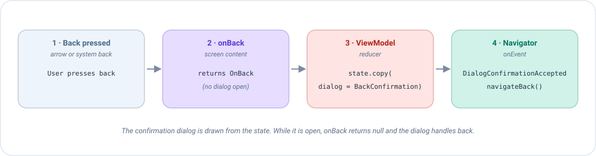

# Botón atrás en Compose

El usuario puede volver atrás de dos formas: pulsando la **flecha atrás** dibujada en tu toolbar, o usando el **atrás del
sistema** (el botón o el gesto del teléfono). Por defecto el atrás del sistema simplemente cierra la pantalla. Esta
página explica cómo tomar el control, por ejemplo para preguntar *"¿Seguro que quieres salir?"* antes de que desaparezca
la pantalla.

## La idea en un minuto

En cada cambio del estado, Emanate hace una pregunta al contenido de tu pantalla:

> *"Si el usuario pulsa atrás ahora mismo, ¿debo hacer algo especial?"*

Respondes implementando `onBack`, que recibe el [estado](../concepts/state.md) actual y devuelve:

| Devuelves | Qué pasa cuando el usuario pulsa atrás |
|-----------|-----------------------------------------|
| Una **acción** | Emanate bloquea el comportamiento por defecto y envía esa acción al ViewModel. El ViewModel decide qué hacer. |
| `null` | Emanate no hace nada y el sistema gestiona atrás como siempre (cierra la pantalla). |

Como la implementación base devuelve `null`, **una pantalla que no sobrescribe `onBack` se comporta como cualquier otra
pantalla de Android**. Solo lo escribes cuando necesitas algo distinto.

```kotlin
override fun onBack(state: ProfileCreationState): ProfileCreationAction? =
    if (state.dialog == null) ProfileCreationAction.OnBack else null
```

Léelo como: *"si no hay ningún diálogo abierto, convierte atrás en la acción `OnBack`; si no, déjalo al sistema"*.

## Lo que hace Emanate por ti

Entre bastidores, Emanate instala un único `BackHandler` (la herramienta estándar de Compose para interceptar atrás) y
llama a tu `onBack` cada vez que cambia el estado:

```kotlin
val backAction = screenContent.onBack(state)
BackHandler(enabled = backAction != null) {
    backAction?.also(actions::dispatch)
}
```

Así que nunca creas un `BackHandler` tú mismo. Solo decides, estado a estado, **si interceptar y con qué acción**.
Devolver `null` en algunos estados es la forma de desactivar la intercepción.

!!! note "Por qué recibe el estado"
    Como `onBack` recibe el estado, la decisión puede depender de él. Un formulario podría interceptar atrás solo cuando
    hay cambios sin guardar, y dejar salir libremente al usuario cuando todo está guardado.

## Ejemplo 1: confirmar antes de salir

La pantalla de creación de perfil tiene un formulario. Si el usuario pulsa atrás, no queremos que pierda por accidente lo
que ha escrito, así que mostramos antes un diálogo de confirmación.



El flujo tiene cuatro pasos:

1. El usuario pulsa atrás (la flecha o el atrás del sistema).
2. `onBack` devuelve `OnBack`, así que Emanate envía esa acción al ViewModel.
3. El ViewModel pone el diálogo en el estado y la pantalla lo pinta.
4. Si el usuario confirma, el ViewModel publica un evento y el navigator cierra la pantalla.

### Paso 1: el contenido de la pantalla

Las dos formas de volver atrás envían **la misma acción**. La flecha lo hace en su `onClick`, y el atrás del sistema lo
hace mediante `onBack`:

```kotlin
class ProfileCreationScreenContent : EmaScreenContent<ProfileCreationState, ProfileCreationAction> {

    // Atrás del sistema
    override fun onBack(state: ProfileCreationState): ProfileCreationAction? =
        if (state.dialog == null) ProfileCreationAction.OnBack else null

    @Composable
    override fun onState(state: ProfileCreationState, actions: EmaActionDispatcher<ProfileCreationAction>) {
        // Flecha atrás de la toolbar
        IconButton(onClick = { actions.dispatch(ProfileCreationAction.OnBack) }) { /* icono de flecha */ }

        // ... resto de la pantalla y el diálogo
    }
}
```

### Paso 2: el ViewModel

El ViewModel no sabe (ni le importa) si la acción vino de la flecha o del atrás del sistema. Reacciona a `OnBack`
abriendo el diálogo, y a la confirmación pidiendo al navigator que salga:

```kotlin
reducers {
    add<ProfileCreationAction> { action ->
        when (action) {
            is ProfileCreationAction.OnBack -> state.copy(dialog = ProfileCreationDialog.BackConfirmation)
            is ProfileCreationAction.DialogBackConfirm -> state.copy(dialog = null)
            is ProfileCreationAction.DialogBackCancel -> state.copy(dialog = null)
            // ...
        }
    }
}
sideEffects {
    // El usuario ha confirmado: el navigator cierra la pantalla
    add<ProfileCreationAction.DialogBackConfirm> { publish(ProfileCreationEvent.DialogConfirmationAccepted) }
}
```

### Paso 3: el navigator cierra la pantalla

El ViewModel no puede cerrar una pantalla por sí mismo: publica un [evento](../concepts/events.md), y el código que
registra la pantalla lo convierte en `navigateBack()`. Mira [Navegación](navigation.md).

```kotlin
onEvent = { event ->
    when (event) {
        ProfileCreationEvent.DialogConfirmationAccepted -> navController.navigateBack()
    }
}
```

## ¿Por qué devolver `null` mientras el diálogo está abierto?

Mira de nuevo la condición: `if (state.dialog == null) OnBack else null`.

Cuando el diálogo está en pantalla y el usuario pulsa atrás, **el propio diálogo debe gestionarlo** (normalmente
cerrándose, que es lo que esperan los usuarios). Los diálogos dibujados con `AlertDialog` o `Dialog` ya lo hacen, y te lo
comunican mediante `onBackPressed` en su listener, como se explica en [Diálogos](dialogs.md).

Si `onBack` siguiera devolviendo `OnBack` con el diálogo abierto, la pantalla interceptaría atrás *otra vez* y el
ViewModel abriría un segundo diálogo sobre el primero. Devolver `null` en ese estado lo evita.

| Estado | `onBack` devuelve | El atrás va a |
|--------|-------------------|---------------|
| Sin diálogo | `OnBack` | El ViewModel, que abre el diálogo |
| Diálogo abierto | `null` | El diálogo, que se cierra solo |

## Ejemplo 2: un atrás que simplemente vuelve

No todas las pantallas necesitan una confirmación. En la pantalla home, atrás simplemente vuelve al login, igual que su botón de cerrar. Aun así, es
mejor enviar una acción que dejar que lo haga el sistema, para que haya **un único camino por el ViewModel** tanto para
la flecha como para el atrás del sistema:

```kotlin
// Contenido de la pantalla: la flecha y el atrás del sistema envían la misma acción
override fun onBack(state: HomeState) = HomeAction.CloseClicked

// ViewModel
sideEffects {
    add<HomeAction.CloseClicked> { publish(HomeEvent.CloseClicked) }
}
```

El navigator convierte `CloseClicked` en `navigateBack()`. Tener un único camino tiene dos ventajas: puedes
añadir lógica más tarde (analíticas, guardar un borrador...) en un solo sitio, y un [test](../guides/testing.md) puede
comprobar el comportamiento sin dibujar la pantalla: envía `CloseClicked` y comprueba el evento.

## ¿Cuál necesito?

| Quiero... | Haz esto |
|-----------|----------|
| Nada especial, que la pantalla simplemente se cierre | No sobrescribas `onBack` (devuelve `null`) |
| Que el ViewModel sepa que el usuario salió | Devuelve siempre una acción, y publica el evento de navegación desde el ViewModel |
| Pedir confirmación antes de salir | Devuelve la acción solo cuando haya algo que proteger, y muestra un diálogo |
| Que atrás funcione con normalidad mientras hay un diálogo abierto | Devuelve `null` cuando el estado tenga un diálogo |
