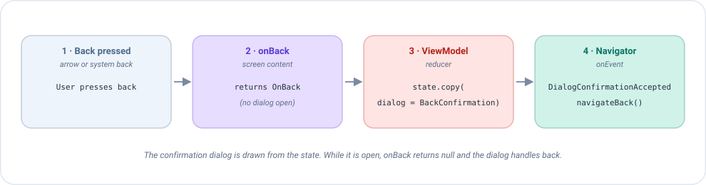

# Compose back handling

The user can go back in two ways: pressing the **back arrow** drawn in your toolbar, or using the **system back**
(the back button or gesture of the phone). By default the system back simply closes the screen. This page explains
how to take control of it, for example to ask *"Are you sure you want to leave?"* before the screen disappears.

## The idea in one minute

On every change of the state, Emanate asks your screen content one question:

> *"If the user presses back right now, should I do something special?"*

You answer by implementing `onBack`, which receives the current [state](../concepts/state.md) and returns:

| You return | What happens when the user presses back |
|------------|------------------------------------------|
| An **action** | Emanate blocks the default behavior and sends that action to the ViewModel. The ViewModel decides what to do. |
| `null` | Emanate does nothing and the system handles back as usual (closes the screen). |

Since the base implementation returns `null`, **a screen that does not override `onBack` behaves like any other
Android screen**. You only write it when you need something different.

```kotlin
override fun onBack(state: ProfileCreationState): ProfileCreationAction? =
    if (state.dialog == null) ProfileCreationAction.OnBack else null
```

Read it as: *"if there is no dialog open, turn back into the action `OnBack`; otherwise, leave it to the system"*.

## What Emanate does for you

Behind the scenes, Emanate installs a single `BackHandler` (the standard Compose tool to intercept back) and
calls your `onBack` each time the state changes:

```kotlin
val backAction = screenContent.onBack(state)
BackHandler(enabled = backAction != null) {
    backAction?.also(actions::dispatch)
}
```

So you never create a `BackHandler` yourself. You only decide, state by state, **whether to intercept and with
which action**. Returning `null` in some states is how you switch the interception off.

!!! note "Why it receives the state"
    Because `onBack` gets the state, the decision can depend on it. A form could intercept back only when there are
    unsaved changes, and let the user leave freely when everything is saved.

## Example 1: confirm before leaving

The profile creation screen has a form. If the user presses back, we don't want to lose what they typed by accident,
so we show a confirmation dialog first.



The flow has four steps:

1. The user presses back (the arrow or the system back).
2. `onBack` returns `OnBack`, so Emanate sends that action to the ViewModel.
3. The ViewModel puts the dialog in the state and the screen draws it.
4. If the user confirms, the ViewModel publishes an event and the navigator closes the screen.

### Step 1: the screen content

Both ways of going back send **the same action**. The arrow does it in its `onClick`, and the system back does it
through `onBack`:

```kotlin
class ProfileCreationScreenContent : EmaScreenContent<ProfileCreationState, ProfileCreationAction> {

    // System back
    override fun onBack(state: ProfileCreationState): ProfileCreationAction? =
        if (state.dialog == null) ProfileCreationAction.OnBack else null

    @Composable
    override fun onState(state: ProfileCreationState, actions: EmaActionDispatcher<ProfileCreationAction>) {
        // Back arrow of the toolbar
        IconButton(onClick = { actions.dispatch(ProfileCreationAction.OnBack) }) { /* arrow icon */ }

        // ... rest of the screen and the dialog
    }
}
```

### Step 2: the ViewModel

The ViewModel does not know (or care) whether the action came from the arrow or from the system back. It reacts
to `OnBack` by opening the dialog, and to the confirmation by asking the navigator to leave:

```kotlin
reducers {
    add<ProfileCreationAction> { action ->
        when (action) {
            is ProfileCreationAction.OnBack -> state.copy(dialog = ProfileCreationDialog.BackConfirmation)
            is ProfileCreationAction.DialogBackConfirm -> state.copy(dialog = null)
            is ProfileCreationAction.DialogBackCancel -> state.copy(dialog = null)
            // ...
        }
    }
}
sideEffects {
    // The user confirmed: the navigator closes the screen
    add<ProfileCreationAction.DialogBackConfirm> { publish(ProfileCreationEvent.DialogConfirmationAccepted) }
}
```

### Step 3: the navigator closes the screen

The ViewModel cannot close a screen by itself: it publishes an [event](../concepts/events.md), and the code that
registers the screen turns it into `navigateBack()`. See [Navigation](navigation.md).

```kotlin
onEvent = { event ->
    when (event) {
        ProfileCreationEvent.DialogConfirmationAccepted -> navController.navigateBack()
    }
}
```

## Why return `null` while the dialog is open?

Look again at the condition: `if (state.dialog == null) OnBack else null`.

When the dialog is on screen and the user presses back, **the dialog itself must handle it** (usually by closing
itself, which is what users expect). The dialogs drawn with `AlertDialog` or `Dialog` already do it, and they report
it to you through `onBackPressed` in their listener, as explained in [Dialogs](dialogs.md).

If `onBack` kept returning `OnBack` with the dialog open, the screen would intercept back *again* and the
ViewModel would open a second dialog over the first one. Returning `null` in that state avoids it.

| State | `onBack` returns | Back press goes to |
|-------|------------------|--------------------|
| No dialog | `OnBack` | The ViewModel, which opens the dialog |
| Dialog open | `null` | The dialog, which closes itself |

## Example 2: back that just goes back

Not every screen needs a confirmation. On the home screen, back simply returns to the login, like its close button. Even so, it is better to
send an action than to leave the system do it, so there is **a single path through the ViewModel** for both the
arrow and the system back:

```kotlin
// Screen content: the arrow and the system back send the same action
override fun onBack(state: HomeState) = HomeAction.CloseClicked

// ViewModel
sideEffects {
    add<HomeAction.CloseClicked> { publish(HomeEvent.CloseClicked) }
}
```

The navigator turns `CloseClicked` into `navigateBack()`. Having a single path has two advantages: you can
add logic later (analytics, saving a draft...) in one place, and a [test](../guides/testing.md) can check the
behavior without drawing the screen: dispatch `CloseClicked` and assert the event.

## Which one do I need?

| I want... | Do this |
|-----------|---------|
| Nothing special, the screen just closes | Don't override `onBack` (it returns `null`) |
| The ViewModel to know that the user left | Return an action always, and publish the navigation event from the ViewModel |
| To ask for confirmation before leaving | Return the action only when there is something to protect, and show a dialog |
| Back to work normally while a dialog is open | Return `null` when the state has a dialog |
