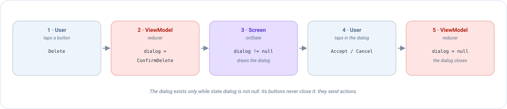

# Diálogos en Compose

Un **diálogo** es una ventana pequeña que aparece sobre la pantalla para decirle algo al usuario o hacerle una pregunta:
*"¿Eliminar esta nota?"*, *"Ha fallado la conexión"*, *"¿Descartar los cambios?"*. Esta página explica cómo mostrar uno
con Emanate, paso a paso, con un ejemplo completo que puedes copiar.

## La idea en un minuto

En Emanate **un diálogo no es algo que se abre: es algo que dice el estado**. No hay `dialog.show()` ni
`dialog.dismiss()`. En su lugar:

1. El estado tiene un campo que dice *qué diálogo está abierto*, o `null` si no hay ninguno.
2. La pantalla dibuja el diálogo **mientras** ese campo no sea `null`.
3. Los botones del diálogo no lo cierran. Envían una **acción**, y el ViewModel cambia el campo.



Si ya conoces el [estado](../concepts/state.md), las [acciones](../concepts/actions.md) y los
[reducers](../concepts/reducers.md), aquí no hay nada nuevo: un diálogo es una pieza más del estado.

!!! tip "¿Por qué hacerlo así?"
    - **Sobrevive a una rotación.** El estado lo conserva el ViewModel, así que el diálogo sigue ahí después de recrear la
      pantalla. Un diálogo abierto con `show()` desaparece.
    - **El ViewModel sabe qué hay en pantalla.** Puede decidir cosas como *"ignora este toque mientras haya un diálogo
      abierto"*.
    - **Puedes testearlo sin dispositivo.** Todo el flujo es estado y acciones: mira
      [Testear un diálogo](#testear-un-diálogo).

## Ejemplo: confirmar antes de eliminar una nota

Vamos a construir una pantalla con un botón *Eliminar*. Cuando el usuario lo pulsa, un diálogo pide confirmación.

### Paso 1: describe los diálogos en el estado

Crea un tipo que liste **todos los diálogos que puede mostrar la pantalla**. Una `sealed interface` es perfecta: cada
diálogo es un caso, y el compilador te avisará si olvidas dibujar alguno.

```kotlin
sealed interface NoteDialog {
    data object ConfirmDelete : NoteDialog
}

data class NoteState(
    val title: String = "",
    val dialog: NoteDialog? = null     // null = ningún diálogo abierto
) : EmaState
```

`dialog` es nullable a propósito: `null` significa *"no hay nada abierto"*.

### Paso 2: describe lo que puede hacer el usuario

Cada botón de la pantalla y del diálogo es una acción:

```kotlin
sealed interface NoteAction : EmaAction {
    data object DeleteClicked : NoteAction          // el botón Eliminar de la pantalla
    data object DeleteConfirmed : NoteAction        // "Aceptar" en el diálogo
    data object DeleteCancelled : NoteAction        // "Cancelar" en el diálogo, o atrás, o tocar fuera
}

sealed interface NoteEvent : EmaEvent {
    data object NoteDeleted : NoteEvent
}
```

### Paso 3: el ViewModel abre y cierra el diálogo

Abrir un diálogo es escribirlo en el estado. Cerrarlo es escribir `null`:

```kotlin
class NoteViewModel(private val deleteNote: DeleteNoteUseCase) :
    EmaViewModel<NoteState, NoteAction, NoteEvent>(NoteState()) {

    override fun setup() = source {
        reducers {
            add<NoteAction> { action ->
                when (action) {
                    is NoteAction.DeleteClicked -> state.copy(dialog = NoteDialog.ConfirmDelete)   // abrir
                    is NoteAction.DeleteCancelled -> state.copy(dialog = null)                     // cerrar
                    is NoteAction.DeleteConfirmed -> state.copy(dialog = null)                     // cerrar
                }
            }
        }
        sideEffects {
            // El trabajo se hace tras confirmar: el diálogo ya está cerrado
            add<NoteAction.DeleteConfirmed> {
                deleteNote(Unit)
                publish(NoteEvent.NoteDeleted)
            }
        }
    }
}
```

Fíjate en que confirmar hace dos cosas, y cada una vive donde le corresponde: el **reducer** cierra el diálogo (es
estado) y el **side effect** elimina la nota (es trabajo). Mira los [reducers](../concepts/reducers.md) y los
[side effects](../concepts/side-effects.md) si necesitas un recordatorio.

### Paso 4: la pantalla dibuja el diálogo

En `onState`, comprueba el campo. Si hay un diálogo, emite el composable que lo dibuja. Aquí usamos el `AlertDialog` de
Material 3, el diálogo estándar de Compose:

```kotlin
@Composable
override fun onState(state: NoteState, actions: EmaActionDispatcher<NoteAction>) {
    Column {
        Text(state.title)
        Button(onClick = { actions.dispatch(NoteAction.DeleteClicked) }) {
            Text("Eliminar")
        }
    }

    // El diálogo se dibuja solo mientras lo diga el estado
    when (state.dialog) {
        NoteDialog.ConfirmDelete -> AlertDialog(
            onDismissRequest = { actions.dispatch(NoteAction.DeleteCancelled) },   // atrás o tocar fuera
            title = { Text("Eliminar nota") },
            text = { Text("Esto no se puede deshacer. ¿Quieres continuar?") },
            confirmButton = {
                TextButton(onClick = { actions.dispatch(NoteAction.DeleteConfirmed) }) { Text("Eliminar") }
            },
            dismissButton = {
                TextButton(onClick = { actions.dispatch(NoteAction.DeleteCancelled) }) { Text("Cancelar") }
            }
        )
        null -> Unit    // nada que dibujar
    }
}
```

Esa es toda la funcionalidad. Sigamos lo que pasa cuando el usuario pulsa *Eliminar*:

| # | Qué pasa | Quién |
|---|----------|-------|
| 1 | El usuario pulsa el botón. La pantalla envía `DeleteClicked`. | Pantalla |
| 2 | El reducer devuelve `state.copy(dialog = ConfirmDelete)`. | ViewModel |
| 3 | El estado cambió, así que `onState` se ejecuta de nuevo. Ahora `state.dialog` no es `null`, y se dibuja el `AlertDialog`. | Pantalla |
| 4 | El usuario pulsa *Eliminar* en el diálogo. La pantalla envía `DeleteConfirmed`. | Pantalla |
| 5 | El reducer devuelve `dialog = null` y el side effect elimina la nota. `onState` se ejecuta de nuevo y el diálogo deja de dibujarse. | ViewModel |

!!! warning "El error más común"
    El `onDismissRequest` de `AlertDialog` se llama cuando el usuario pulsa atrás o toca fuera del diálogo. **No** lo
    cierra. Si lo dejas vacío (`onDismissRequest = {}`), el diálogo nunca se puede descartar de esa forma, y si intentas
    ocultarlo con un `var` local, el estado y la pantalla se desincronizan. **Envía siempre una acción** que ponga
    `dialog = null`.

## Diálogos que llevan datos

Un diálogo a menudo necesita información: ¿*qué* nota se va a eliminar? Usa una `data class` en lugar de un
`data object` y pon los datos dentro:

```kotlin
sealed interface NoteListDialog {
    data class ConfirmDelete(val noteId: Int, val noteTitle: String) : NoteListDialog
    data class Error(val message: EmaText) : NoteListDialog
}
```

```kotlin
// Reducer: el diálogo se crea con los datos de la nota pulsada
is NoteListAction.DeleteClicked -> state.copy(
    dialog = NoteListDialog.ConfirmDelete(action.note.id, action.note.title)
)
```

```kotlin
// Pantalla: cada caso del tipo sealed se dibuja de forma distinta
when (val dialog = state.dialog) {
    is NoteListDialog.ConfirmDelete -> AlertDialog(
        onDismissRequest = { actions.dispatch(NoteListAction.DialogDismissed) },
        title = { Text("¿Eliminar \"${dialog.noteTitle}\"?") },
        confirmButton = {
            TextButton(onClick = { actions.dispatch(NoteListAction.DeleteConfirmed(dialog.noteId)) }) {
                Text("Eliminar")
            }
        },
        dismissButton = {
            TextButton(onClick = { actions.dispatch(NoteListAction.DialogDismissed) }) { Text("Cancelar") }
        }
    )
    is NoteListDialog.Error -> AlertDialog(
        onDismissRequest = { actions.dispatch(NoteListAction.DialogDismissed) },
        text = { Text(dialog.message.stringResource()) },
        confirmButton = {
            TextButton(onClick = { actions.dispatch(NoteListAction.DialogDismissed) }) { Text("OK") }
        }
    )
    null -> Unit
}
```

Como un `when` sobre una `sealed interface` debe ser exhaustivo, **añadir un diálogo nuevo al tipo hace que el
compilador te señale el sitio donde tienes que dibujarlo**.

!!! note "Solo un diálogo a la vez"
    Un campo nullable solo puede guardar un diálogo. Casi siempre es lo que quieres, ya que dos diálogos apilados
    confunden. Si de verdad necesitas dos a la vez, usa dos campos.

## Evita repetirte: un diálogo reutilizable

Cuando varios diálogos tienen el mismo aspecto (un título, un mensaje, *Aceptar* y *Cancelar*), no escribas el
`AlertDialog` una y otra vez. Envuélvelo una vez en un composable tuyo que reciba los textos y **dos lambdas**:

```kotlin
@Composable
fun ConfirmationDialog(
    title: String,
    message: String,
    onConfirm: () -> Unit,
    onCancel: () -> Unit
) {
    AlertDialog(
        onDismissRequest = onCancel,
        title = { Text(title) },
        text = { Text(message) },
        confirmButton = { TextButton(onClick = onConfirm) { Text("Aceptar") } },
        dismissButton = { TextButton(onClick = onCancel) { Text("Cancelar") } }
    )
}

// Uso
NoteDialog.ConfirmDelete -> ConfirmationDialog(
    title = "Eliminar nota",
    message = "Esto no se puede deshacer.",
    onConfirm = { actions.dispatch(NoteAction.DeleteConfirmed) },
    onCancel = { actions.dispatch(NoteAction.DeleteCancelled) }
)
```

## El diálogo y el botón atrás

Mientras un diálogo está en pantalla, **el diálogo debe gestionar el botón atrás**, no la pantalla de detrás. Haz que
`onBack` devuelva `null` cuando `state.dialog` no sea `null`:

```kotlin
override fun onBack(state: NoteState): NoteAction? =
    if (state.dialog == null) NoteAction.BackClicked else null
```

Si lo olvidas, la pantalla intercepta atrás *y* el diálogo también, y el usuario puede ver dos diálogos uno sobre el
otro. La explicación completa está en [Botón atrás](back-handling.md).

## Carga: no siempre es un diálogo

Un spinner no es necesariamente un diálogo. En la mayoría de casos es mejor modelarlo como un **booleano** del estado y
dibujar un indicador de progreso donde corresponda, por ejemplo dentro del botón que inició el trabajo:

```kotlin
data class LoginState(val isLoading: Boolean = false /* ... */) : EmaState

// Reducer
is LoginAction.LoginClicked -> state.copy(isLoading = true)
is LoginAction.LoginFinished -> state.copy(isLoading = false)
```

```kotlin
Button(onClick = { actions.dispatch(LoginAction.LoginClicked) }, enabled = !state.isLoading) {
    if (state.isLoading) CircularProgressIndicator(Modifier.size(18.dp)) else Text("Iniciar sesión")
}
```

Usa un *diálogo de carga* bloqueante solo cuando el usuario no deba tocar nada mientras se ejecuta el trabajo. Incluso
entonces es el mismo patrón: `isLoading` en el estado, y `if (state.isLoading) LoadingDialog()` en la pantalla.

## Testear un diálogo

Como el diálogo es estado y las opciones son acciones, pruebas todo el flujo **sin dibujar nada**: envía la acción y
comprueba el estado.

```kotlin
@Test
fun `pressing delete asks for confirmation and confirming deletes the note`() = runTest {
    val viewModel = NoteViewModel(FakeDeleteNoteUseCase())
    val recorder = viewModel.record()

    viewModel.dispatch(NoteAction.DeleteClicked)
    recorder.assertState { it.dialog == NoteDialog.ConfirmDelete }

    viewModel.dispatch(NoteAction.DeleteConfirmed)
    advanceUntilIdle()

    recorder.assertState { it.dialog == null }
    recorder.assertEvents(NoteEvent.NoteDeleted)
}
```

Mira [Testing](../guides/testing.md) para saber cómo configurar `useTestConfiguration()`.
