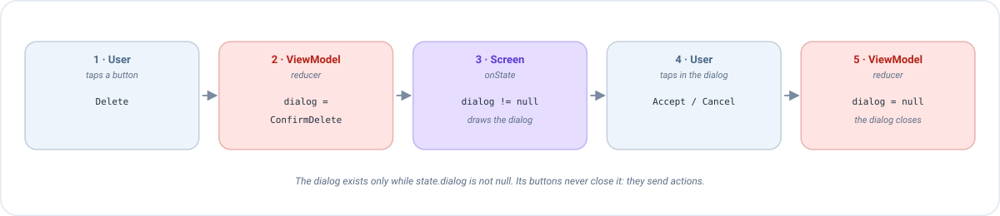

# Compose dialogs

A **dialog** is a small window that appears over the screen to tell something to the user or to ask a question:
*"Delete this note?"*, *"The connection failed"*, *"Discard your changes?"*. This page explains how to show one with
Emanate, step by step, with a complete example you can copy.

## The idea in one minute

In Emanate **a dialog is not something you open: it is something the state says**. There is no `dialog.show()` and
no `dialog.dismiss()`. Instead:

1. The state has a field that says *which dialog is open*, or `null` if there is none.
2. The screen draws the dialog **while** that field is not `null`.
3. The buttons of the dialog don't close it. They send an **action**, and the ViewModel changes the field.



If you already know [state](../concepts/state.md), [actions](../concepts/actions.md) and
[reducers](../concepts/reducers.md), there is nothing new here: a dialog is one more piece of the state.

!!! tip "Why do it this way?"
    - **It survives a rotation.** The state is kept by the ViewModel, so the dialog is still there after the screen
      is recreated. A dialog opened with `show()` disappears.
    - **The ViewModel knows what is on screen.** It can decide things like *"ignore this tap while a dialog is
      open"*.
    - **You can test it without a device.** The whole flow is state and actions: see [Testing](#testing-a-dialog).

## Example: confirm before deleting a note

We are going to build a screen with a *Delete* button. When the user presses it, a dialog asks for confirmation.

### Step 1: describe the dialogs in the state

Create a type that lists **every dialog the screen can show**. A `sealed interface` is perfect: each dialog is one
case, and the compiler will warn you if you forget to draw one.

```kotlin
sealed interface NoteDialog {
    data object ConfirmDelete : NoteDialog
}

data class NoteState(
    val title: String = "",
    val dialog: NoteDialog? = null     // null = no dialog open
) : EmaState
```

`dialog` is nullable on purpose: `null` means *"nothing is open"*.

### Step 2: describe what the user can do

Every button of the screen and of the dialog is an action:

```kotlin
sealed interface NoteAction : EmaAction {
    data object DeleteClicked : NoteAction          // the Delete button of the screen
    data object DeleteConfirmed : NoteAction        // "Accept" in the dialog
    data object DeleteCancelled : NoteAction        // "Cancel" in the dialog, or back, or tapping outside
}

sealed interface NoteEvent : EmaEvent {
    data object NoteDeleted : NoteEvent
}
```

### Step 3: the ViewModel opens and closes the dialog

Opening a dialog is writing it in the state. Closing it is writing `null`:

```kotlin
class NoteViewModel(private val deleteNote: DeleteNoteUseCase) :
    EmaViewModel<NoteState, NoteAction, NoteEvent>(NoteState()) {

    override fun setup() = source {
        reducers {
            add<NoteAction> { action ->
                when (action) {
                    is NoteAction.DeleteClicked -> state.copy(dialog = NoteDialog.ConfirmDelete)   // open
                    is NoteAction.DeleteCancelled -> state.copy(dialog = null)                     // close
                    is NoteAction.DeleteConfirmed -> state.copy(dialog = null)                     // close
                }
            }
        }
        sideEffects {
            // The work is done after confirming: the dialog is already closed
            add<NoteAction.DeleteConfirmed> {
                deleteNote(Unit)
                postEvent(NoteEvent.NoteDeleted)
            }
        }
    }
}
```

Notice that confirming does two things, and each one lives where it belongs: the **reducer** closes the dialog
(it is state) and the **side effect** deletes the note (it is work). See [reducers](../concepts/reducers.md) and
[side effects](../concepts/side-effects.md) if you need a reminder.

### Step 4: the screen draws the dialog

In `onState`, check the field. If there is a dialog, emit the composable that draws it. Here we use the
`AlertDialog` of Material 3, the standard dialog of Compose:

```kotlin
@Composable
override fun onState(state: NoteState, actions: EmaActionDispatcher<NoteAction>) {
    Column {
        Text(state.title)
        Button(onClick = { actions.dispatch(NoteAction.DeleteClicked) }) {
            Text("Delete")
        }
    }

    // The dialog is drawn only while the state says so
    when (state.dialog) {
        NoteDialog.ConfirmDelete -> AlertDialog(
            onDismissRequest = { actions.dispatch(NoteAction.DeleteCancelled) },   // back or tap outside
            title = { Text("Delete note") },
            text = { Text("This cannot be undone. Do you want to continue?") },
            confirmButton = {
                TextButton(onClick = { actions.dispatch(NoteAction.DeleteConfirmed) }) { Text("Delete") }
            },
            dismissButton = {
                TextButton(onClick = { actions.dispatch(NoteAction.DeleteCancelled) }) { Text("Cancel") }
            }
        )
        null -> Unit    // nothing to draw
    }
}
```

That is the whole feature. Let's follow what happens when the user presses *Delete*:

| # | What happens | Who |
|---|--------------|-----|
| 1 | The user presses the button. The screen sends `DeleteClicked`. | Screen |
| 2 | The reducer returns `state.copy(dialog = ConfirmDelete)`. | ViewModel |
| 3 | The state changed, so `onState` runs again. Now `state.dialog` is not `null`, and the `AlertDialog` is drawn. | Screen |
| 4 | The user presses *Delete* in the dialog. The screen sends `DeleteConfirmed`. | Screen |
| 5 | The reducer returns `dialog = null` and the side effect deletes the note. `onState` runs again and the dialog is no longer drawn. | ViewModel |

!!! warning "The most common mistake"
    The `onDismissRequest` of `AlertDialog` is called when the user presses back or taps outside the dialog. It does
    **not** close it. If you leave it empty (`onDismissRequest = {}`), the dialog can never be dismissed that way, and
    if you try to hide it with a local `var`, the state and the screen get out of sync. Always **dispatch an
    action** that sets `dialog = null`.

## Dialogs that carry data

A dialog often needs information: *which* note is going to be deleted? Use a `data class` instead of a `data object`
and put the data inside:

```kotlin
sealed interface NoteListDialog {
    data class ConfirmDelete(val noteId: Int, val noteTitle: String) : NoteListDialog
    data class Error(val message: EmaText) : NoteListDialog
}
```

```kotlin
// Reducer: the dialog is created with the data of the tapped note
is NoteListAction.DeleteClicked -> state.copy(
    dialog = NoteListDialog.ConfirmDelete(action.note.id, action.note.title)
)
```

```kotlin
// Screen: each case of the sealed type is drawn differently
when (val dialog = state.dialog) {
    is NoteListDialog.ConfirmDelete -> AlertDialog(
        onDismissRequest = { actions.dispatch(NoteListAction.DialogDismissed) },
        title = { Text("Delete \"${dialog.noteTitle}\"?") },
        confirmButton = {
            TextButton(onClick = { actions.dispatch(NoteListAction.DeleteConfirmed(dialog.noteId)) }) {
                Text("Delete")
            }
        },
        dismissButton = {
            TextButton(onClick = { actions.dispatch(NoteListAction.DialogDismissed) }) { Text("Cancel") }
        }
    )
    is NoteListDialog.Error -> AlertDialog(
        onDismissRequest = { actions.dispatch(NoteListAction.DialogDismissed) },
        text = { Text(dialog.message.stringResource()) },
        confirmButton = {
            TextButton(onClick = { actions.dispatch(NoteListAction.DialogDismissed) }) { Text("OK") }
        }
    )
    null -> Unit
}
```

Because `when` over a `sealed interface` must be exhaustive, **adding a new dialog to the type makes the compiler
point you to the place where you have to draw it**.

!!! note "Only one dialog at a time"
    A nullable field can hold a single dialog. That is almost always what you want, since two stacked dialogs are
    confusing. If you really need two at once, use two fields.

## Avoid repeating yourself: a reusable dialog

When several dialogs look the same (a title, a message, *Accept* and *Cancel*), don't write the `AlertDialog` over
and over. Wrap it once in your own composable that receives the texts and **two lambdas**:

```kotlin
@Composable
fun ConfirmationDialog(
    title: String,
    message: String,
    onConfirm: () -> Unit,
    onCancel: () -> Unit
) {
    AlertDialog(
        onDismissRequest = onCancel,
        title = { Text(title) },
        text = { Text(message) },
        confirmButton = { TextButton(onClick = onConfirm) { Text("Accept") } },
        dismissButton = { TextButton(onClick = onCancel) { Text("Cancel") } }
    )
}

// Use
NoteDialog.ConfirmDelete -> ConfirmationDialog(
    title = "Delete note",
    message = "This cannot be undone.",
    onConfirm = { actions.dispatch(NoteAction.DeleteConfirmed) },
    onCancel = { actions.dispatch(NoteAction.DeleteCancelled) }
)
```

## The dialog and the back button

While a dialog is on screen, **the dialog must handle the back button**, not the screen behind it. Make `onBack`
return `null` when `state.dialog` is not `null`:

```kotlin
override fun onBack(state: NoteState): NoteAction? =
    if (state.dialog == null) NoteAction.BackClicked else null
```

If you forget it, the screen intercepts back *and* the dialog does too, and the user may see two dialogs one over the
other. The full explanation is in [Back handling](back-handling.md).

## Loading: it is not always a dialog

A spinner is not necessarily a dialog. In most cases it is better to model it as a **boolean** of the state and draw
a progress indicator where it belongs, for example inside the button that started the work:

```kotlin
data class LoginState(val isLoading: Boolean = false /* ... */) : EmaState

// Reducer
is LoginAction.LoginClicked -> state.copy(isLoading = true)
is LoginAction.LoginFinished -> state.copy(isLoading = false)
```

```kotlin
Button(onClick = { actions.dispatch(LoginAction.LoginClicked) }, enabled = !state.isLoading) {
    if (state.isLoading) CircularProgressIndicator(Modifier.size(18.dp)) else Text("Log in")
}
```

Use a blocking *loading dialog* only when the user must not touch anything while the work runs. Even then it is the
same pattern: `isLoading` in the state, and `if (state.isLoading) LoadingDialog()` in the screen.

## Testing a dialog

Since the dialog is state and the choices are actions, you test the whole flow **without drawing anything**:
dispatch the action, check the state.

```kotlin
@Test
fun `pressing delete asks for confirmation and confirming deletes the note`() = runTest {
    val viewModel = NoteViewModel(FakeDeleteNoteUseCase())
    val recorder = viewModel.record()

    viewModel.dispatch(NoteAction.DeleteClicked)
    recorder.assertState { it.dialog == NoteDialog.ConfirmDelete }

    viewModel.dispatch(NoteAction.DeleteConfirmed)
    advanceUntilIdle()

    recorder.assertState { it.dialog == null }
    recorder.assertEvents(NoteEvent.NoteDeleted)
}
```

See [Testing](../guides/testing.md) for how to set up `useTestConfiguration()`.
