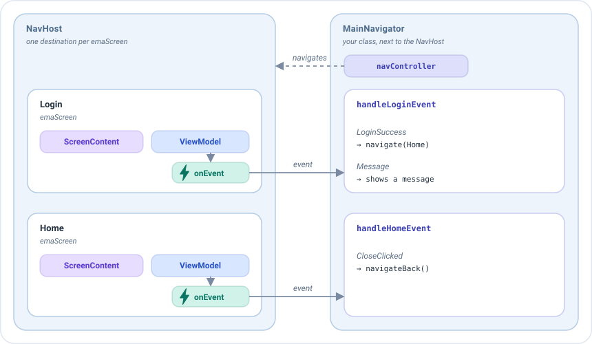

# Navegación en Compose

> Esta página trata de Navigation Compose, y necesita el artefacto `emanate-compose-nav2`. El resto de
> artefactos de Compose no dependen de ninguna librería de navegación, así que se puede usar otra navegación con
> `EmaScreen`.
>
> El módulo es **multiplataforma**: se escribe una vez para Android, JVM e iOS, sobre el Navigation Compose de
> JetBrains.

En Emanate un **ViewModel nunca navega**. Navegar es tarea del grafo de navegación que contiene la pantalla,
normalmente el `NavHost`: es el que sabe qué pantallas existen y tiene el `NavController` para moverse entre ellas.

El ViewModel solo publica un [evento](../concepts/events.md) que dice **lo que ha pasado**, como "el login ha sido
correcto". Alguien fuera de las pantallas tiene que recibir esos eventos y decidir **adónde ir**: el
**navigator**, una clase que vive junto al `NavHost` y tiene su `NavController`. No es una clase de Emanate: es una
clase normal tuya, y es un buen patrón gestionar así toda la navegación de tu app.

Este es el flujo principal del sample, con dos de sus pantallas, el login y la home:



1. Cada destino del `NavHost` es un `emaScreen`, con su contenido de pantalla, su ViewModel y su `onEvent`.
2. Cuando las credenciales son correctas, el ViewModel de `Login` publica `LoginSuccess(user)`. No sabe qué pantalla
   viene después.
3. El `onEvent` de esa pantalla entrega el evento al navigator, a su función para esa pantalla: `handleLogin`.
4. El navigator decide para cada evento: `LoginSuccess` abre `Home`, y el `CloseClicked` de `Home` vuelve al login. Lo
   hace con el `navController`, que cambia el destino que muestra el `NavHost`.

Mantener la navegación fuera del ViewModel tiene dos ventajas. El ViewModel se puede testear sin Android, y el mismo
evento puede llevar a sitios distintos en apps o grafos distintos: en un móvil puede abrir una pantalla nueva y en una
tablet actualizar un panel lateral.

La decisión de adónde ir podría escribirse directamente en cada lambda `onEvent`, pero recomendamos que toda navegación
pase por un navigator: el grafo solo declara las pantallas, y toda la navegación de un flujo vive en un único sitio fácil
de leer y de cambiar. Mira [El navigator](#el-navigator).

## Rutas

Cada pantalla registrada con `emaScreen` o `emaDialog` tiene una ruta. Por defecto es `ScreenContent::class.routeId`,
única por clase:

```kotlin
navController.navigate(HomeScreenContent::class.routeId)
```

## El navigator

Crea **un navigator por grafo de navegación**, no uno por pantalla, y deja que gestione la navegación de todas las
pantallas del grafo. Es una clase normal que recibe el `NavController` y tiene una función por pantalla: cada función
recibe los eventos de esa pantalla y decide adónde ir. Emanate no exige una clase base ni una interfaz para él: sirve
cualquier clase con esta forma. Créalo una vez, con `remember`, junto al `NavHost`:

```kotlin
class MainNavigator(private val navController: NavController) {

    fun handleLogin(event: LoginEvent) {
        when (event) {
            is LoginEvent.LoginSuccess -> navController.navigate(
                route = HomeScreenContent::class.routeId,
                initializer = HomeInitializer.HomeUser(event.user),
                serializer = HomeInitializer.serializer()
            )
        }
    }

    fun handleHome(event: HomeEvent) {
        when (event) {
            HomeEvent.CreateClicked -> navController.navigate(ProfileScreenContent::class.routeId)

            // El login es la pantalla que hay debajo de la home
            HomeEvent.CloseClicked -> navController.navigateBack()
        }
    }
}
```

Cada función se llama `handle` más la pantalla, y recibe el tipo sellado de sus eventos. Si hay que devolver algo a la pantalla que contiene el grafo, añade una lambda a la función: la función decide, para cada evento, qué devolver por ella.

```kotlin
fun handleHome(event: HomeEvent, onFriendCreated: (Friend) -> Unit) {
    when (event) {
        is HomeEvent.FriendCreated -> onFriendCreated(event.friend)
        HomeEvent.CloseClicked -> navController.navigateBack()
    }
}
```

```kotlin
@Composable
fun MainGraph() {
    val navController = rememberNavController()
    val navigator = remember { MainNavigator(navController) }

    NavHost(navController, startDestination = LoginScreenContent::class.routeId) {
        emaScreen(
            screenContent = LoginScreenContent(),
            viewModel = { createLoginViewModel() },
            onEvent = { navigator.handleLogin(it) }
        )
    }
}
```

`NavController.navigateBack(onBackStackEmpty = {})` saca una pantalla de la pila y devuelve si había una pantalla a la
que volver. Cuando no la hay, llama a `onBackStackEmpty`, así que la app decide qué significa una pila vacía:

```kotlin
navController.navigateBack { onExit() }
```

## Pasar un inicializador

Envía el [inicializador](../guides/initializers.md) con la extensión `navigate` que recibe el inicializador y su
serializer:

```kotlin
navController.navigate(
    route = HomeScreenContent::class.routeId,
    initializer = HomeInitializer.HomeUser(user),
    serializer = HomeInitializer.serializer()
)
```

Para navegar sin inicializador, usa el `navigate(route)` normal.

Otra sobrecarga recibe una lambda `NavOptionsBuilder`, como `navigate(route) { launchSingleTop = true }`.

El destino declara de dónde leerlo con `initializerSupport`. El inicializador viaja en la ruta como texto (JSON), así que la
navegación de Compose lo lee con kotlinx.serialization: anótalo con `@Serializable`.

```kotlin
emaScreen(
    screenContent = HomeScreenContent(),
    viewModel = { createHomeViewModel() },
    initializerSupport = EmaInitializerSupport.fromRoute(HomeInitializer.serializer()),
    onEvent = { navigator.handleHome(it) }
)
```

El inicializador llega al ViewModel como una acción, la primera vez que se crea la pantalla. Mira
[Inicializadores](../guides/initializers.md).

### De dónde viene el inicializador

`EmaInitializerSupport` tiene una función por origen. El nombre dice de dónde se lee el inicializador:

| Función                                    | De dónde lee el inicializador                                                           | Cuándo usarla                                                                  |
|--------------------------------------------|-----------------------------------------------------------------------------------------|--------------------------------------------------------------------------------|
| `fromRoute(serializer)`                    | La ruta del destino.                                                                    | La mayoría de pantallas: a las que llegas con `navigate(route, initializer, serializer)`. |
| `fromInitializer(serializer, initializer)` | La ruta y, si no tiene, el inicializador que le des.                                    | Un inicializador que ya tienes, como el de un deep link, o un test.        |

En todas **gana la ruta**: si lleva un inicializador, la pantalla lo usa. El origen de la función es solo el respaldo
para cuando la ruta no tiene ninguno.

### La primera pantalla

El inicializador de una pantalla normalmente viaja en su **ruta**: el navigator lo pone ahí con
`navigate(route, initializer, serializer)`, y `fromRoute` lo lee de vuelta. Pero la **primera pantalla** de un
`NavHost`, su `startDestination`, no se alcanza con `navigate`: se muestra en cuanto se crea el `NavHost`, así que su
ruta no tiene inicializador.

Si esa pantalla necesita uno, dáselo con `fromInitializer`. Es el respaldo que usa la pantalla cuando su ruta no tiene
ninguno:

```kotlin
NavHost(navController, startDestination = ProfileCreationScreenContent::class.routeId) {
    emaScreen(
        screenContent = ProfileCreationScreenContent(),
        viewModel = { createProfileCreationViewModel() },
        initializerSupport = EmaInitializerSupport.fromInitializer(
            ProfileCreationInitializer.serializer(),
            ProfileCreationInitializer.Default("Carlos")
        ),
        onEvent = { navigator.handleProfileCreation(it) }
    )
}
```

El resto de pantallas del grafo se declaran con `fromRoute`.

#### Cuando la primera pantalla se abre de nuevo

El respaldo solo se usa cuando la ruta no tiene inicializador: gana la ruta. Si la primera pantalla se abre de nuevo
más tarde con `navigate`, recibe:

| Cómo se abre                                           | La pantalla recibe                                     |
|--------------------------------------------------------|--------------------------------------------------------|
| `navigate(route, Default("Ana"), serializer)`          | `Default("Ana")`, el de la ruta.                       |
| `navigate(route)`, sin inicializador                   | `Default("Carlos")`, el respaldo, como la primera vez. |
| `navigate(route, Default(""), serializer)`             | `Default("")`, el de la ruta.                          |

La última fila es la forma de **evitar el respaldo**. Si la nueva pantalla no debe usar el respaldo, navega con un
inicializador de la pantalla **sin valores**, para que la ruta lo tenga y gane. Es un inicializador normal, del tipo que
espera la pantalla, con valores vacíos:

```kotlin
navController.navigate(
    route = ProfileCreationScreenContent::class.routeId,
    initializer = ProfileCreationInitializer.Default(admin = ""),
    serializer = ProfileCreationInitializer.serializer()
)
```

La pantalla recibe entonces ese inicializador, y es el reducer de `ProfileCreationInitializer` el que decide qué
significa: por ejemplo, que no hay ningún creador que mostrar.

Volver a la primera pantalla con el botón atrás no la abre de nuevo: vuelve la pantalla original, con su ViewModel, y no
lee el inicializador otra vez.
