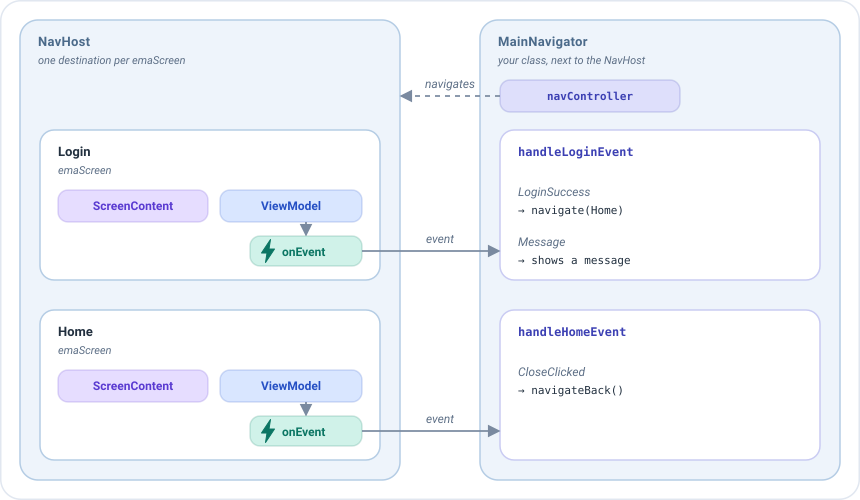
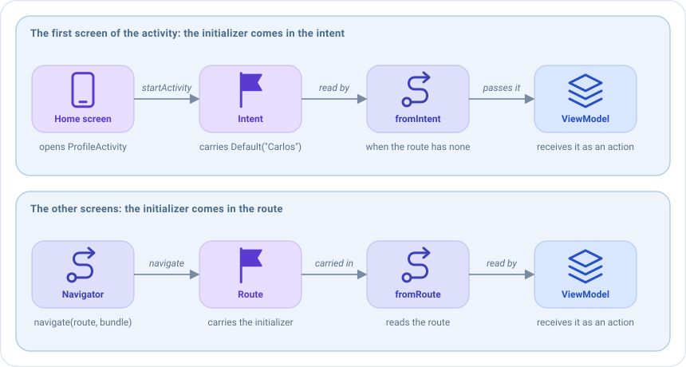

# Navegación en Compose

> Esta página trata de Navigation Compose, y necesita el artefacto `emanate-compose-android-nav2`. El resto de
> artefactos de Compose no dependen de ninguna librería de navegación, así que se puede usar otra navegación con
> `EmaScreen`.

En Emanate un **ViewModel nunca navega**. Navegar es tarea del grafo de navegación que contiene la pantalla,
normalmente el `NavHost`: es el que sabe qué pantallas existen y tiene el `NavController` para moverse entre ellas.

El ViewModel solo publica un [evento](../concepts/events.md) que dice **lo que ha pasado**, como "el login ha sido
correcto". Alguien fuera de las pantallas tiene que recibir esos eventos y decidir **adónde ir**: el
**navigator**, una clase que vive junto al `NavHost` y tiene su `NavController`. No es una clase de Emanate: es una
clase normal tuya, y es un buen patrón gestionar así toda la navegación de tu app.

Este es el flujo principal del sample, con dos de sus pantallas, el login y la home:



1. Cada destino del `NavHost` es un `emaScreen`, con su contenido de pantalla, su ViewModel y su `onEvent`.
2. Cuando las credenciales son correctas, el ViewModel de `Login` publica `LoginSuccess(user)`. No sabe qué pantalla
   viene después.
3. El `onEvent` de esa pantalla entrega el evento al navigator, a su función para esa pantalla: `handleLoginEvent`.
4. El navigator decide para cada evento: `LoginSuccess` abre `Home`, y el `CloseClicked` de `Home` vuelve al login. Lo
   hace con el `navController`, que cambia el destino que muestra el `NavHost`.

Mantener la navegación fuera del ViewModel tiene dos ventajas. El ViewModel se puede testear sin Android, y el mismo
evento puede llevar a sitios distintos en apps o grafos distintos: en un móvil puede abrir una pantalla nueva y en una
tablet actualizar un panel lateral.

La decisión de adónde ir podría escribirse directamente en cada lambda `onEvent`, pero recomendamos que toda navegación
pase por un navigator: el grafo solo declara las pantallas, y toda la navegación de un flujo vive en un único sitio fácil
de leer y de cambiar. Mira [El navigator](#el-navigator).

## Rutas

Cada pantalla registrada con `emaScreen` o `emaDialog` tiene una ruta. Por defecto es `ScreenContent::class.routeId`,
única por clase:

```kotlin
navController.navigate(HomeScreenContent::class.routeId)
```

## El navigator

Crea **un navigator por grafo de navegación**, no uno por pantalla, y deja que gestione la navegación de todas las
pantallas del grafo. Es una clase normal que recibe el `NavController` y tiene una función por pantalla: cada función
recibe los eventos de esa pantalla y decide adónde ir. Emanate no exige una clase base ni una interfaz para él: sirve
cualquier clase con esta forma. Créalo una vez, con `remember`, junto al `NavHost`:

```kotlin
class MainNavigator(private val navController: NavController, private val context: Context) {

    fun handleLoginEvent(event: LoginEvent, onMessage: (LoginEvent) -> Unit) {
        when (event) {
            is LoginEvent.LoginSuccess -> navController.navigate(
                route = HomeScreenContent::class.routeId,
                initializerBundle = EmaInitializerBundle(
                    HomeInitializer.HomeUser(event.user),
                    BundleSerializerStrategy.kSerialization(HomeInitializer.serializer())
                )
            )

            // Un mensaje no es navegación: lo gestiona quien muestra los mensajes
            is LoginEvent.Message -> onMessage(event)
        }
    }

    fun handleHomeEvent(event: HomeEvent, onMessage: (HomeEvent) -> Unit) {
        when (event) {
            // La creación de perfil está en su propia activity
            HomeEvent.CreateClicked -> context.startActivity(Intent(context, ProfileActivity::class.java))

            // El login es la pantalla que hay debajo de la home
            HomeEvent.CloseClicked -> navController.navigateBack()

            is HomeEvent.FriendCreated -> onMessage(event)
        }
    }
}
```

```kotlin
setContent {
    val navController = rememberNavController()
    val navigator = remember { MainNavigator(navController, context) }

    NavHost(navController, startDestination = LoginScreenContent::class.routeId) {
        emaScreen(
            screenContent = LoginScreenContent(),
            viewModel = { get<LoginViewModel>() },
            onEvent = { navigator.handleLoginEvent(it) { /* mostrar el mensaje */ } }
        )
    }
}
```

`NavController.navigateBack(closeActivityWhenBackstackIsEmpty = true)` saca una pantalla de la pila y cierra la activity
cuando no queda nada, y `NavController.navigateToExternalLink(url)` abre un enlace en otra app.

## Pasar un inicializador

Envía el [inicializador](../guides/initializers.md) con la extensión `navigate` que recibe un `EmaInitializerBundle`:

```kotlin
navController.navigate(
    route = HomeScreenContent::class.routeId,
    initializerBundle = EmaInitializerBundle(
        HomeInitializer.HomeUser(user),
        BundleSerializerStrategy.kSerialization(HomeInitializer.serializer())
    )
)
```

Otra sobrecarga recibe una lambda `NavOptionsBuilder`, como `navigate(route) { launchSingleTop = true }`.

El destino declara de dónde leerlo con `initializerSupport`. El inicializador viaja en la ruta como texto, así que la
navegación de Compose lo lee con kotlinx.serialization: las estrategias `parcelable` y `serializable`, que solo
funcionan con Bundles, no se pueden usar en una ruta.

```kotlin
emaScreen(
    screenContent = HomeScreenContent(),
    viewModel = { get<HomeViewModel>() },
    initializerSupport = EmaInitializerSupport.fromRoute(HomeInitializer.serializer()),
    onEvent = { navigator.handleHomeEvent(it) { /* mostrar el mensaje */ } }
)
```

El inicializador llega al ViewModel como una acción, la primera vez que se crea la pantalla. Mira
[Inicializadores](../guides/initializers.md).

### De dónde viene el inicializador

`EmaInitializerSupport` tiene una función por origen. El nombre dice de dónde se lee el inicializador:

| Función                                    | De dónde lee el inicializador                                                           | Cuándo usarla                                                                  |
|--------------------------------------------|-----------------------------------------------------------------------------------------|--------------------------------------------------------------------------------|
| `fromRoute(serializer)`                    | La ruta del destino.                                                                    | La mayoría de pantallas: a las que llegas con `navigate(route, initializerBundle)`. |
| `fromIntent(serializer)`                   | La ruta y, si no tiene, el intent de la activity.                                       | La primera pantalla de una activity que se abre con un inicializador.          |
| `fromBundle(serializer, bundle)`           | La ruta y, si no tiene, el `Bundle` que le des.                                         | Un grafo que recibe sus argumentos en un `Bundle`.                                    |
| `fromInitializer(serializer, initializer)` | La ruta y, si no tiene, el inicializador que le des.                                    | Un inicializador que ya tienes, como el de un deep link, o un test.            |

En todas **gana la ruta**: si lleva un inicializador, la pantalla lo usa. El origen de la función es solo el respaldo
para cuando la ruta no tiene ninguno.

### La primera pantalla de una activity

El inicializador de una pantalla normalmente viaja en su **ruta**: el navigator lo pone ahí con
`navigate(route, initializerBundle)`, y `fromRoute` lo lee de vuelta. Pero la **primera pantalla** de un `NavHost`, su
`startDestination`, no se alcanza con `navigate`: se muestra en cuanto se crea el `NavHost`, así que su ruta no tiene
inicializador.

Si esa pantalla necesita uno, puede venir del **intent de la activity**. El sample no lo necesita, porque la
creación de perfil no recibe datos, pero imagina que la home lanza `ProfileActivity` y pone un
`ProfileCreationInitializer.Default("Carlos")` en el intent, para que la pantalla de creación pueda decir quién crea
el usuario. Requiere dos pasos, uno en cada activity:



**1. Pon el inicializador en el intent de la activity que abre el grafo.** Usa `setInitializer` del `Intent`, con el
serializer del inicializador, e inicia la activity:

```kotlin
val intent = Intent(context, ProfileActivity::class.java).setInitializer(
    ProfileCreationInitializer.Default("Carlos"),
    BundleSerializerStrategy.kSerialization(ProfileCreationInitializer.serializer())
)
context.startActivity(intent)
```

El inicializador viaja en los extras del intent, bajo la clave que lee Emanate. Si abres la activity con un grafo de
navegación de Android, como hace el sample con una acción que va a una activity, `navController.navigate(id,
EmaInitializerBundle(...))` lo pone ahí por ti, y solo tienes que usar el mismo serializer cuando lo leas.

**2. Declara la primera pantalla con `fromIntent`.** Lee el inicializador del intent de la activity que contiene el
`NavHost`, usando el mismo serializer:

```kotlin
NavHost(navController, startDestination = ProfileCreationScreenContent::class.routeId) {
    emaScreen(
        screenContent = ProfileCreationScreenContent(),
        viewModel = { get<ProfileCreationViewModel>() },
        // El inicializador que la pantalla de inicio puso en el intent de la activity
        initializerSupport = EmaInitializerSupport.fromIntent(ProfileCreationInitializer.serializer()),
        onEvent = { navigator.handleProfileCreationEvent(it) }
    )
}
```

No tienes que leer el intent tú mismo. El resto de pantallas del grafo se declaran con `fromRoute`, así que nunca leen
el intent.

#### Cuando la primera pantalla se abre de nuevo

El intent es un **respaldo**: gana la ruta. Si la primera pantalla se abre de nuevo más tarde con `navigate`, recibe:

| Cómo se abre                                                              | La pantalla recibe                                     |
|---------------------------------------------------------------------------|--------------------------------------------------------|
| `navigate(route, EmaInitializerBundle(Default("Ana"), ...))`              | `Default("Ana")`, el de la ruta.                       |
| `navigate(route)`, sin inicializador                                      | `Default("Carlos")`, el del intent, como la primera vez. |
| `navigate(route, EmaInitializerBundle(Default(""), ...))`                 | `Default("")`, el de la ruta.                          |

La última fila es la forma de **evitar el respaldo**. Si la nueva pantalla no debe usar el inicializador del intent,
navega con un inicializador de la pantalla **sin valores**, para que la ruta lo tenga y gane. Es un inicializador normal,
del tipo que espera la pantalla, con valores vacíos:

```kotlin
navController.navigate(
    route = ProfileCreationScreenContent::class.routeId,
    initializerBundle = EmaInitializerBundle(
        ProfileCreationInitializer.Default(admin = ""),
        BundleSerializerStrategy.kSerialization(ProfileCreationInitializer.serializer())
    )
)
```

La pantalla recibe entonces ese inicializador, y es el reducer de `ProfileCreationInitializer` el que decide qué
significa: por ejemplo, que no hay ningún creador que mostrar.

Volver a la primera pantalla con el botón atrás no la abre de nuevo: vuelve la pantalla original, con su ViewModel, y no
lee el inicializador otra vez.
