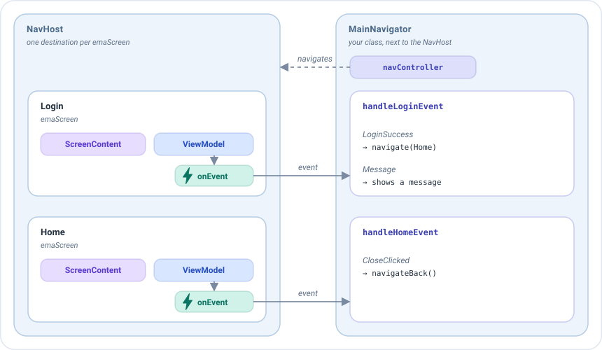

# Compose navigation

> This page is about Navigation Compose, and it needs the `emanate-compose-nav2` artifact. The rest of the Compose
> artifacts don't depend on any navigation library, so a different navigation can be used with `EmaScreen`.
>
> The module is **multiplatform**: it is written once for Android, JVM and iOS, over the Navigation Compose of
> JetBrains.

In Emanate a **ViewModel never navigates**. Navigating is the job of the navigation graph that contains the screen,
usually the `NavHost`: it is the one that knows which screens exist and holds the `NavController` to move between them.

The ViewModel only publishes an [event](../concepts/events.md) that says **what happened**, like "the login succeeded". Someone outside the screens has to receive those events and decide **where to go**: the **navigator**, a class
that lives next to the `NavHost` and holds its `NavController`. It is not a class of Emanate: it is a plain class of
yours, and it is a good pattern to handle all the navigation of your app this way.

This is the main flow of the sample, with two of its screens, the login and the home:



1. Each destination of the `NavHost` is an `emaScreen`, with its screen content, its ViewModel and its `onEvent`.
2. When the credentials are right, the ViewModel of `Login` publishes `LoginSuccess(user)`. It doesn't know which
   screen comes next.
3. The `onEvent` of that screen hands the event to the navigator, to its function for that screen:
   `handleLogin`.
4. The navigator decides for each event: `LoginSuccess` opens `Home`, and the `CloseClicked` of `Home` goes back to the
   login. It does it with the `navController`, which changes the destination shown by the `NavHost`.

Keeping the navigation out of the ViewModel has two advantages. The ViewModel can be tested without Android, and the
same event can lead to different places in different apps or graphs: on a phone it may open a new screen and on a
tablet update a side panel.

The decision of where to go could be written directly in each `onEvent` lambda, but we recommend that every navigation
goes through a navigator: the graph only declares the screens, and all the navigation of a flow lives in one place that
is easy to read and to change. See [The navigator](#the-navigator).

## Routes

Every screen registered with `emaScreen` or `emaDialog` has a route. By default it is `ScreenContent::class.routeId`,
unique per class:

```kotlin
navController.navigate(HomeScreenContent::class.routeId)
```

## The navigator

Create **one navigator per navigation graph**, not one per screen, and let it handle the navigation of all the screens
of the graph. It is a plain class that receives the `NavController` and has one function per screen: each function
receives the events of that screen and decides where to go. Emanate doesn't require a base class or an interface for it:
any class with this shape works. Create it once, with `remember`, next to the `NavHost`:

```kotlin
class MainNavigator(private val navController: NavController) {

    fun handleLogin(event: LoginEvent) {
        when (event) {
            is LoginEvent.LoginSuccess -> navController.navigate(
                route = HomeScreenContent::class.routeId,
                initializer = HomeInitializer.HomeUser(event.user),
                serializer = HomeInitializer.serializer()
            )
        }
    }

    fun handleHome(event: HomeEvent) {
        when (event) {
            HomeEvent.CreateClicked -> navController.navigate(ProfileScreenContent::class.routeId)

            // The login is the screen below the home
            HomeEvent.CloseClicked -> navController.navigateBack()
        }
    }
}
```

Each function is named `handle` plus the screen, and receives the sealed type of its events. If something has to go back to the screen that contains the graph, add a lambda to the function: the function decides, for each event, what to send through it.

```kotlin
fun handleHome(event: HomeEvent, onFriendCreated: (Friend) -> Unit) {
    when (event) {
        is HomeEvent.FriendCreated -> onFriendCreated(event.friend)
        HomeEvent.CloseClicked -> navController.navigateBack()
    }
}
```

```kotlin
@Composable
fun MainGraph() {
    val navController = rememberNavController()
    val navigator = remember { MainNavigator(navController) }

    NavHost(navController, startDestination = LoginScreenContent::class.routeId) {
        emaScreen(
            screenContent = LoginScreenContent(),
            viewModel = { createLoginViewModel() },
            onEvent = { navigator.handleLogin(it) }
        )
    }
}
```

`NavController.navigateBack(onBackStackEmpty = {})` pops the back stack and returns whether there was a screen to go
back to. When there is none, it calls `onBackStackEmpty`, so the app decides what an empty back stack means:

```kotlin
navController.navigateBack { onExit() }
```

## Passing an initializer

Send the [initializer](../guides/initializers.md) with the `navigate` extension that receives the initializer and its
serializer:

```kotlin
navController.navigate(
    route = HomeScreenContent::class.routeId,
    initializer = HomeInitializer.HomeUser(user),
    serializer = HomeInitializer.serializer()
)
```

To navigate without an initializer, use the normal `navigate(route)`.

Another overload receives a `NavOptionsBuilder` lambda, like `navigate(route) { launchSingleTop = true }`.

The destination declares where to read it from with `initializerSupport`. The initializer travels in the route as
text (JSON), so Compose navigation reads it with kotlinx.serialization: annotate it with `@Serializable`.

```kotlin
emaScreen(
    screenContent = HomeScreenContent(),
    viewModel = { createHomeViewModel() },
    initializerSupport = EmaInitializerSupport.fromRoute(HomeInitializer.serializer()),
    onEvent = { navigator.handleHome(it) }
)
```

The initializer reaches the ViewModel as an action, the first time the screen is created. See [Initializers](../guides/initializers.md).

### Where the initializer comes from

`EmaInitializerSupport` has one function per origin. The name says where the initializer is read from:

| Function                                   | Where it reads the initializer                                                          | When to use it                                                                 |
|--------------------------------------------|-----------------------------------------------------------------------------------------|--------------------------------------------------------------------------------|
| `fromRoute(serializer)`                    | The route of the destination.                                                           | Most screens: the ones you reach with `navigate(route, initializer, serializer)`. |
| `fromInitializer(serializer, initializer)` | The route and, if it has none, the initializer that you give it.                        | An initializer that you already have, like the one of a deep link, or a test.  |

In all of them **the route wins**: if it carries an initializer, the screen uses it. The origin of the function is
only the backup for when the route has none.

### The first screen

The initializer of a screen normally travels in its **route**: the navigator puts it there with
`navigate(route, initializer, serializer)`, and `fromRoute` reads it back. But the **first screen** of a `NavHost`, its
`startDestination`, is not reached with `navigate`: it is shown as soon as the `NavHost` is created, so its route has no
initializer.

If that screen needs one, give it to the screen with `fromInitializer`. It is the backup that the screen uses when its
route has none:

```kotlin
NavHost(navController, startDestination = ProfileCreationScreenContent::class.routeId) {
    emaScreen(
        screenContent = ProfileCreationScreenContent(),
        viewModel = { createProfileCreationViewModel() },
        initializerSupport = EmaInitializerSupport.fromInitializer(
            ProfileCreationInitializer.serializer(),
            ProfileCreationInitializer.Default("Carlos")
        ),
        onEvent = { navigator.handleProfileCreation(it) }
    )
}
```

The rest of the screens of the graph are declared with `fromRoute`.

#### When the first screen is opened again

The backup is used only when the route has no initializer: the route wins. If the first screen is opened again later
with `navigate`, it receives:

| How it is opened                                       | The screen receives                                    |
|--------------------------------------------------------|--------------------------------------------------------|
| `navigate(route, Default("Ana"), serializer)`          | `Default("Ana")`, the one of the route.                |
| `navigate(route)`, without initializer                 | `Default("Carlos")`, the backup, as the first time.    |
| `navigate(route, Default(""), serializer)`             | `Default("")`, the one of the route.                   |

The last row is the way to **avoid the backup**. If the new screen must not use the backup, navigate with an initializer
of the screen **without values**, so that the route has one and wins. It is a normal initializer, of the type that the
screen expects, with empty values:

```kotlin
navController.navigate(
    route = ProfileCreationScreenContent::class.routeId,
    initializer = ProfileCreationInitializer.Default(admin = ""),
    serializer = ProfileCreationInitializer.serializer()
)
```

The screen then receives that initializer, and it is the reducer of `ProfileCreationInitializer` that decides what it
means: for example, that there is no creator to show.

Going back to the first screen with the back button doesn't open it again: the original screen, with its ViewModel,
comes back and doesn't read the initializer again.
