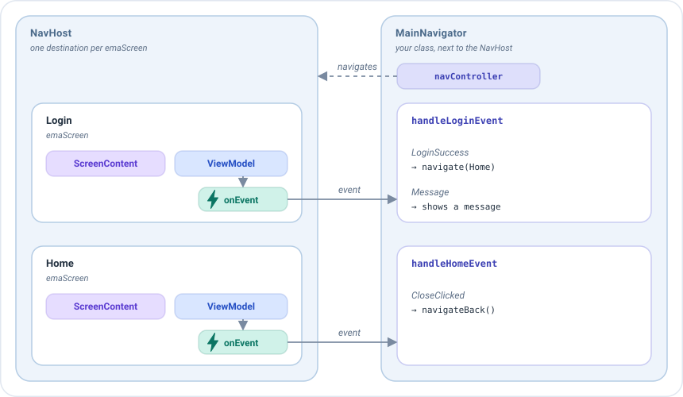
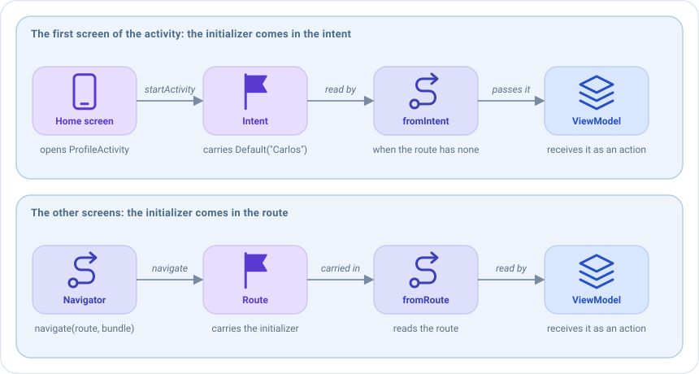

# Compose navigation

> This page is about Navigation Compose, and it needs the `emanate-compose-android-nav2` artifact. The rest of the Compose
> artifacts don't depend on any navigation library, so a different navigation can be used with `EmaScreen`.

In Emanate a **ViewModel never navigates**. Navigating is the job of the navigation graph that contains the screen,
usually the `NavHost`: it is the one that knows which screens exist and holds the `NavController` to move between them.

The ViewModel only publishes an [event](../concepts/events.md) that says **what happened**, like "the user chose to be an
admin". Someone outside the screens has to receive those events and decide **where to go**: the **navigator**, a class
that lives next to the `NavHost` and holds its `NavController`. It is not a class of Emanate: it is a plain class of
yours, and it is a good pattern to handle all the navigation of your app this way.

This is the profile flow of the sample, with two screens:



1. Each destination of the `NavHost` is an `emaScreen`, with its screen content, its ViewModel and its `onEvent`.
2. When the user taps **Admin**, the ViewModel of `ProfileOnBoarding` publishes `UserTypeSelected(ADMIN)`. It doesn't
   know which screen comes next.
3. The `onEvent` of that screen hands the event to the navigator, to its function for that screen:
   `handleProfileOnBoardingEvent`.
4. The navigator decides for each event: `UserTypeSelected` opens `ProfileCreation`, and `OnBoardingCancelled` goes
   back. It does it with the `navController`, which changes the destination shown by the `NavHost`.

Keeping the navigation out of the ViewModel has two advantages. The ViewModel can be tested without Android, and the
same event can lead to different places in different apps or graphs: on a phone it may open a new screen and on a
tablet update a side panel.

The decision of where to go could be written directly in each `onEvent` lambda, but we recommend that every navigation
goes through a navigator: the graph only declares the screens, and all the navigation of a flow lives in one place that
is easy to read and to change. See [The navigator](#the-navigator).

## Routes

Every screen registered with `emaScreen` or `emaDialog` has a route. By default it is `ScreenContent::class.routeId`,
unique per class:

```kotlin
navController.navigate(ProfileCreationScreenContent::class.routeId)
```

## The navigator

Create **one navigator per navigation graph**, not one per screen, and let it handle the navigation of all the screens
of the graph. It is a plain class that receives the `NavController` and has one function per screen: each function
receives the events of that screen and decides where to go. Emanate doesn't require a base class or an interface for it:
any class with this shape works. Create it once, with `remember`, next to the `NavHost`:

```kotlin
class ProfileNavigator(private val navController: NavController) {

    fun handleProfileOnBoardingEvent(event: ProfileOnBoardingEvent) {
        when (event) {
            is ProfileOnBoardingEvent.UserTypeSelected -> navController.navigate(
                route = ProfileCreationScreenContent::class.routeId,
                initializerBundle = EmaInitializerBundle(
                    mapToCreationInitializer(event.role),
                    BundleSerializerStrategy.kSerialization(ProfileCreationInitializer.serializer())
                )
            )

            is ProfileOnBoardingEvent.OnBoardingCancelled -> navController.navigateBack()
        }
    }

    fun handleProfileCreationEvent(event: ProfileCreationEvent) {
        when (event) {
            ProfileCreationEvent.DialogConfirmationAccepted -> navController.navigateBack()
        }
    }
}
```

```kotlin
setContent {
    val navController = rememberNavController()
    val navigator = remember { ProfileNavigator(navController) }

    NavHost(navController, startDestination = ProfileOnBoardingScreenContent::class.routeId) {
        emaScreen(
            screenContent = ProfileOnBoardingScreenContent(),
            viewModel = { get<ProfileOnBoardingViewModel>() },
            onEvent = { navigator.handleProfileOnBoardingEvent(it) }
        )
    }
}
```

`NavController.navigateBack(closeActivityWhenBackstackIsEmpty = true)` pops the back stack and closes the activity when
there is nothing left, and `NavController.navigateToExternalLink(url)` opens a link in another app.

## Passing an initializer

Send the [initializer](../guides/initializers.md) with the `navigate` extension that receives an `EmaInitializerBundle`:

```kotlin
navController.navigate(
    route = ProfileCreationScreenContent::class.routeId,
    initializerBundle = EmaInitializerBundle(
        ProfileCreationInitializer.Admin,
        BundleSerializerStrategy.kSerialization(ProfileCreationInitializer.serializer())
    )
)
```

Another overload receives a `NavOptionsBuilder` lambda, like `navigate(route) { launchSingleTop = true }`.

The destination declares where to read it from with `initializerSupport`. The initializer travels in the route as
text, so Compose navigation reads it with kotlinx.serialization: the `parcelable` and `serializable` strategies, which
only work with Bundles, can't be used in a route.

```kotlin
emaScreen(
    screenContent = ProfileCreationScreenContent(),
    viewModel = { get<ProfileCreationViewModel>() },
    initializerSupport = EmaInitializerSupport.fromRoute(ProfileCreationInitializer.serializer()),
    onEvent = { navigator.handleProfileCreationEvent(it) }
)
```

The initializer reaches the ViewModel as an action, the first time the screen is created. See [Initializers](../guides/initializers.md).

### Where the initializer comes from

`EmaInitializerSupport` has one function per origin. The name says where the initializer is read from:

| Function                                   | Where it reads the initializer                                                          | When to use it                                                                 |
|--------------------------------------------|-----------------------------------------------------------------------------------------|--------------------------------------------------------------------------------|
| `fromRoute(serializer)`                    | The route of the destination.                                                           | Most screens: the ones you reach with `navigate(route, initializerBundle)`.    |
| `fromIntent(serializer)`                   | The route and, if it has none, the intent of the activity.                              | The first screen of an activity that is opened with an initializer.            |
| `fromBundle(serializer, bundle)`           | The route and, if it has none, the `Bundle` that you give it.                           | A graph inside a `ComposeView` of a fragment, with the arguments of the fragment. |
| `fromInitializer(serializer, initializer)` | The route and, if it has none, the initializer that you give it.                        | An initializer that you already have, like the one of a deep link, or a test.  |

In all of them **the route wins**: if it carries an initializer, the screen uses it. The origin of the function is
only the backup for when the route has none.

### The first screen of an activity

The initializer of a screen normally travels in its **route**: the navigator puts it there with
`navigate(route, initializerBundle)`, and `fromRoute` reads it back. But the **first screen** of a `NavHost`, its
`startDestination`, is not reached with `navigate`: it is shown as soon as the `NavHost` is created, so its route has no
initializer.

If that screen needs one, it can come from the **intent of the activity**. In the sample, the home screen starts
`ProfileActivity` and puts a `ProfileOnBoardingInitializer.Default("Carlos")` in the intent, so that the onboarding
screen can greet that user. It takes two steps, one in each activity:



**1. Put the initializer in the intent of the activity that opens the graph.** Use `setInitializer` of the `Intent`,
with the serializer of the initializer, and start the activity:

```kotlin
val intent = Intent(context, ProfileActivity::class.java).setInitializer(
    ProfileOnBoardingInitializer.Default("Carlos"),
    BundleSerializerStrategy.kSerialization(ProfileOnBoardingInitializer.serializer())
)
context.startActivity(intent)
```

The initializer travels in the extras of the intent, under the key that Emanate reads. If you open the activity with a
navigation graph of Android, as the sample does with an action that goes to an activity, `navController.navigate(id,
EmaInitializerBundle(...))` puts it there for you, and you only have to use the same serializer when you read it.

**2. Declare the first screen with `fromIntent`.** It reads the initializer from the intent of the activity that
contains the `NavHost`, using the same serializer:

```kotlin
NavHost(navController, startDestination = ProfileOnBoardingScreenContent::class.routeId) {
    emaScreen(
        screenContent = ProfileOnBoardingScreenContent(),
        viewModel = { get<ProfileOnBoardingViewModel>() },
        // The initializer that the home screen put in the intent of the activity
        initializerSupport = EmaInitializerSupport.fromIntent(ProfileOnBoardingInitializer.serializer()),
        onEvent = { navigator.handleProfileOnBoardingEvent(it) }
    )
}
```

You don't have to read the intent yourself. The rest of the screens of the graph are declared with `fromRoute`, so
they never read the intent.

#### When the first screen is opened again

The intent is a **backup**: the route wins. If the first screen is opened again later with `navigate`, it receives:

| How it is opened                                                          | The screen receives                                    |
|---------------------------------------------------------------------------|--------------------------------------------------------|
| `navigate(route, EmaInitializerBundle(Default("Ana"), ...))`              | `Default("Ana")`, the one of the route.                |
| `navigate(route)`, without initializer                                    | `Default("Carlos")`, the one of the intent, as the first time. |
| `navigate(route, EmaInitializerBundle(Default(""), ...))`                 | `Default("")`, the one of the route.                   |

The last row is the way to **avoid the backup**. If the new screen must not use the initializer of the intent, navigate
with an initializer of the screen **without values**, so that the route has one and wins. It is a normal initializer,
of the type that the screen expects, with empty values:

```kotlin
navController.navigate(
    route = ProfileOnBoardingScreenContent::class.routeId,
    initializerBundle = EmaInitializerBundle(
        ProfileOnBoardingInitializer.Default(admin = ""),
        BundleSerializerStrategy.kSerialization(ProfileOnBoardingInitializer.serializer())
    )
)
```

The screen then receives that initializer, and it is the reducer of `ProfileOnBoardingInitializer` that decides what it
means: for example, that there is no user to greet.

Going back to the first screen with the back button doesn't open it again: the original screen, with its ViewModel,
comes back and doesn't read the initializer again.
