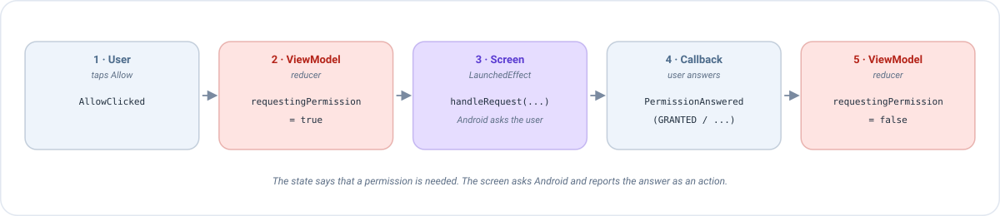

# Permisos en Compose

Algunas cosas que una app quiere hacer están protegidas por Android: usar la cámara, leer la ubicación, enviar
notificaciones... Antes de poder hacerlas, **el usuario debe decir que sí** en un diálogo del sistema. Esta página
explica cómo pedir esos permisos con Emanate, paso a paso, con un ejemplo completo que puedes copiar.

## La idea en un minuto

Pedir un permiso es incómodo para un ViewModel, porque el diálogo del sistema pertenece a la pantalla (la Activity), y el
ViewModel no debe saber nada de Android. Emanate lo resuelve con la misma receta que todo lo demás:

1. El ViewModel **escribe en el estado** que hace falta un permiso (`requestingPermission = true`).
2. La pantalla lo ve, **le pide el permiso a Android** y espera al usuario.
3. Cuando el usuario responde, la pantalla **envía la respuesta como una acción** (`PermissionAnswered`), y el ViewModel
   decide qué hacer a continuación.



La herramienta que habla con Android es `EmaPermissionManager`. Convierte el flujo del sistema (launchers, callbacks...)
en funciones `suspend` sencillas.

## Antes de empezar

### 1. Declara el permiso en el manifest

Android ignora cualquier permiso que no esté declarado en `AndroidManifest.xml`, así que esto es lo primero:

```xml
<uses-permission android:name="android.permission.CAMERA" />
```

### 2. Conoce las tres respuestas

Cuando pides un permiso, el resultado es un `PermissionState`:

| `PermissionState` | Qué significa | Reacción habitual |
|-------------------|---------------|-------------------|
| `GRANTED` | El usuario dijo que sí (o ya lo había dicho). | Haz lo que necesitaba el permiso. |
| `NOT_GRANTED` | El permiso no está concedido. | Sigue sin él, o avisa de que hace falta. |
| `NOT_GRANTED_SHOULD_EXPLAIN` | No está concedido, y el usuario ya lo rechazó una vez. Android recomienda explicar **por qué** lo necesita la app antes de volver a pedirlo. | Muestra tu propio mensaje (un diálogo, por ejemplo) y deja que el usuario lo intente de nuevo. |

!!! note "Cuando el usuario rechaza dos veces"
    Tras un segundo rechazo Android deja de mostrar el diálogo del sistema: pedirlo otra vez devuelve `NOT_GRANTED`
    al instante. La única forma de conseguir el permiso entonces es que el usuario lo active en los ajustes de la
    app, así que ofrece un botón que los abra.

## El gestor

La pantalla crea el gestor con `rememberEmaPermissionManager()`. En un `@Preview` devuelve un gestor que lo concede
todo, para que tus previews no abran diálogos del sistema.

```kotlin
val permissionManager = rememberEmaPermissionManager()
```

Estas son sus funciones. Las que **piden** son `suspend` (esperan al usuario), así que llámalas desde una corrutina:

| Función | Qué hace |
|---------|----------|
| `isPermissionGranted(permission)` | ¿Está concedido ahora mismo? Devuelve un `PermissionState`. **No pide nada.** |
| `areAllPermissionsGranted(a, b)` | `true` si todos están concedidos. No pide nada. |
| `shouldShowRequestPermissionRationale(permission)` | `true` si Android recomienda explicar antes de pedir. No pide nada. |
| `requestPermission(permission)` | **Pide** un permiso y devuelve su `PermissionState`. |
| `requestMultiplePermission(a, b)` | **Pide** varios a la vez y devuelve un `Map<String, PermissionState>`. |

```kotlin
if (permissionManager.isPermissionGranted(Manifest.permission.CAMERA) == PermissionState.GRANTED) {
    openCamera()
}
```

!!! warning "Una petición cada vez"
    Android cancela una petición hecha mientras otra está en pantalla: devuelve `NOT_GRANTED` (un mapa vacío si son
    varios permisos) en lugar de esperar. No lances nunca dos peticiones a la vez.

## La forma rápida: pedirlo desde la pantalla

Si la respuesta solo le importa a la pantalla, puedes pedirlo desde una corrutina, sin ViewModel:

```kotlin
val scope = rememberCoroutineScope()

Button(onClick = {
    scope.launch {
        when (permissionManager.requestPermission(Manifest.permission.CAMERA)) {
            PermissionState.GRANTED -> openCamera()
            else -> showMessage("Hace falta la cámara para hacer la foto")
        }
    }
}) { Text("Hacer foto") }
```

Funciona, pero la decisión (*¿qué pasa cuando el usuario dice que no?*) vive ahora en la pantalla, donde no se puede
probar sin dispositivo. Cuando la respuesta cambia **lo que la pantalla muestra o hace**, usa la sección siguiente.

## La forma de Emanate: pedirlo desde el ViewModel

Vamos a construir una pantalla que necesita la ubicación. El usuario pulsa *Permitir*, Android pregunta, y la pantalla
muestra si el permiso se concedió. Si el usuario lo rechaza una vez, mostramos una explicación.

### Paso 1: el estado y las acciones

El estado solo dice *"se está pidiendo un permiso"* y *"el permiso está concedido"*. Son booleanos simples: el ViewModel
nunca toca Android.

```kotlin
data class LocationState(
    val requestingPermission: Boolean = false,   // true mientras haya que pedir el permiso
    val locationGranted: Boolean = false
) : EmaState

sealed interface LocationAction : EmaAction {
    data object AllowClicked : LocationAction                                           // el usuario pulsó Permitir
    data class PermissionAnswered(val permissionState: PermissionState) : LocationAction  // Android respondió
}

sealed interface LocationEvent : EmaEvent {
    data object PermissionRationaleNeeded : LocationEvent
}
```

### Paso 2: el ViewModel

```kotlin
class LocationViewModel : EmaViewModel<LocationState, LocationAction, LocationEvent>(LocationState()) {

    override fun setup() = source {
        reducers {
            add<LocationAction> { action ->
                when (action) {
                    is LocationAction.AllowClicked -> state.copy(requestingPermission = true)
                    is LocationAction.PermissionAnswered -> state.copy(
                        // La petición ya está hecha, así que no debe ejecutarse otra vez
                        requestingPermission = false,
                        locationGranted = action.permissionState == PermissionState.GRANTED
                    )
                }
            }
        }
        sideEffects {
            add<LocationAction.PermissionAnswered> { action ->
                if (action.permissionState == PermissionState.NOT_GRANTED_SHOULD_EXPLAIN) {
                    postEvent(LocationEvent.PermissionRationaleNeeded)
                }
            }
        }
    }
}
```

Léelo como una conversación:

- `AllowClicked` → *"necesito el permiso"*: el reducer activa `requestingPermission`.
- `PermissionAnswered` → *"aquí está la respuesta"*: el reducer **desactiva** `requestingPermission` (muy importante,
  mira el aviso de más abajo) y guarda si se concedió.
- Si Android recomienda una explicación, el efecto secundario envía un [evento](../concepts/events.es.md) para que la
  pantalla la muestre.

### Paso 3: la pantalla ejecuta la petición

La pantalla observa `requestingPermission`. Cada vez que cambia, se ejecuta un `LaunchedEffect` y le pide el permiso a
Android:

```kotlin
@Composable
override fun onState(state: LocationState, actions: EmaActionDispatcher<LocationAction>) {
    val permissionManager = rememberEmaPermissionManager()
    val scope = rememberCoroutineScope()

    LaunchedEffect(state.requestingPermission) {
        val request = if (state.requestingPermission) {
            // Cuando el usuario responde, la respuesta se envía como una acción
            EmaPermissionRequest.createRequest { actions.dispatch(LocationAction.PermissionAnswered(it)) }
        } else {
            // "Nada que hacer": el gestor la ignora
            EmaPermissionRequest.cancelRequest()
        }
        permissionManager.handleRequest(request, scope, Manifest.permission.ACCESS_COARSE_LOCATION)
    }

    Column {
        Text(if (state.locationGranted) "Ubicación permitida" else "Ubicación no permitida")
        Button(onClick = { actions.dispatch(LocationAction.AllowClicked) }) { Text("Permitir") }
    }
}
```

Qué hace cada pieza:

| Pieza | Su trabajo |
|-------|------------|
| `LaunchedEffect(state.requestingPermission)` | Ejecuta el bloque **cada vez** que cambia el flag: una vez cuando pasa a `true` y otra cuando pasa a `false`. |
| `EmaPermissionRequest.createRequest { ... }` | Una petición con un callback. El callback recibe el `PermissionState` que eligió el usuario. |
| `EmaPermissionRequest.cancelRequest()` | La petición *"nada que hacer"*. `handleRequest` la ignora. Es la que se ejecuta cuando el flag es `false`. |
| `permissionManager.handleRequest(request, scope, permission)` | Si la petición es real, se la pide a Android en `scope` y llama al callback con la respuesta. |

Sigamos lo que ocurre cuando el usuario pulsa *Permitir*:

| # | Qué ocurre | Quién |
|---|------------|-------|
| 1 | El usuario pulsa *Permitir*. La pantalla envía `AllowClicked`. | Pantalla |
| 2 | El reducer devuelve `requestingPermission = true`. | ViewModel |
| 3 | El flag cambió, así que el `LaunchedEffect` se ejecuta y llama a `handleRequest`. Android muestra su diálogo. | Pantalla |
| 4 | El usuario elige. El callback envía `PermissionAnswered(GRANTED)` (u otro estado). | Pantalla |
| 5 | El reducer devuelve `requestingPermission = false` y `locationGranted = true`. El `LaunchedEffect` se ejecuta de nuevo, pero ahora con `cancelRequest()`. | ViewModel |

!!! warning "No olvides desactivar el flag"
    Si `PermissionAnswered` deja `requestingPermission = true`, el flag no vuelve a cambiar nunca, el `LaunchedEffect`
    no se ejecuta, y la siguiente pulsación de *Permitir* no hace nada. El reducer de la respuesta **siempre** lo
    vuelve a poner a `false`.

### Paso 4: explica cuando Android lo recomienda

El efecto secundario del Paso 2 envió `PermissionRationaleNeeded`. Gestiónalo como cualquier otro evento, por ejemplo
abriendo un [diálogo](dialogs.es.md) que explique por qué la app necesita la ubicación, con un botón que vuelva a pedirla:

```kotlin
sealed interface LocationDialog {
    data object WhyLocation : LocationDialog
}

// Reducer
is LocationAction.PermissionAnswered -> state.copy(
    requestingPermission = false,
    locationGranted = action.permissionState == PermissionState.GRANTED,
    dialog = if (action.permissionState == PermissionState.NOT_GRANTED_SHOULD_EXPLAIN) {
        LocationDialog.WhyLocation
    } else {
        null
    }
)
```

Aquí `dialog` es un campo nullable nuevo de `LocationState`, como se explica en [Diálogos](dialogs.es.md). El botón
*"Intentar de nuevo"* de ese diálogo envía `AllowClicked` y el ciclo empieza otra vez.

### Probarlo sin dispositivo

La respuesta del usuario es solo una acción, así que un test puede simular **cada resultado** sin Android:

```kotlin
@Test
fun `un permiso rechazado pide una explicación`() = runTest {
    val viewModel = LocationViewModel()
    val recorder = viewModel.record()

    viewModel.dispatch(LocationAction.AllowClicked)
    recorder.assertState { it.requestingPermission }

    viewModel.dispatch(LocationAction.PermissionAnswered(PermissionState.NOT_GRANTED_SHOULD_EXPLAIN))
    advanceUntilIdle()

    recorder.assertState { !it.requestingPermission && !it.locationGranted }
    recorder.assertEvents(LocationEvent.PermissionRationaleNeeded)
}
```

Consulta [Testing](../guides/testing.es.md) para saber cómo configurar `useTestConfiguration()`.

## Varios permisos a la vez

Para pedir más de un permiso en un único diálogo del sistema, usa las versiones *multiple*. El callback recibe un `Map`
con la respuesta de cada permiso:

```kotlin
LaunchedEffect(state.requestingPermissions) {
    val request = if (state.requestingPermissions) {
        EmaMultiplePermissionRequest.createRequest { answers: Map<String, PermissionState> ->
            actions.dispatch(CaptureAction.PermissionsAnswered(answers))
        }
    } else {
        EmaMultiplePermissionRequest.cancelRequest()
    }
    permissionManager.handleRequestMultiple(
        request, scope,
        Manifest.permission.CAMERA, Manifest.permission.RECORD_AUDIO
    )
}
```

```kotlin
// En el reducer
val allGranted = action.answers.values.all { it == PermissionState.GRANTED }
```

## Ubicación

La ubicación tiene sus propios atajos, porque tiene reglas especiales:

| Función | Uso |
|---------|-----|
| `requestCoarseLocationPermission()` | Ubicación aproximada. |
| `requestFineLocationPermission()` | Ubicación precisa. |
| `isLocationCoarseGranted()`, `isLocationFineGranted()`, `isLocationBackgroundGranted()` | Comprueban sin pedir. |

- Pide la ubicación precisa con `requestFineLocationPermission()`, **no** con `requestPermission`: según la versión de
  Android hay que pedirla junto con la aproximada, y la función lo hace por ti.
- La ubicación en **segundo plano** (`requestBackgroundLocationPermission(infoDialogType)` de
  `EmaAndroidPermissionManager`) necesita antes la precisa. En las versiones recientes de Android el usuario la concede en
  los ajustes del sistema, e `infoDialogType` decide la explicación que se muestra antes de abrirlos:
  `InfoDialogType.Default(title, message)`, o `InfoDialogType.CustomDialog(alertDialog, onAcceptClickListener)` para
  mostrar tu propio diálogo.

## Buenas prácticas

- **Pídelo cuando haga falta, no al arrancar.** Pide la cámara cuando el usuario toque *Hacer foto*, no cuando se abre
  la app. La gente acepta más cuando entiende para qué.
- **Gestiona siempre el rechazo.** La pantalla debe tener sentido también sin el permiso.
- **Ten presentes los ajustes del sistema.** Si el usuario sale de la app para activar un permiso allí, Android puede
  matar el proceso mientras tanto. Un [backup](../guides/process-death.md) conserva lo que había escrito.
