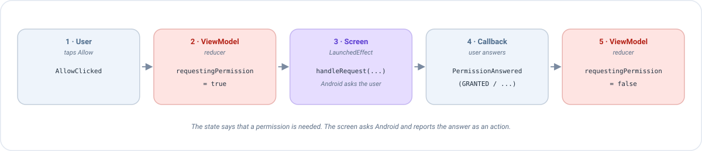

# Permissions (Android)

Some things an app wants to do are protected by Android: using the camera, reading the location, sending
notifications... Before the app can do them, **the user must say yes** in a system dialog. This page explains how to
ask for those permissions with Emanate, step by step, with a complete example you can copy.

## The idea in one minute

Asking for a permission is awkward for a ViewModel, because the system dialog belongs to the screen (the Activity),
and the ViewModel must not know anything about Android. Emanate solves it with the same recipe as everything else:

1. The ViewModel **writes in the state** that a permission is needed (`requestingPermission = true`).
2. The screen sees it, **asks Android** for the permission, and waits for the user.
3. When the user answers, the screen **sends the answer as an action** (`PermissionAnswered`), and the ViewModel
   decides what to do next.



The tool that talks to Android is `EmaPermissionManager`. It turns the system flow (launchers, callbacks...) into
simple `suspend` functions.

## Before you start

### 1. Declare the permission in the manifest

Android ignores any permission that is not declared in `AndroidManifest.xml`, so this is the first thing to do:

```xml
<uses-permission android:name="android.permission.CAMERA" />
```

### 2. Know the three answers

When you ask, the result is a `PermissionState`:

| `PermissionState` | What it means | Typical reaction |
|-------------------|---------------|------------------|
| `GRANTED` | The user said yes (or had already said it). | Do the thing that needed the permission. |
| `NOT_GRANTED` | The permission is not granted. | Do without it, or tell the user it is needed. |
| `NOT_GRANTED_SHOULD_EXPLAIN` | Not granted, and the user already refused it once. Android recommends explaining **why** the app needs it before asking again. | Show your own message (a dialog, for example) and let the user try again. |

!!! note "When the user refuses twice"
    After a second refusal Android stops showing the system dialog: asking again returns `NOT_GRANTED` at once.
    The only way to get the permission then is that the user enables it in the settings of the app, so offer a
    button that opens them.

## The manager

The screen creates the manager with `rememberEmaPermissionManager()`. In a `@Preview` it returns a manager that
grants everything, so your previews don't open system dialogs.

```kotlin
val permissionManager = rememberEmaPermissionManager()
```

These are its functions. The ones that **ask** are `suspend` (they wait for the user), so call them from a coroutine:

| Function | What it does |
|----------|--------------|
| `isPermissionGranted(permission)` | Is it granted right now? Returns a `PermissionState`. **Doesn't ask anything.** |
| `areAllPermissionsGranted(a, b)` | `true` if all of them are granted. Doesn't ask. |
| `shouldShowRequestPermissionRationale(permission)` | `true` if Android recommends explaining before asking. Doesn't ask. |
| `requestPermission(permission)` | **Asks** for one permission and returns its `PermissionState`. |
| `requestMultiplePermission(a, b)` | **Asks** for several at once and returns a `Map<String, PermissionState>`. |

```kotlin
if (permissionManager.isPermissionGranted(Manifest.permission.CAMERA) == PermissionState.GRANTED) {
    openCamera()
}
```

!!! warning "One request at a time"
    Android cancels a request made while another one is on screen: it returns `NOT_GRANTED` (an empty map for several
    permissions) instead of waiting. Never launch two requests together.

## The quick way: ask from the screen

If the answer only matters to the screen, you can ask from a coroutine, with no ViewModel involved:

```kotlin
val scope = rememberCoroutineScope()

Button(onClick = {
    scope.launch {
        when (permissionManager.requestPermission(Manifest.permission.CAMERA)) {
            PermissionState.GRANTED -> openCamera()
            else -> showMessage("The camera is needed to take the photo")
        }
    }
}) { Text("Take photo") }
```

It works, but the decision (*what happens when the user says no?*) now lives in the screen, where it can't be tested
without a device. When the answer changes **what the screen shows or does**, use the next section.

## The Emanate way: ask from the ViewModel

We are going to build a screen that needs the location. The user presses *Allow*, Android asks, and the screen shows
whether the permission was granted. If the user refuses once, we show an explanation.

### Step 1: the state and the actions

The state only says *"a permission is being requested"* and *"the permission is granted"*. These are plain booleans: the
ViewModel never touches Android.

```kotlin
data class LocationState(
    val requestingPermission: Boolean = false,   // true while the permission has to be requested
    val locationGranted: Boolean = false
) : EmaState

sealed interface LocationAction : EmaAction {
    data object AllowClicked : LocationAction                                           // the user pressed Allow
    data class PermissionAnswered(val permissionState: PermissionState) : LocationAction  // Android answered
}

sealed interface LocationEvent : EmaEvent {
    data object PermissionRationaleNeeded : LocationEvent
}
```

### Step 2: the ViewModel

```kotlin
class LocationViewModel : EmaViewModel<LocationState, LocationAction, LocationEvent>(LocationState()) {

    override fun setup() = source {
        reducers {
            add<LocationAction> { action ->
                when (action) {
                    is LocationAction.AllowClicked -> state.copy(requestingPermission = true)
                    is LocationAction.PermissionAnswered -> state.copy(
                        // The request is done, so it must not be executed again
                        requestingPermission = false,
                        locationGranted = action.permissionState == PermissionState.GRANTED
                    )
                }
            }
        }
        sideEffects {
            add<LocationAction.PermissionAnswered> { action ->
                if (action.permissionState == PermissionState.NOT_GRANTED_SHOULD_EXPLAIN) {
                    publish(LocationEvent.PermissionRationaleNeeded)
                }
            }
        }
    }
}
```

Read it as a conversation:

- `AllowClicked` → *"I need the permission"*: the reducer turns `requestingPermission` on.
- `PermissionAnswered` → *"here is the answer"*: the reducer turns `requestingPermission` **off** (very important, see
  the warning below) and stores whether it was granted.
- If Android recommends an explanation, the side effect publishes an [event](../concepts/events.md) so the screen can
  show it.

### Step 3: the screen executes the request

The screen watches `requestingPermission`. Each time it changes, a `LaunchedEffect` runs and asks Android:

```kotlin
@Composable
override fun onState(state: LocationState, actions: EmaActionDispatcher<LocationAction>) {
    val permissionManager = rememberEmaPermissionManager()
    val scope = rememberCoroutineScope()

    LaunchedEffect(state.requestingPermission) {
        val request = if (state.requestingPermission) {
            // When the user answers, the answer is dispatched as an action
            EmaPermissionRequest.createRequest { actions.dispatch(LocationAction.PermissionAnswered(it)) }
        } else {
            // "Nothing to do": the manager ignores it
            EmaPermissionRequest.cancelRequest()
        }
        permissionManager.handleRequest(request, scope, Manifest.permission.ACCESS_COARSE_LOCATION)
    }

    Column {
        Text(if (state.locationGranted) "Location allowed" else "Location not allowed")
        Button(onClick = { actions.dispatch(LocationAction.AllowClicked) }) { Text("Allow") }
    }
}
```

What each piece does:

| Piece | Its job |
|-------|---------|
| `LaunchedEffect(state.requestingPermission)` | Runs the block **every time** the flag changes: once when it turns `true`, and once when it turns `false`. |
| `EmaPermissionRequest.createRequest { ... }` | A request with a callback. The callback receives the `PermissionState` chosen by the user. |
| `EmaPermissionRequest.cancelRequest()` | The *"nothing to do"* request. `handleRequest` ignores it. It is what runs when the flag is `false`. |
| `permissionManager.handleRequest(request, scope, permission)` | If the request is real, it asks Android in `scope` and calls the callback with the answer. |

Let's follow what happens when the user presses *Allow*:

| # | What happens | Who |
|---|--------------|-----|
| 1 | The user presses *Allow*. The screen sends `AllowClicked`. | Screen |
| 2 | The reducer returns `requestingPermission = true`. | ViewModel |
| 3 | The flag changed, so the `LaunchedEffect` runs and calls `handleRequest`. Android shows its dialog. | Screen |
| 4 | The user chooses. The callback sends `PermissionAnswered(GRANTED)` (or another state). | Screen |
| 5 | The reducer returns `requestingPermission = false` and `locationGranted = true`. The `LaunchedEffect` runs again, but now with `cancelRequest()`. | ViewModel |

!!! warning "Don't forget to turn the flag off"
    If `PermissionAnswered` leaves `requestingPermission = true`, the flag never changes again, the `LaunchedEffect`
    doesn't run, and the next press of *Allow* does nothing. The reducer of the answer **always** sets it back to
    `false`.

### Step 4: explain when Android recommends it

The side effect of Step 2 published `PermissionRationaleNeeded`. Handle it like any other event, for example opening a
[dialog](dialogs.md) that explains why the app needs the location, with a button that asks again:

```kotlin
sealed interface LocationDialog {
    data object WhyLocation : LocationDialog
}

// Reducer
is LocationAction.PermissionAnswered -> state.copy(
    requestingPermission = false,
    locationGranted = action.permissionState == PermissionState.GRANTED,
    dialog = if (action.permissionState == PermissionState.NOT_GRANTED_SHOULD_EXPLAIN) {
        LocationDialog.WhyLocation
    } else {
        null
    }
)
```

Here `dialog` is a new nullable field of `LocationState`, as explained in [Dialogs](dialogs.md). The *"Try again"* button of that dialog
dispatches `AllowClicked` and the cycle starts again.

### Testing it without a device

The answer of the user is just an action, so a test can simulate **every outcome** without Android:

```kotlin
@Test
fun `a refused permission asks for an explanation`() = runTest {
    val viewModel = LocationViewModel()
    val recorder = viewModel.record()

    viewModel.dispatch(LocationAction.AllowClicked)
    recorder.assertState { it.requestingPermission }

    viewModel.dispatch(LocationAction.PermissionAnswered(PermissionState.NOT_GRANTED_SHOULD_EXPLAIN))
    advanceUntilIdle()

    recorder.assertState { !it.requestingPermission && !it.locationGranted }
    recorder.assertEvents(LocationEvent.PermissionRationaleNeeded)
}
```

See [Testing](../guides/testing.md) for how to set up `useTestConfiguration()`.

## Several permissions at once

To ask for more than one permission in a single system dialog, use the *multiple* versions. The callback receives a
`Map` with the answer of each permission:

```kotlin
LaunchedEffect(state.requestingPermissions) {
    val request = if (state.requestingPermissions) {
        EmaMultiplePermissionRequest.createRequest { answers: Map<String, PermissionState> ->
            actions.dispatch(CaptureAction.PermissionsAnswered(answers))
        }
    } else {
        EmaMultiplePermissionRequest.cancelRequest()
    }
    permissionManager.handleRequestMultiple(
        request, scope,
        Manifest.permission.CAMERA, Manifest.permission.RECORD_AUDIO
    )
}
```

```kotlin
// In the reducer
val allGranted = action.answers.values.all { it == PermissionState.GRANTED }
```

## Location

Location has its own shortcuts, because it has some special rules:

| Function | Use |
|----------|-----|
| `requestCoarseLocationPermission()` | Approximate location. |
| `requestFineLocationPermission()` | Precise location. |
| `isLocationCoarseGranted()`, `isLocationFineGranted()`, `isLocationBackgroundGranted()` | Check without asking. |

- Ask for the precise location with `requestFineLocationPermission()`, **not** with `requestPermission`: depending on
  the Android version it must be requested together with the approximate one, and the function does it for you.
- The **background** location (`requestBackgroundLocationPermission(infoDialogType)` of `EmaAndroidPermissionManager`)
  needs the precise one first. On recent Android versions the user grants it in the settings of the system, and
  `infoDialogType` decides the explanation shown before opening them: `InfoDialogType.Default(title, message)`, or
  `InfoDialogType.CustomDialog(alertDialog, onAcceptClickListener)` to show your own dialog.

## Good practices

- **Ask when it is needed, not at startup.** Request the camera when the user taps *Take photo*, not when the app
  opens. People accept more when they understand why.
- **Always handle the refusal.** The screen must still make sense without the permission.
- **Mind the system settings.** If the user leaves the app to enable a permission there, Android may kill the process
  meanwhile. A [backup](../guides/process-death.md) keeps what they had typed.
