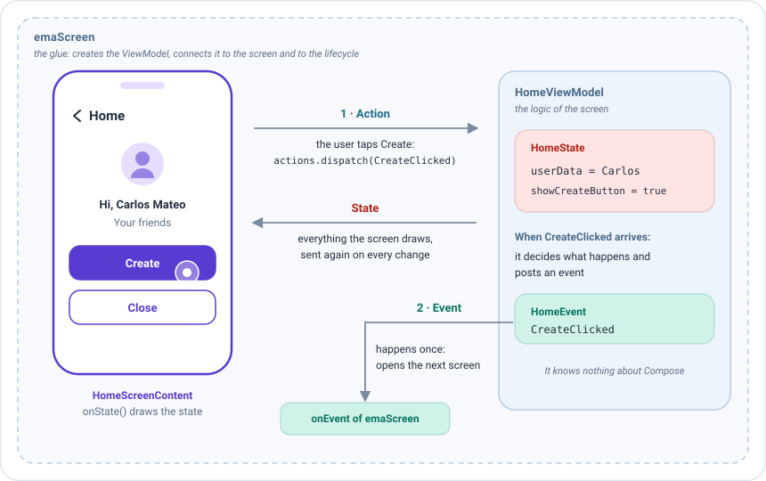
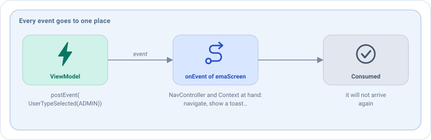
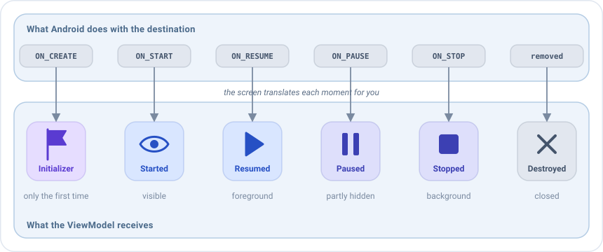
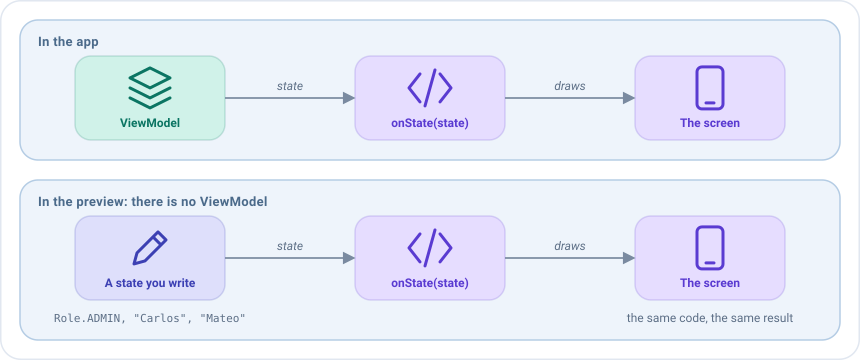

# Pantallas en Compose

Una pantalla de Emanate reparte el trabajo entre tres piezas, para que cada una tenga una única tarea:

| Pieza | Tarea | Ejemplo |
|-------|-------|---------|
| El **ViewModel** | Guarda el [estado](../concepts/state.md) y decide qué pasa cuando el usuario hace algo. No sabe nada de Compose. | `HomeViewModel` |
| El **contenido de la pantalla** (`EmaScreenContent`) | Pinta el estado con Compose y comunica lo que hace el usuario. No guarda datos propios. | `HomeScreenContent` |
| El **registro** (`emaScreen`) | El pegamento. Crea el ViewModel, lo conecta con el contenido y con el ciclo de vida, coloca la pantalla en tu grafo de navegación y recibe sus eventos. | El bloque del `NavHost` |

La información siempre viaja igual. En la pantalla home del sample, el administrador toca el botón para crear un
usuario:



1. El usuario toca **Create**, y el contenido de la pantalla envía la acción `CreateClicked`.
2. El ViewModel decide qué significa eso. Cada vez que cambia su estado, el contenido de la pantalla lo pinta de nuevo.
3. Aquí la respuesta es algo puntual: el ViewModel publica el evento `CreateClicked`, y el `onEvent` de
   `emaScreen` abre la siguiente pantalla.

La pantalla **nunca cambia el estado por sí misma**: solo envía [acciones](../concepts/actions.md) y pinta el estado que
le da el ViewModel. Por eso el mismo contenido se puede mostrar en una preview, en un test o en una app real sin
cambios.

Esta página sigue la vida de una pantalla, desde que se escribe hasta que se usa. Necesitas los artefactos
`emanate-android` y `emanate-compose-android`. Para registrar las pantallas en un grafo de Navigation Compose, como en
los ejemplos, necesitas también `emanate-compose-android-nav2`: los demás artefactos no dependen de ninguna librería de
navegación.

## Contenido de la pantalla

Esta es la parte que más escribirás: el código Compose de la pantalla. Creas una clase que implementa
`EmaScreenContent` y rellenas `onState`, que recibe el estado actual y lo pinta. Cuando el usuario pulsa un botón, no
cambias nada: envías una acción con `actions.dispatch(...)`, y el ViewModel responde con un nuevo estado que hace que
`onState` se ejecute de nuevo.

```kotlin
class HomeScreenContent : EmaScreenContent<HomeState, HomeAction> {

    @Composable
    override fun onState(
        state: HomeState,
        actions: EmaActionDispatcher<HomeAction>
    ) {
        // Pinta el estado. Envía lo que haga el usuario con actions.dispatch(...)
    }
}
```

`EmaScreenContent<S, A>` recibe el tipo del estado y el tipo de las acciones, y tiene dos miembros:

| Miembro                   | Propósito                                                                                            |
|---------------------------|------------------------------------------------------------------------------------------------------|
| `onState(state, actions)` | **Obligatorio.** Pinta el estado. Es un `@Composable`.                                               |
| `onBack(state): A?`       | La acción a enviar cuando se pulsa atrás, o `null`. Mira [Botón atrás](back-handling.md). Opcional.  |

El contenido de la pantalla no recibe los eventos: se gestionan donde se registra la pantalla, como se explica en
[Gestionar los eventos](#gestionar-los-eventos).

Mantén el contenido de la pantalla sin estado: es una descripción sin estado, creada una vez por pantalla. Todo lo que
deba sobrevivir pertenece al [estado](../concepts/state.md) del ViewModel.

## Registrar la pantalla

Un contenido de pantalla por sí solo es solo una descripción: nada lo muestra todavía. Registrarlo significa añadirlo
como destino de tu `NavHost`, como harías con el `composable(...)` de Compose Navigation, pero con `emaScreen`, que
además crea el ViewModel y lo conecta todo. Aquí también decides qué pasa cuando el ViewModel envía un evento, como
navegar a otra pantalla. `emaScreen` está en el artefacto `emanate-compose-android-nav2`. Si usas otra navegación, coloca
la pantalla con [`EmaScreen`](#usar-una-pantalla-sin-grafo-de-navegación), que está en `emanate-compose-android`.

```kotlin
NavHost(
    navController = navController,
    startDestination = HomeScreenContent::class.routeId
) {
    emaScreen(
        screenContent = HomeScreenContent(),
        viewModel = { createHomeViewModel() },
        onEvent = { navigator.handleHome(it) }
    )
}
```

!!! tip "Proporciona los ViewModels con un inyector"
    `createHomeViewModel()` representa lo que crea el ViewModel en tu proyecto. Es buena idea usar para ello un inyector
    de dependencias como Koin: el ViewModel y sus casos de uso se declaran una vez, en un módulo, y la pantalla solo pide
    el tipo. Declara los ViewModels con `factory`, para que cada pantalla tenga el suyo:

    ```kotlin
    // El módulo del inyector
    val uiModule = module {
        factoryOf(::HomeViewModel)
        factory { HomeState.DEFAULT }
    }

    // La pantalla solo pide su ViewModel
    emaScreen(
        screenContent = HomeScreenContent(),
        viewModel = { get<HomeViewModel>() },
        onEvent = { navigator.handleHome(it) }
    )
    ```

    Consulta [Inyección de dependencias](../guides/dependency-injection.md#con-koin).

| Parámetro              | Propósito                                                                                      |
|------------------------|------------------------------------------------------------------------------------------------|
| `screenContent`        | El contenido de la pantalla.                                                                   |
| `viewModel`            | Una lambda que crea el ViewModel. Se llama una vez, cuando se abre la pantalla, y recibe el `EmaStateStore` de la pantalla para un [backup](../guides/process-death.md). Mira [Inyección de dependencias](../guides/dependency-injection.md). |
| `onEvent`              | Recibe todos los eventos de la pantalla. Mira [Gestionar los eventos](#gestionar-los-eventos). |
| `routeId`              | La ruta. Por defecto `ScreenContent::class.routeId`, que es única por clase.                   |
| `initializerSupport`   | Cómo leer el [inicializador](../guides/initializers.md) de la ruta. Mira [Navegación](navigation.md#pasar-un-inicializador). |
| `transitionAnimation`  | `EmaAnimTransition(enterTransition, exitTransition, popEnterTransition, popExitTransition)`. Las transiciones pop usan por defecto las de entrada y salida. |

Los parámetros que más usarás son los tres primeros. El resto tienen un valor por defecto, así que añádelos solo cuando
los necesites. Por ejemplo, una pantalla que entra deslizándose desde la derecha:

```kotlin
emaScreen(
    screenContent = ProfileCreationScreenContent(),
    viewModel = { createProfileCreationViewModel() },
    transitionAnimation = EmaAnimTransition(
        enterTransition = { slideInHorizontally { width -> width } },
        exitTransition = { slideOutHorizontally { width -> width } }
    ),
    onEvent = { navigator.handleProfileCreation(it) }
)
```

### Mostrar una pantalla como diálogo

Algunas pantallas se muestran sobre la anterior, en un diálogo, en lugar de sustituirla. Regístralas con `emaDialog` en
lugar de `emaScreen`. Todo lo demás es igual: el contenido de la pantalla, el ViewModel, los eventos y el inicializador
de la ruta. Solo cambian las transiciones, ya que un diálogo no tiene, por `dialogProperties`, las `DialogProperties` de
Compose:

```kotlin
emaDialog(
    screenContent = FilterScreenContent(),
    viewModel = { createFilterViewModel() },
    dialogProperties = DialogProperties(usePlatformDefaultWidth = false),
    onEvent = { navigator.handleFilter(it) }
)
```

La abres como cualquier otra pantalla, con `navController.navigate(FilterScreenContent::class.routeId)`.

> Este es un destino del grafo que parece un diálogo. Para un diálogo pequeño dentro de una pantalla, como una
> confirmación, usa el estado: mira [Diálogos](dialogs.md).

## Gestionar los eventos

Un [evento](../concepts/events.md) es algo que debe ocurrir **una vez**, como mostrar un toast o abrir otra pantalla, a
diferencia del estado, que siempre está ahí. Todos los eventos de la pantalla llegan a un único sitio: la lambda
`onEvent` de `emaScreen`. Cuando termina, el evento queda consumido y no volverá a llegar.



`onEvent` se escribe en el grafo, dentro de tu activity o composable, así que tienes a mano todo lo que un evento pueda
necesitar: el `NavController` o el navigator para navegar, y el `Context` para mostrar un toast o abrir otra app.

```kotlin
val context = LocalContext.current

NavHost(navController, startDestination = ProfileCreationScreenContent::class.routeId) {
    emaScreen(
        screenContent = ProfileCreationScreenContent(),
        viewModel = { createProfileCreationViewModel() },
        onEvent = { event ->
            when (event) {
                ProfileCreationEvent.DialogConfirmationAccepted -> navController.navigateBack()
                is ProfileCreationEvent.ProfileSaved ->
                    Toast.makeText(context, "Perfil guardado", Toast.LENGTH_SHORT).show()
            }
        }
    )
}
```

Como todos los eventos llegan al mismo `when`, el compilador te avisa cuando un evento nuevo no está gestionado. Cuando
el `when` crece, muévelo a una función de tu navigator, como hace el sample con
`navigator.handleHome(it)`.

`onEvent` debe terminar rápido: los siguientes eventos esperan por él. Navegar o mostrar un toast es inmediato. Para algo
que tarda, como un snackbar, lánzalo en un scope de corrutinas tuyo:

```kotlin
val scope = rememberCoroutineScope()
val snackbarHostState = remember { SnackbarHostState.DEFAULT }

NavHost(navController, startDestination = ProfileCreationScreenContent::class.routeId) {
    emaScreen(
        screenContent = ProfileCreationScreenContent(),
        viewModel = { createProfileCreationViewModel() },
        onEvent = { event ->
            when (event) {
                is ProfileCreationEvent.ProfileSaved -> scope.launch { snackbarHostState.showSnackbar("Guardado") }
                ProfileCreationEvent.DialogConfirmationAccepted -> navController.navigateBack()
            }
        }
    )
}
```

## Ciclo de vida

Una pantalla pasa por momentos: se crea, aparece, el usuario se va a otra app, vuelve, se destruye. El ViewModel a
menudo necesita saberlo, por ejemplo para cargar datos cuando aparece la pantalla o para dejar de escuchar algo cuando se
pausa. No tienes que observar el ciclo de vida tú mismo: la pantalla lo hace y pasa cada momento al ViewModel.



La pantalla conecta el ViewModel con el ciclo de vida de su destino:

| Evento del ciclo de vida          | El ViewModel recibe                             |
|-----------------------------------|-------------------------------------------------|
| `ON_CREATE`, la primera vez       | El `EmaInitializer` de la pantalla              |
| `ON_START`                        | `EmaLifecycle.Started`                          |
| `ON_RESUME`                       | `EmaLifecycle.Resumed`                          |
| `ON_PAUSE`                        | `EmaLifecycle.Paused`                           |
| `ON_STOP`                         | `EmaLifecycle.Stopped`                          |
| La pantalla sale de la composición | `EmaLifecycle.Paused` y `EmaLifecycle.Stopped` |
| Se elimina el destino             | `EmaLifecycle.Destroyed`, y se cierra           |

El estado se recoge con `collectAsStateWithLifecycle` y los eventos mientras el ciclo de vida está en `STARTED`.

## Previews

**Cada contenido de pantalla tiene su preview**, anotada con `@PreviewLightDark` para verla en modo claro y oscuro, dentro del tema de la app.

El `@PreviewLightDark` de Android Studio dibuja un composable sin ejecutar la app, lo que hace mucho más rápido diseñar la UI.
Pero una preview no puede crear un ViewModel real, así que le das un estado a mano y ves cómo queda la pantalla con él.
Escribir una preview por cada estado interesante (vacío, cargando, error...) es una forma barata de comprobarlos todos.



Dentro de la preview del IDE no hay ViewModel, así que llama a `onState` directamente con un estado y un dispatcher
vacío:

```kotlin
@PreviewLightDark
@Composable
private fun PreviewNormal() {
    EmaSampleTheme {
        ProfileCreationScreenContent().onState(
            state = ProfileCreationState.DEFAULT.copy(name = "Carlos", surname = "Mateo"),
            actions = EmaActionDispatcher.EMPTY
        )
    }
}
```

## Usar una pantalla sin grafo de navegación

`emaScreen` necesita un `NavHost`. Pero no todas las apps usan Navigation Compose: una activity puede mostrar una sola
pantalla, o puede que quieras una pantalla de Emanate como simple **parte** de un layout mayor, como un contador dentro
de una página. Para esos casos existe `EmaScreen`, un composable que colocas donde quieras, como un `Text` o una
`Column`.

`EmaScreen` es en realidad lo que `emaScreen` dibuja dentro de cada destino, así que hace el mismo trabajo: crea el
ViewModel, lo conecta con el ciclo de vida, pinta el estado con el contenido de la pantalla, envía las acciones del botón
atrás y pasa cada evento a `onEvent`. Lo único que falta es el grafo.

### Una pantalla en una activity

El caso más habitual: una activity que muestra una pantalla de Emanate y nada más. Imagina un contador con un botón `+`
que avisa al usuario cuando llega a 10.

```kotlin
class CounterActivity : ComponentActivity() {

    override fun onCreate(savedInstanceState: Bundle?) {
        super.onCreate(savedInstanceState)
        setContent {
            EmaSampleTheme {
                EmaScreen(
                    vm = { CounterViewModel() },
                    screenContent = CounterScreenContent(),
                    onEvent = { event ->
                        when (event) {
                            CounterEvent.LimitReached ->
                                Toast.makeText(this, "Has llegado a 10", Toast.LENGTH_SHORT).show()
                        }
                    }
                )
            }
        }
    }
}
```

Los parámetros son los de `emaScreen`, con nombres más cortos:

| Parámetro            | Propósito                                                                                   |
|----------------------|---------------------------------------------------------------------------------------------|
| `vm`                 | Una lambda que crea el ViewModel. Se llama solo la primera vez, como en `emaScreen`.        |
| `screenContent`      | El contenido de la pantalla.                                                                |
| `onEvent`            | Recibe todos los eventos de la pantalla, como en [Gestionar los eventos](#gestionar-los-eventos). |
| `initializer`        | El [inicializador](../guides/initializers.md) de la pantalla. Aquí no hay una ruta de la que leerlo, así que lo pasas directamente. Opcional. |
| `previewRenderState` | El estado a pintar en una preview. Mira [Previews de un layout mayor](#previews-de-un-layout-mayor). Opcional. |

Por ejemplo, para abrir el contador empezando en 5, pasa tú el inicializador:

```kotlin
EmaScreen(
    initializer = CounterInitializer(start = 5),
    vm = { CounterViewModel() },
    screenContent = CounterScreenContent(),
    onEvent = { /* ... */ }
)
```

### Una pantalla dentro de un layout mayor

Como `EmaScreen` es un composable, puede ser una pieza de una página. Aquí el contador está bajo un título y sobre un
botón que no forma parte de él:

```kotlin
@Composable
fun DashboardPage(onSettingsClicked: () -> Unit) {
    Column {
        Text("Dashboard", style = MaterialTheme.typography.headlineMedium)

        EmaScreen(
            vm = { CounterViewModel() },
            screenContent = CounterScreenContent(),
            onEvent = { /* ... */ }
        )

        Button(onClick = onSettingsClicked) { Text("Settings") }
    }
}
```

El ViewModel vive tanto como la activity (o el destino del grafo) que contiene la página, no tanto como el composable. Si
el contador está dentro de un `if` y desaparece, su ViewModel recibe `Paused` y `Stopped`, y conserva su estado: cuando
el contador vuelve a aparecer, muestra el mismo número.

### Previews de un layout mayor

`previewRenderState` es el estado que muestra la pantalla **en lugar del real** cuando se dibuja en la preview de
Android Studio:

| Dónde se dibuja la pantalla     | Qué muestra                                      |
|---------------------------------|--------------------------------------------------|
| En la app, en un dispositivo    | El estado real, el del ViewModel. `previewRenderState` se ignora. |
| En la preview de Android Studio | `previewRenderState`. Ni siquiera se crea el ViewModel. |

Lo necesitas porque una [preview](#previews) no puede crear el ViewModel, así que sin `previewRenderState` la pantalla no
tiene estado que pintar y su espacio queda vacío. Con él, ves la página completa tal como se verá:

```kotlin
@Composable
fun DashboardPage() {
    Column {
        Text("Dashboard")
        EmaScreen(
            vm = { CounterViewModel() },
            screenContent = CounterScreenContent(),
            onEvent = { /* ... */ },
            // Solo para la preview: la app muestra la cuenta real del ViewModel
            previewRenderState = CounterState.DEFAULT.copy(count = 3)
        )
    }
}

@PreviewLightDark
@Composable
private fun PreviewDashboard() {
    // El título y un contador con el número 3
    DashboardPage()
}
```
