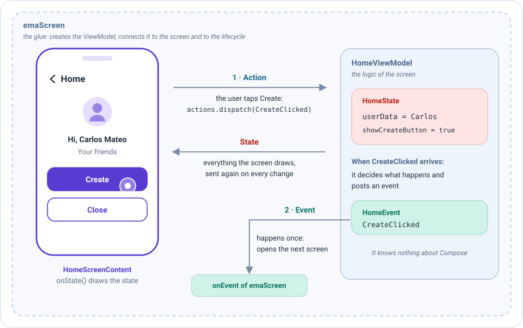
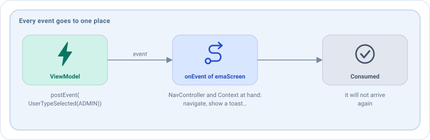
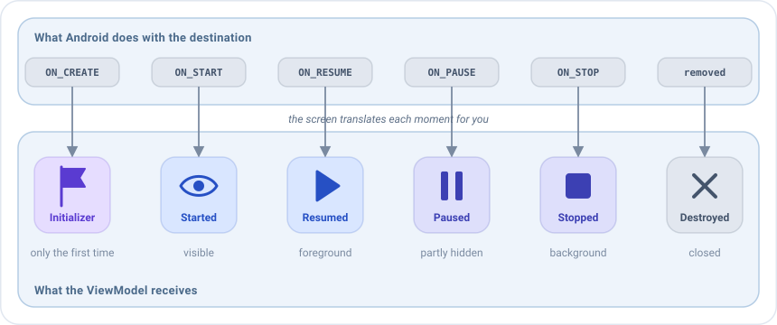
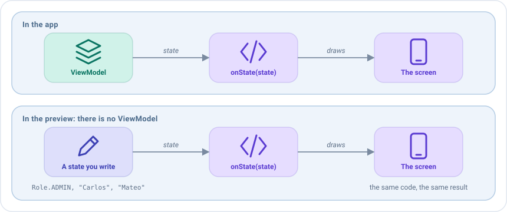

# Compose screens

An Emanate screen splits the work between three pieces, so that each one has a single job:

| Piece | Job | Example |
|-------|-----|---------|
| The **ViewModel** | Holds the [state](../concepts/state.md) and decides what happens when the user does something. It knows nothing about Compose. | `ProfileOnBoardingViewModel` |
| The **screen content** (`EmaScreenContent`) | Draws the state with Compose and reports what the user does. It keeps no data of its own. | `ProfileOnBoardingScreenContent` |
| The **registration** (`emaScreen`) | The glue. It creates the ViewModel, connects it to the content and to the lifecycle, puts the screen in your navigation graph and receives its events. | The `NavHost` block |

The information always travels the same way. In the onboarding screen of the sample, the user says whether they are
an admin or a user:



1. The user taps **Admin**, and the screen content sends the action `AdminClicked`.
2. The ViewModel decides what that means. Whenever its state changes, the screen content draws it again.
3. Here the answer is a one-off: the ViewModel posts the event `UserTypeSelected(ADMIN)`, and the `onEvent` of
   `emaScreen` opens the next screen.

The screen **never changes the state itself**: it only sends [actions](../concepts/actions.md) and draws whatever
state the ViewModel gives it. Because of that, the same content can be shown in a preview, in a test or in a real
app without changes.

This page follows the life of a screen, from writing it to using it. You need the `emanate-android` and
`emanate-compose` artifacts.

## Screen content

This is the part you will write most often: the Compose code of the screen. You create one class that implements
`EmaScreenContent` and fill in `onState`, which receives the current state and draws it. When the user
presses a button, you do not change anything: you send an action with `actions.dispatch(...)`, and the ViewModel
answers with a new state that makes `onState` run again.

```kotlin
class ProfileOnBoardingScreenContent : EmaScreenContent<ProfileOnBoardingState, ProfileOnBoardingActions> {

    @Composable
    override fun onState(
        state: ProfileOnBoardingState,
        actions: EmaActionDispatcher<ProfileOnBoardingActions>
    ) {
        // Draw the state. Send user input with actions.dispatch(...)
    }
}
```

`EmaScreenContent<S, A>` takes the type of the state and the type of the actions, and has two members:

| Member                    | Purpose                                                                                              |
|---------------------------|------------------------------------------------------------------------------------------------------|
| `onState(state, actions)` | **Required.** Draws the state. It is a `@Composable`.                                                |
| `onBack(state): A?`       | The action to send when back is pressed, or `null`. See [Back handling](back-handling.md). Optional. |

The screen content doesn't receive the events: they are handled where the screen is registered, as explained in
[Handling the events](#handling-the-events).

Keep the screen content free of state: it is a stateless description, created once per screen.
Anything that must survive belongs in the [state](../concepts/state.md) of the ViewModel.

## Registering the screen

A screen content on its own is just a description: nothing shows it yet. Registering it means adding it as a
destination of your `NavHost`, as you would with Compose Navigation's `composable(...)`, but with
`emaScreen`, which also creates the ViewModel and wires everything together. This is also where you
decide what happens when the ViewModel sends an event, such as navigating to another screen.

```kotlin
NavHost(
    navController = navController,
    startDestination = ProfileOnBoardingScreenContent::class.routeId
) {
    emaScreen(
        screenContent = ProfileOnBoardingScreenContent(),
        viewModel = { get<ProfileOnBoardingViewModel>() },
        onEvent = { navigator.handleProfileOnBoardingEvent(it) }
    )
}
```

| Parameter              | Purpose                                                                                        |
|------------------------|------------------------------------------------------------------------------------------------|
| `screenContent`        | The screen content.                                                                            |
| `viewModel`            | A lambda that creates the ViewModel. It is called once, when the screen is opened, and receives the `EmaStateStore` of the screen for a [backup](../guides/process-death.md). See [Dependency injection](../guides/dependency-injection.md). |
| `onEvent`              | Receives every event of the screen. See [Handling the events](#handling-the-events).           |
| `routeId`              | The route. By default `ScreenContent::class.routeId`, which is unique per class.               |
| `initializerSupport`   | How to read the [initializer](../guides/initializers.md) from the route. See [Navigation](navigation.md#passing-an-initializer). |
| `transitionAnimation`  | `EmaAnimTransition(enterTransition, exitTransition, popEnterTransition, popExitTransition)`. The pop transitions default to the enter and exit ones. |

The parameters you will use most are the first three. The rest have a default value, so add them only when you need
them. For example, a screen that enters sliding from the right:

```kotlin
emaScreen(
    screenContent = ProfileCreationScreenContent(),
    viewModel = { get<ProfileCreationViewModel>() },
    transitionAnimation = EmaAnimTransition(
        enterTransition = { slideInHorizontally { width -> width } },
        exitTransition = { slideOutHorizontally { width -> width } }
    ),
    onEvent = { navigator.handleProfileCreationEvent(it) }
)
```

### Showing a screen as a dialog

Some screens are shown over the previous one, in a dialog, instead of replacing it. Register them with `emaDialog`
instead of `emaScreen`. Everything else is the same: the screen content, the ViewModel, the events and the
initializer of the route. Only the transitions change, as a dialog has none, for `dialogProperties`, the
`DialogProperties` of Compose:

```kotlin
emaDialog(
    screenContent = FilterScreenContent(),
    viewModel = { get<FilterViewModel>() },
    dialogProperties = DialogProperties(usePlatformDefaultWidth = false),
    onEvent = { navigator.handleFilterEvent(it) }
)
```

You open it like any other screen, with `navController.navigate(FilterScreenContent::class.routeId)`.

> This is a destination of the graph that looks like a dialog. For a small dialog inside a screen, like a confirmation,
> use the state instead: see [Dialogs](dialogs.md).

## Handling the events

An [event](../concepts/events.md) is something that must happen **once**, like showing a toast or opening another
screen, as opposed to the state, which is always there. Every event of the screen arrives at one place: the `onEvent`
lambda of `emaScreen`. After it returns, the event is consumed and it will not arrive again.



`onEvent` is written in the graph, inside your activity or composable, so everything an event may need is at hand:
the `NavController` or the navigator to navigate, and the `Context` to show a toast or open another app.

```kotlin
val context = LocalContext.current

NavHost(navController, startDestination = ProfileCreationScreenContent::class.routeId) {
    emaScreen(
        screenContent = ProfileCreationScreenContent(),
        viewModel = { get<ProfileCreationViewModel>() },
        onEvent = { event ->
            when (event) {
                ProfileCreationEvent.DialogConfirmationAccepted -> navController.navigateBack()
                is ProfileCreationEvent.ProfileSaved ->
                    Toast.makeText(context, "Profile saved", Toast.LENGTH_SHORT).show()
            }
        }
    )
}
```

As every event arrives at the same `when`, the compiler warns you when a new event is not handled. When the `when`
grows, move it to a function of your navigator, as the sample does with `navigator.handleProfileCreationEvent(it)`.

`onEvent` must return quickly: the next events wait for it. Navigating or showing a toast is immediate. For something
that takes time, like a snackbar, launch it in a coroutine scope of yours:

```kotlin
val scope = rememberCoroutineScope()
val snackbarHostState = remember { SnackbarHostState() }

NavHost(navController, startDestination = ProfileCreationScreenContent::class.routeId) {
    emaScreen(
        screenContent = ProfileCreationScreenContent(),
        viewModel = { get<ProfileCreationViewModel>() },
        onEvent = { event ->
            when (event) {
                is ProfileCreationEvent.ProfileSaved -> scope.launch { snackbarHostState.showSnackbar("Saved") }
                ProfileCreationEvent.DialogConfirmationAccepted -> navController.navigateBack()
            }
        }
    )
}
```

## Lifecycle

A screen goes through moments: it is created, it appears, the user leaves to another app, it comes back, it is
destroyed. The ViewModel often needs to know, for example to load data when the screen appears or to stop listening
to something when it is paused. You do not have to observe the lifecycle yourself: the screen does it and passes
each moment on to the ViewModel.



The screen connects the ViewModel to the lifecycle of its destination:

| Lifecycle event                   | The ViewModel receives                          |
|-----------------------------------|-------------------------------------------------|
| `ON_CREATE`, the first time       | The `EmaInitializer` of the screen              |
| `ON_START`                        | `EmaLifecycle.Started`                          |
| `ON_RESUME`                       | `EmaLifecycle.Resumed`                          |
| `ON_PAUSE`                        | `EmaLifecycle.Paused`                           |
| `ON_STOP`                         | `EmaLifecycle.Stopped`                          |
| The screen leaves the composition | `EmaLifecycle.Paused` and `EmaLifecycle.Stopped` |
| The destination is removed        | `EmaLifecycle.Destroyed`, and it is closed      |

The state is collected with `collectAsStateWithLifecycle` and the events while the lifecycle is `STARTED`.

## Previews

The `@Preview` of Android Studio draws a composable without running the app, which makes designing the UI much faster.
But a preview cannot create a real ViewModel, so you give it a state by hand and see how the screen looks with it.
Writing one preview per interesting state (empty, loading, error...) is a cheap way to check them all.



Inside the IDE preview there is no ViewModel, so call `onState` directly with a state and an empty dispatcher:

```kotlin
@Preview
@Composable
private fun NormalPreview() {
    EmaSampleTheme {
        ProfileCreationScreenContent().onState(
            state = ProfileCreationState(Role.ADMIN, "Carlos", "Mateo"),
            actions = EmaActionDispatcher.EMPTY
        )
    }
}
```

## Using a screen without a navigation graph

Not every app uses Navigation Compose, and sometimes you only want an Emanate screen as a **part** of another
screen, such as a small counter inside a bigger layout. For those cases you can skip the graph and place the screen
as any other composable.

`EmaScreen` is the composable behind `emaScreen`. Use it to place an Emanate screen anywhere:

```kotlin
EmaScreen(
    vm = { CounterViewModel() },
    screenContent = CounterScreenContent(),
    onEvent = { /* ... */ }
)
```

It accepts the `initializer` and a `previewRenderState`: when a preview draws a composable that contains the screen,
the ViewModel is not created and the screen draws that state. Another overload receives a ViewModel instance and its
action dispatcher, for ViewModels created and kept by you.

## Theme

The screen content draws with whatever theme surrounds it, so it does not set colors or typography itself. You only
need to set the theme once, at the top.

Wrap the `NavHost` (or your content) in your Material theme. The sample uses `EmaSampleTheme`.
