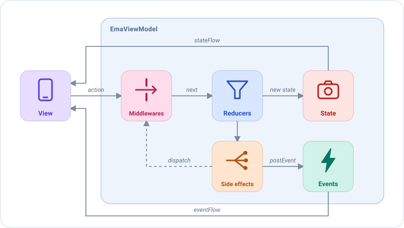

# Arquitectura

Cada pantalla de Emanate se compone de las mismas piezas, y cada acción sigue el mismo camino a través de ellas.

1. La **vista** envía una acción con `dispatch`.
2. Los **middlewares** de su tipo deciden su camino: dejarla continuar, cambiarla, retrasarla o detenerla.
3. Los **reducers** de su tipo devuelven el siguiente estado, que la vista pinta.
4. Los **side effects** de su tipo ejecutan la lógica de negocio de forma asíncrona. Comunican el resultado enviando
   nuevas acciones, que siguen el mismo camino, o publicando eventos.
5. La vista gestiona cada **evento** una vez, por ejemplo para navegar o mostrar un mensaje.

| Pieza          | Responsabilidad                                                                | ¿Depende de la plataforma? |
|----------------|--------------------------------------------------------------------------------|----------------------------|
| `EmaState`     | Cómo se ve la pantalla ahora mismo.                                            | No                         |
| `EmaAction`    | Lo que ha hecho el usuario, o el resultado de algún trabajo.                   | No                         |
| `EmaEvent`     | Lo que ha ocurrido y debe gestionarse una vez.                                 | No                         |
| `EmaViewModel` | Gestiona cada acción con sus middlewares, reducers y side effects.             | No                         |
| Vista          | Pinta el estado, gestiona los eventos y envía acciones.                        | Sí                         |

## Las reglas

1. **La vista solo pinta y notifica.** Pinta el estado y envía acciones. Nunca cambia el estado ni contiene lógica de
   negocio.
2. **El estado solo cambia en los reducers.** Son funciones puras: el estado se reemplaza, nunca se muta.
3. **La lógica de negocio vive en los side effects.** Llaman a casos de uso y responden con acciones, de modo que cada
   cambio del estado es visible como una acción.
4. **Lo que dura pertenece al estado; lo que ocurre una vez pertenece a un evento.**
   Un indicador de carga o un error de validación es estado. Un snackbar o una navegación es un evento.
5. **Los eventos describen lo que ha pasado, no lo que hay que hacer.** Llámalos `FriendSelected`, no `OpenProfile`.
   El receptor decide la reacción: el mismo evento podría abrir una pantalla en un móvil y actualizar un panel en una
   tablet.
6. **Los repositorios solo se acceden a través de casos de uso** (una recomendación, mira
   [Recomendaciones](../recommendations.md)).

## ¿Estado o evento?

Esta es la pregunta que más te harás al construir una funcionalidad.

| Pregunta                                                           | Si sí → |
|--------------------------------------------------------------------|---------|
| ¿Debería seguir ahí después de recrear la pantalla?                | Estado  |
| ¿Debería mostrarse de nuevo si el usuario vuelve a la pantalla?    | Estado  |
| ¿Es un hecho sobre algo que acaba de ocurrir?                      | Evento  |
| ¿Mostrarlo dos veces sería un fallo (toast, navegación)?           | Evento  |

Ejemplos de una pantalla de inicio:

| Qué                                          | Dónde                                  |
|----------------------------------------------|----------------------------------------|
| La consulta escrita en el campo de búsqueda  | Estado (`HomeState.query`)             |
| El indicador de carga de la lista            | Estado (`HomeState.isLoading`)         |
| El diálogo "No se pudieron cargar los amigos"| Estado (`HomeState.dialog`)            |
| El mensaje "12 amigos"                       | Evento (`HomeEvent.FriendsUpdated`)    |
| Abrir el perfil de un amigo                  | Evento (`HomeEvent.FriendSelected`)    |
