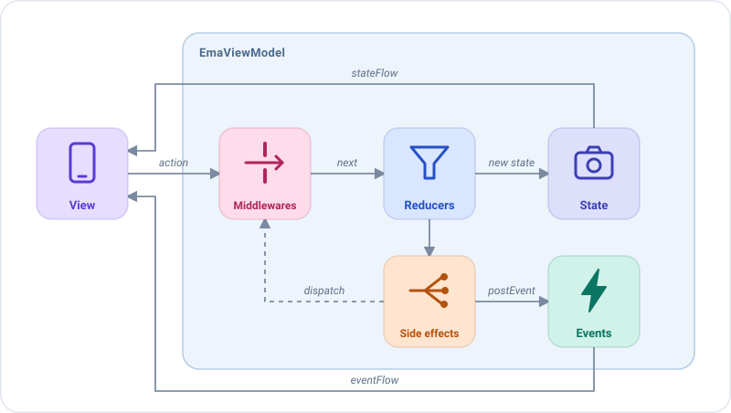
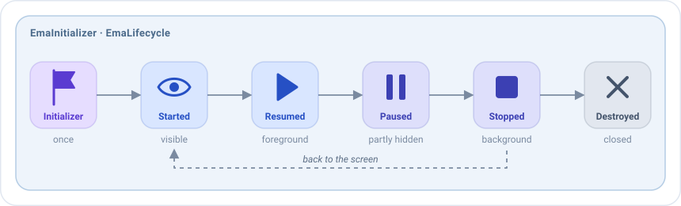

# Architecture

Every Emanate screen is made of the same pieces, and every action follows the same path through them.

1. The **view** sends an action with `dispatch`.
2. The **middlewares** of its type decide its path: let it continue, change it, delay it or stop it.
3. The **reducers** of its type return the next state, which the view renders.
4. The **side effects** of its type run the business logic asynchronously. They report the result by dispatching new
   actions, which go through the same path, or by posting events.
5. The view handles each **event** once, for example to navigate or show a message.

| Piece         | Responsibility                                                                 | Depends on the platform? |
|---------------|--------------------------------------------------------------------------------|--------------------------|
| `EmaState`    | What the screen looks like right now.                                          | No                       |
| `EmaAction`   | What the user did, or the result of some work.                                 | No                       |
| `EmaEvent`    | What happened and must be handled once.                                        | No                       |
| `EmaViewModel`| Handles each action with its middlewares, reducers and side effects.           | No                       |
| View          | Renders the state, handles events and sends actions.                           | Yes                      |

## The rules

1. **The view only renders and reports.** It renders the state and sends actions. It never changes the state or holds
   business logic.
2. **The state only changes in the reducers.** They are pure functions: the state is replaced, never mutated.
3. **The business logic lives in the side effects.** They call use cases and report back with actions, so every change
   of the state is visible as an action.
4. **Anything that lasts belongs in the state; anything that happens once belongs in an event.**
   A loading spinner or a validation error is state. A snackbar or a navigation is an event.
5. **Events describe what happened, not what to do.** Name them `FriendSelected`, not `OpenProfile`.
   The receiver decides the reaction: the same event could open a screen on a phone and update a pane on a tablet.
6. **Repositories are only accessed through use cases** (a recommendation, see [Recommendations](../recommendations.md)).

## State or event?

This is the question you will ask most often when building a feature.

| Question                                                  | If yes → |
|-----------------------------------------------------------|----------|
| Should it still be there after the screen is recreated?   | State    |
| Should it show again if the user comes back to the screen?| State    |
| Is it a fact about something that just happened?          | Event    |
| Would showing it twice be a bug (toast, navigation)?      | Event    |

Examples from a home screen:

| What                                   | Where                                  |
|----------------------------------------|----------------------------------------|
| The query typed in the search field    | State (`HomeState.query`)              |
| The loading indicator of the list      | State (`HomeState.isLoading`)          |
| "The friends couldn't be loaded" dialog| State (`HomeState.dialog`)            |
| "12 friends" message                   | Event (`HomeEvent.FriendsUpdated`)     |
| Opening the profile of a friend        | Event (`HomeEvent.FriendSelected`)     |

## Lifecycle at a glance

The lifecycle of the screen reaches the ViewModel as **actions**, so the same middlewares, reducers and side effects
that handle the user handle the lifecycle too.

The initializer arrives **once**, the first time the screen is created, so recreating the screen doesn't load the data again.
The details are in [ViewModel](viewmodel.md#the-lifecycle-as-actions).
