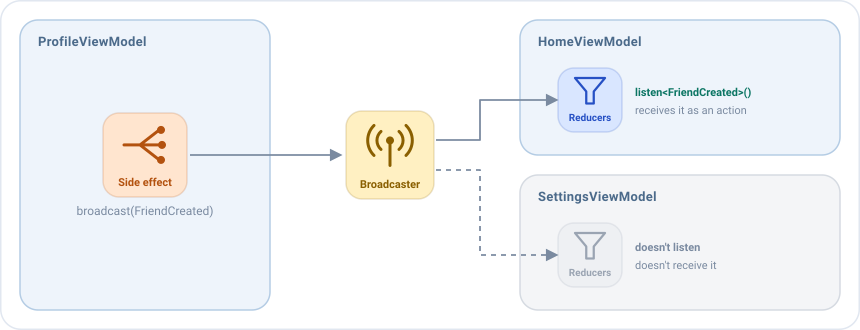

# Broadcasts

Un broadcast **envía una acción de una pantalla a otras pantallas**. El caso típico es un resultado.

Imagina una app con una pantalla **Home** que muestra una lista de amigos, y un botón que abre una pantalla **Profile**,
con un formulario para crear un amigo nuevo. Cuando el usuario guarda el formulario, la pantalla Profile se cierra y la
lista de Home, que esperaba detrás, debe mostrar al nuevo amigo.

La pantalla Profile no conoce la pantalla Home, y no debería. Solo anuncia lo que ha pasado ("se ha creado un amigo") y
cualquier pantalla interesada reacciona. Ese anuncio es un broadcast.



Cualquier ViewModel que escuche el tipo de la acción la recibe como **una acción más de las suyas**, así que la gestiona
con sus [middlewares](middlewares.md), [reducers](reducers.md) y [side effects](side-effects.md) habituales. No hay
ViewModels compartidos, ni APIs de resultados de la plataforma, ni casts: el resultado es una data class tipada.

## Cuándo usar un broadcast

Un ViewModel nunca guarda una referencia a otro, así que un broadcast es la forma de comunicar **ViewModels que no están
enlazados directamente**: el que envía no sabe quién recibe, y el que recibe no sabe quién envió.

| Quieres...                                                       | Usa                                              |
|------------------------------------------------------------------|--------------------------------------------------|
| Enviar un resultado o una notificación a otras pantallas         | Un broadcast                                     |
| Decirle a la vista de la misma pantalla que haga algo una vez    | Un [evento](events.md)                           |

## En cuatro pasos

**1. Declara la acción**, junto a las acciones de la pantalla que la envía:

```kotlin
sealed interface ProfileBroadcast : EmaAction {
    data class FriendCreated(val friend: User) : ProfileBroadcast
}
```

**2. Envíala** desde un side effect del emisor, con `broadcast`:

```kotlin
// ProfileViewModel
sideEffects {
    add<ProfileAction.SaveClicked> {
        broadcast(ProfileBroadcast.FriendCreated(state.friend))
        publish(ProfileEvent.Saved)  // El navigator cierra la pantalla
    }
}
```

**3. Escucha su tipo** en el bloque `broadcasts` del receptor:

```kotlin
// HomeViewModel
override fun setup() = source {
    broadcasts {
        listen<ProfileBroadcast.FriendCreated>()
    }
    // ...
}
```

**4. Gestiónala** como cualquier otra acción:

```kotlin
// HomeViewModel
reducers {
    add<ProfileBroadcast.FriendCreated> { action -> state.copy(friends = state.friends + action.friend) }
}
sideEffects {
    add<ProfileBroadcast.FriendCreated> { action -> publish(HomeEvent.FriendAdded(action.friend)) }
}
```

!!! warning "No olvides escuchar el broadcast"
    Sin `listen<Tipo>()`, el receptor nunca recibe la acción, y nada falla: ni error ni log. La pantalla simplemente no
    se actualiza.

## Cómo se entrega

- **Al instante**, a todos los ViewModels que escuchan el tipo en ese momento. Los ViewModels de las pantallas
  anteriores están vivos en la pila de navegación, así que la reciben.
- **A cualquier número de receptores.** Todos los ViewModels que escuchan el tipo reciben la acción.
- **Solo mientras existe el receptor.** Su listener se elimina cuando se cierra, junto con el resto de su trabajo.
- **En memoria.** No se guarda si se mata el proceso.
- **Se pierde si nadie escucha**, a menos que se conserve. Mira más abajo.

## Conservarlo hasta que se reciba

Con `keepUntilReceived = true`, una acción que nadie está escuchando se conserva y se entrega al **primer** ViewModel que
escuche su tipo. Solo se conserva la última de cada clase. Si alguien escucha, se entrega al instante, como siempre.

```kotlin
broadcast(ProfileBroadcast.FriendCreated(state.friend), keepUntilReceived = true)
```

Cubre una pantalla que aún no existe. Por ejemplo, cuando el sistema mata la app en segundo plano, restaura solo la
pantalla actual: el ViewModel de la anterior se crea cuando el usuario vuelve a ella. Sin conservar el resultado, se
perdería.

## Quién puede recibirlo

Las acciones pasan por el `broadcaster` de la [configuración](../guides/configuration.md). Por defecto todos los
ViewModels de la app comparten el mismo. Una librería construida con Emanate puede dar a sus ViewModels su propio
broadcaster, para que solo hablen entre ellos. Mira [Librerías y SDKs](../guides/configuration.md#librerías-y-sdks).
