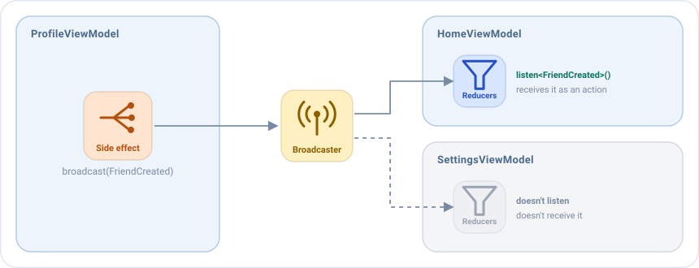

# Broadcasts

A broadcast **sends an action from one screen to other screens**. The typical case is a result.

Imagine an app with a **Home** screen that shows a list of friends, and a button that opens a **Profile** screen, with
a form to create a new friend. When the user saves the form, the Profile screen closes and the list of the Home
screen, which was waiting behind it, must show the new friend.

The Profile screen doesn't know the Home screen, and it shouldn't. It only announces what happened ("a friend was
created") and any screen that is interested reacts to it. That announcement is a broadcast.



Any ViewModel that listens to the type of the action receives it as **one more action of its own**, so it handles it
with its usual [middlewares](middlewares.md), [reducers](reducers.md) and [side effects](side-effects.md). There are no
shared ViewModels, no result APIs of the platform and no casts: the result is a typed data class.

## When to use a broadcast

A ViewModel never holds a reference to another one, so a broadcast is the way to communicate **ViewModels that are not
directly linked**: the one that sends doesn't know who receives, and the one that receives doesn't know who sent.

| You want to...                                                   | Use                                              |
|------------------------------------------------------------------|--------------------------------------------------|
| Send a result or a notification to other screens                 | A broadcast                                      |
| Tell the view of the same screen to do something once            | An [event](events.md)                            |

## In four steps

**1. Declare the action**, next to the actions of the screen that sends it:

```kotlin
sealed interface ProfileBroadcast : EmaAction {
    data class FriendCreated(val friend: User) : ProfileBroadcast
}
```

**2. Send it** from a side effect of the sender, with `broadcast`:

```kotlin
// ProfileViewModel
sideEffects {
    add<ProfileAction.SaveClicked> {
        broadcast(ProfileBroadcast.FriendCreated(state.friend))
        postEvent(ProfileEvent.Saved)  // The navigator closes the screen
    }
}
```

**3. Listen to its type** in the `broadcasts` block of the receiver:

```kotlin
// HomeViewModel
override fun setup() = source {
    broadcasts {
        listen<ProfileBroadcast.FriendCreated>()
    }
    // ...
}
```

**4. Handle it** like any other action:

```kotlin
// HomeViewModel
reducers {
    add<ProfileBroadcast.FriendCreated> { action -> state.copy(friends = state.friends + action.friend) }
}
sideEffects {
    add<ProfileBroadcast.FriendCreated> { action -> postEvent(HomeEvent.FriendAdded(action.friend)) }
}
```

!!! warning "Don't forget to listen to the broadcast"
    Without `listen<Type>()`, the receiver never gets the action, and nothing fails: no error, no log. The screen just
    doesn't update.

## How it is delivered

- **At once**, to every ViewModel that listens to the type at that moment. The ViewModels of the previous screens are
  alive in the back stack, so they receive it.
- **To any number of receivers.** Every ViewModel that listens to the type receives the action.
- **Only while the receiver exists.** Its listener is removed when it is closed, with the rest of its work.
- **In memory.** It is not saved if the process is killed.
- **Lost if nobody listens**, unless it is kept. See below.

## Keeping it until it is received

With `keepUntilReceived = true`, an action that nobody is listening to is kept and delivered to the **first** ViewModel
that listens to its type. Only the last one of each class is kept. If someone is listening, it is delivered at once, as
usual.

```kotlin
broadcast(ProfileBroadcast.FriendCreated(state.friend), keepUntilReceived = true)
```

It covers a screen that doesn't exist yet. For example, when the system kills the app in the background, it restores
only the current screen: the ViewModel of the previous one is created when the user goes back to it. Without keeping
the result, it would be lost.

## Who can receive it

The actions go through the `broadcaster` of the [configuration](../guides/configuration.md). By default every
ViewModel of the app shares the same one. A library built with Emanate can give its ViewModels their own broadcaster,
so they only talk to each other. See [Libraries and SDKs](../guides/configuration.md#libraries-and-sdks).
