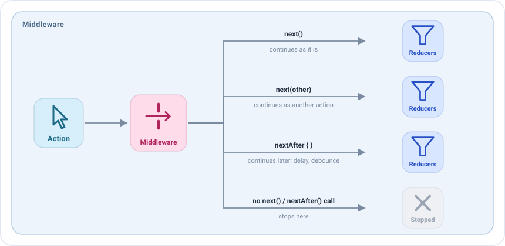

# Middlewares

Un middleware es un **punto de control**: ve una acción antes que los [reducers](reducers.md) y los
[side effects](side-effects.md), y decide qué pasa con ella.



| En el middleware    | Efecto                                                                            |
|---------------------|-----------------------------------------------------------------------------------|
| `next()`            | Continúa tal cual, hacia el siguiente middleware y luego hacia los reducers.      |
| `next(other)`       | Se sustituye: continúa `other` en su lugar.                                       |
| `nextAfter { }`     | Continúa más tarde, cuando termina el bloque. Mientras tanto la pantalla sigue funcionando. |
| No llama a `next`   | Se detiene aquí. Los reducers y los side effects nunca la ven.                    |
| `state`             | El estado actual de la pantalla, que se puede leer antes y después de `next()`.   |
| `dispatch(action)`  | Envía una nueva acción.                                                           |

La mayoría de pantallas no necesitan middlewares. Brillan en cosas que se aplican a muchas acciones y que la lógica de
negocio no debería conocer: analíticas, logs, debounce, feature flags, latencia simulada en una build de test...

## Tu primer middleware

Los middlewares se declaran en el bloque `middlewares` del `setup`, para un tipo de acción. Este registra cada acción de
la pantalla y la deja continuar:

```kotlin
middlewares {
    add<HomeAction> { action ->
        println("El usuario ha hecho $action")
        next()
    }
}
```

!!! warning "Acuérdate de llamar a next, solo una vez"
    Si lo olvidas, la acción se detiene ahí y la pantalla parece ignorarla. Si lo llamas dos veces, la app falla con un
    error, porque una acción solo puede continuar una vez.

## Detener una acción

No llamar a `next` detiene la acción. Por ejemplo, para ignorar los toques en una funcionalidad desactivada:

```kotlin
middlewares {
    add<HomeAction.FriendClicked> {
        if (featureFlags.profilesEnabled) next()
    }
}
```

## Sustituir una acción

`next(other)` deja continuar otra acción en lugar de la recibida:

```kotlin
middlewares {
    // Una consulta en blanco equivale a limpiar la búsqueda
    add<HomeAction.QueryWritten> { action ->
        if (action.query.isBlank()) next(HomeAction.SearchCleared) else next()
    }
}
```

## Esperar: retrasos y debounce

`nextAfter` deja continuar la acción cuando termina su bloque, sin bloquear la pantalla. Dentro del bloque, `stop()`
descarta la acción.

Con un `id`, un nuevo `nextAfter` con el mismo id cancela el que sigue esperando. Eso es un **debounce**: mientras el
usuario sigue escribiendo, solo continúa la última consulta.

```kotlin
middlewares {
    add<HomeAction.QueryWritten> { action ->
        nextAfter(id = "search") {
            delay(300)
            if (action.query.length < 2) stop()
        }
    }
}
```

Para un retraso fijo, `middlewareDelayOf` crea el middleware por ti:

```kotlin
middlewares {
    // Cada refresco espera dos segundos.
    // Puede ser útil, por ejemplo, para ver el estado de carga en una build de test
    add(middlewareDelayOf(HomeAction.RefreshRequested::class, 2.seconds))
}
```

`nextAfter` también acepta un `timeout`: si el bloque no termina a tiempo, se cancela, la acción no continúa y se
ejecuta `onTimeout` en su lugar. En este ejemplo, un refresco que tarda más de un segundo se comunica como un fallo:

```kotlin
middlewares {
    add<HomeAction.RefreshRequested> {
        nextAfter(
            timeout = 1.seconds,
            onTimeout = { dispatch(HomeAction.EffectQueryResult.Failed) }
        ) {
            // Una tarea que tarda más de 1 segundo
        }
    }
}
```

## Leer el estado

Un middleware puede leer el estado de la pantalla con `state`, antes y después de llamar a `next()`. No puede
cambiarlo: el estado solo cambia en los reducers. Para cambiarlo, el middleware envía una acción.

**Antes de `next()`**, `state` es el estado con el que se encuentra la acción, antes de que los reducers la apliquen.
Úsalo para decidir el camino de la acción. Por ejemplo, ignorar los toques en un amigo mientras hay un diálogo abierto:

```kotlin
middlewares {
    add<HomeAction.FriendClicked> {
        if (state.dialog == null) next()
    }
}
```

**Después de `next()`**, `state` es el nuevo estado: cuando `next()` devuelve el control, el resto de middlewares y los
reducers ya se han ejecutado. Úsalo para ver qué ha cambiado la acción. Este middleware registra solo las acciones que
cambiaron el estado:

```kotlin
middlewares(MiddlewarePosition.Last) {
    add<HomeAction> { action ->
        val before = state
        next()
        if (state != before) println("$action ha cambiado el estado a $state")
    }
}
```

!!! note
    Después de `next()`, el estado es el nuevo solo si ningún middleware posterior a este retrasa la acción con
    `nextAfter` o la detiene. Con `MiddlewarePosition.Last` no puede haber nada en medio, así que siempre es el nuevo
    estado.

**Mientras espera**, el bloque de `nextAfter` también puede leer `state`: es el estado en el momento en que se lee,
después de la espera, que puede ser distinto del que encontró la acción. Este ejemplo espera un momento y solo continúa
si no se ha abierto ningún diálogo mientras tanto:

```kotlin
middlewares {
    add<HomeAction.QueryWritten> { action ->
        nextAfter(id = "search") {
            delay(300)
            if (state.dialog != null) stop()
        }
    }
}
```

## Dónde se ejecuta un middleware

Por defecto los middlewares se ejecutan en el orden en que están escritos. Un bloque puede colocar sus middlewares antes
o después del resto, esté donde esté escrito:

| `MiddlewarePosition` | Se ejecuta                                 | Úsalo para                                                        |
|----------------------|--------------------------------------------|-------------------------------------------------------------------|
| `First`              | Antes que el resto                         | Decidir primero el camino de cada acción: una comprobación de sesión, un feature flag. |
| `InPlace` (por defecto) | Donde está escrito el bloque            | Los middlewares de la pantalla.                                   |
| `Last`               | Después del resto, justo antes de los reducers | Observar el nuevo estado: cuando `next()` devuelve el control, los reducers ya se han ejecutado. |

Por ejemplo, este middleware se ejecuta antes que todos los demás y comprueba la sesión del usuario. Si la sesión está
activa, la acción continúa como siempre; si no, no se llama a `next()`, así que la acción se detiene y ninguna pieza de
la pantalla la ve:

```kotlin
middlewares(MiddlewarePosition.First) {
    add<HomeAction> { if (session.isActive) next() }
}
```

La posición es especialmente útil al escribir [plugins](plugins.md). Un plugin se instala en muchas pantallas, así que no
puede depender de dónde está escrito: con `First` ve cada acción antes que las piezas de la pantalla, como la
comprobación de sesión anterior, y con `Last` ve el nuevo estado tras los reducers, como el backup del estado.

## Las reglas

- **Llama a `next` una vez**, ahora o más tarde con `nextAfter`.
- **No publiques eventos.** Para decirle algo a la vista, envía una acción con `dispatch(action)` y deja que un side
  effect publique el evento.
- **Mantén la lógica de negocio en los side effects.** Un middleware decide el camino de la acción; el trabajo que
  inicia pertenece a un side effect.

## Middlewares como valores

Un middleware también se puede crear con `middlewareOf` o `middlewareDelayOf`, en lugar de escribirlo en línea.
Así se implementaría un middleware como valor:

```kotlin
class HomeViewModel : EmaViewModel<HomeState, HomeAction, HomeEvent>(HomeState()) {

    private val blankQueryAsClear = middlewareOf(HomeAction.QueryWritten::class) { action ->
        if (action.query.isBlank()) next(HomeAction.SearchCleared) else next()
    }

    override fun setup() = source {
        middlewares { add(blankQueryAsClear) }
        // ...
    }
}
```

También se podría recibir en el constructor, de modo que una build de QA pueda añadir latencia a la pantalla sin
tocarla:

```kotlin
class HomeViewModel(
    private val tuning: List<EmaMiddleware<HomeState, HomeAction, *>> = emptyList()
) : EmaViewModel<HomeState, HomeAction, HomeEvent>(HomeState()) {

    override fun setup() = source {
        middlewares(MiddlewarePosition.First) { tuning.forEach { add(it) } }
        // ...
    }
}
```

Mira [Inyección de dependencias y entornos](../guides/dependency-injection.md#qué-puede-cambiar-un-entorno).
