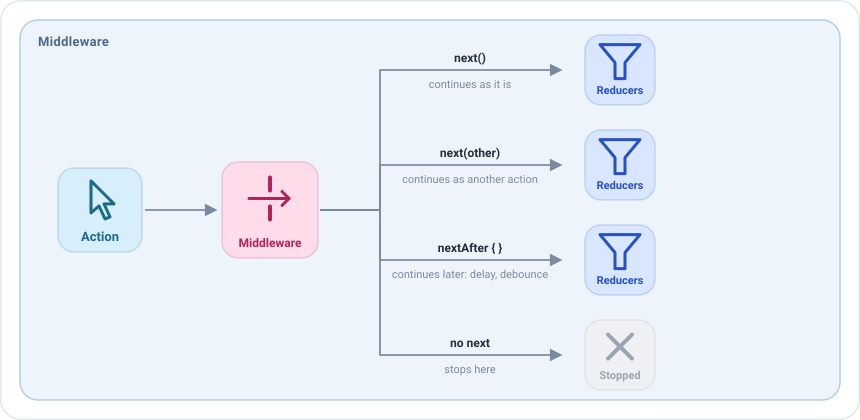

# Middlewares

A middleware is a **checkpoint**: it sees an action before the [reducers](reducers.md) and the
[side effects](side-effects.md), and decides what happens to it.



| In the middleware   | Effect                                                                            |
|---------------------|-----------------------------------------------------------------------------------|
| `next()`            | Continues as it is, to the next middleware and then to the reducers.              |
| `next(other)`       | Is replaced: `other` continues instead.                                           |
| `nextAfter { }`     | Continues later, when the block finishes. The screen keeps working meanwhile.     |
| Doesn't call `next` | Stops here. The reducers and the side effects never see it.                       |
| `state`             | The current state of the screen, readable before and after `next()`.              |
| `dispatch(action)`  | Dispatches a new action.                                                          |

Most screens don't need middlewares. They shine for things that apply to many actions and that the business logic
shouldn't know: analytics, logs, debounce, feature flags, simulated latency in a test build...

## Your first middleware

Middlewares are declared in the `middlewares` block of the `setup`, for a type of action. This one logs every action of
the screen and lets it continue:

```kotlin
middlewares {
    add<HomeAction> { action ->
        println("The user did $action")
        next()
    }
}
```

!!! warning "Remember call next, only once"
    If you forget it, the action stops there and the screen seems to ignore it. If you call it twice, the app fails
    with an error, because an action can only continue once.

## Stopping an action

Not calling `next` stops the action. For example, to ignore taps on a feature that is disabled:

```kotlin
middlewares {
    add<HomeAction.FriendClicked> {
        if (featureFlags.profilesEnabled) next()
    }
}
```

## Replacing an action

`next(other)` lets another action continue instead of the received one:

```kotlin
middlewares {
    // A blank query is the same as clearing the search
    add<HomeAction.QueryWritten> { action ->
        if (action.query.isBlank()) next(HomeAction.SearchCleared) else next()
    }
}
```

## Waiting: delays and debounce

`nextAfter` lets the action continue when its block finishes, without blocking the screen. Inside the block, `stop()`
discards the action.

With an `id`, a new `nextAfter` with the same id cancels the one that is still waiting. That is a **debounce**: while
the user keeps typing, only the last query continues.

```kotlin
middlewares {
    add<HomeAction.QueryWritten> { action ->
        nextAfter(id = "search") {
            delay(300)
            if (action.query.length < 2) stop()
        }
    }
}
```

For a fixed delay, `middlewareDelayOf` creates the middleware for you:

```kotlin
middlewares {
    // Every refresh waits two seconds.
    // This can be useful, for example, to see the loading state in a test build
    +middlewareDelayOf(HomeAction.RefreshRequested::class, 2.seconds)
}
```

`nextAfter` also accepts a `timeout`: if the block doesn't finish in time, the block is cancelled, the action doesn't
continue, and `onTimeout` runs instead. In this example, a refresh that takes more than one second is reported as a
failure:

```kotlin
middlewares {
    add<HomeAction.RefreshRequested> {
        nextAfter(
            timeout = 1.seconds,
            onTimeout = { dispatch(HomeAction.EffectQueryResult.Failed) }
        ) {
            // A task that takes more than 1 second
        }
    }
}
```

## Reading the state

A middleware can read the state of the screen with `state`, before and after calling `next()`. It can't change it:
the state only changes in the reducers. To change it, the middleware dispatches an action.

**Before `next()`**, `state` is the state the action finds, before the reducers apply it. Use it to decide the path of
the action. For example, ignore the taps on a friend while a dialog is open:

```kotlin
middlewares {
    add<HomeAction.FriendClicked> {
        if (state.dialog == null) next()
    }
}
```

**After `next()`**, `state` is the new state: when `next()` returns, the rest of the middlewares and the reducers have
run. Use it to see what the action changed. This middleware logs only the actions that changed the state:

```kotlin
middlewares(MiddlewarePosition.Last) {
    add<HomeAction> { action ->
        val before = state
        next()
        if (state != before) println("$action changed the state to $state")
    }
}
```

!!! note
    After `next()`, the state is the new one only if no middleware after this one delays the action with `nextAfter` or
    stops it. With `MiddlewarePosition.Last` nothing can be in between, so it is always the new state.

**While waiting**, the block of `nextAfter` can also read `state`: it is the state at the moment it is read, after the
wait, which can be different from the one the action found. This example waits a moment and only continues if no dialog
has been opened meanwhile:

```kotlin
middlewares {
    add<HomeAction.QueryWritten> { action ->
        nextAfter(id = "search") {
            delay(300)
            if (state.dialog != null) stop()
        }
    }
}
```

## Where a middleware runs

By default the middlewares run in the order they are written. A block can place its middlewares before or after the
rest, wherever it is written:

| `MiddlewarePosition` | Runs                                       | Use it for                                                        |
|----------------------|--------------------------------------------|-------------------------------------------------------------------|
| `First`              | Before the rest                            | Deciding the path of every action first: a session check, a feature flag. |
| `InPlace` (default)  | Where the block is written                 | The middlewares of the screen.                                    |
| `Last`               | After the rest, right before the reducers  | Observing the new state: when `next()` returns, the reducers have run. |

For example, this middleware runs before all the others and checks the session of the user. If the session is active,
the action continues as usual; otherwise `next()` is not called, so the action stops and none of the pieces of the
screen see it:

```kotlin
middlewares(MiddlewarePosition.First) {
    add<HomeAction> { if (session.isActive) next() }
}
```

The position is especially useful when you write [plugins](plugins.md). A plugin is installed in many screens, so it
can't depend on where it is written: with `First` it sees every action before the pieces of the screen, like the
session check above, and with `Last` it sees the new state after the reducers, like the backup of the state.

## The rules

- **Call `next` once**, now or later with `nextAfter`.
- **Don't post events.** To tell the view something, dispatch an action with `dispatch(action)` and let a side effect
  post the event.
- **Keep the business logic in the side effects.** A middleware decides the path of the action; the work it starts
  belongs to a side effect.

## Middlewares as values

A middleware can also be created with `middlewareOf` or `middlewareDelayOf`, instead of being written inline.
This would be how a middleware is implemented as value:

```kotlin
class HomeViewModel : EmaViewModel<HomeState, HomeAction, HomeEvent>(HomeState()) {

    private val blankQueryAsClear = middlewareOf(HomeAction.QueryWritten::class) { action ->
        if (action.query.isBlank()) next(HomeAction.SearchCleared) else next()
    }

    override fun setup() = source {
        middlewares { +blankQueryAsClear }
        // ...
    }
}
```

It could also be received in the constructor, so a QA build could add latency to the screen without touching it:

```kotlin
class HomeViewModel(
    private val tuning: List<EmaMiddleware<HomeState, HomeAction, *>> = emptyList()
) : EmaViewModel<HomeState, HomeAction, HomeEvent>(HomeState()) {

    override fun setup() = source {
        middlewares(MiddlewarePosition.First) { tuning.forEach { +it } }
        // ...
    }
}
```

See [Dependency injection and environments](../guides/dependency-injection.md#what-an-environment-can-change).
