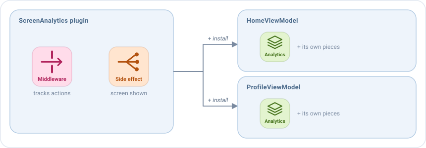

# Plugins

Un plugin es un **setup reutilizable**: agrupa un conjunto de middlewares, reducers, side effects y listeners de
broadcast que trabajan juntos, y cualquier pantalla los instala todos en una línea.



Usa un plugin para una funcionalidad que necesitan muchas pantallas, pero que nada tiene que ver con lo que hace cada
una: analíticas, una comprobación de sesión, un feature flag, el [backup del estado](../guides/process-death.md)... Sin
plugins, ese código se copia en cada ViewModel, o se esconde en una clase base que toda pantalla debe extender.

## Instalar un plugin

Los plugins se instalan en el bloque `plugins` del `setup`, con `add`:

```kotlin
override fun setup() = source {
    plugins {
        add(ScreenAnalytics<HomeState>(tracker, screen = "Home"))
    }
    reducers { /* ... */ }
}
```

Sus piezas se añaden al setup de la pantalla, donde está escrito el bloque `plugins`, y trabajan junto con las piezas de
la pantalla.

## Escribir un plugin

Un plugin implementa `EmaSourcePlugin` y añade sus piezas en `install`, con los mismos bloques que `setup`. Este
registra cada acción de la pantalla y cuándo se muestra la pantalla:

```kotlin
class ScreenAnalytics<S : EmaState>(private val tracker: Tracker, private val screen: String) :
    EmaSourcePlugin<S, Nothing> {

    override fun install(setup: SourceSetupScope<S, Nothing, Nothing>) {
        // Un middleware ve cada acción de la pantalla antes que los reducers
        setup.middlewares {
            add<EmaAction> { action ->
                tracker.track(screen, action::class.simpleName.orEmpty())
                next()
            }
        }
        // Un side effect reacciona al ciclo de vida de la pantalla
        setup.sideEffects {
            add<EmaLifecycle.Resumed> { tracker.screenShown(screen) }
        }
    }
}
```

- **Lo que necesita, lo recibe en el constructor**, como el `tracker`. No se puede instalar sin ello.
- **`S` es el estado** de las pantallas donde se puede instalar. Una `S` genérica, como aquí, sirve en cualquier
  pantalla; escríbela al instalarlo: `ScreenAnalytics<HomeState>(...)`.
- **El segundo tipo es el tipo de las acciones que envía el plugin.** `Nothing` significa que no envía ninguna.

## Un plugin con sus propias acciones

Un plugin no puede publicar eventos, porque los eventos pertenecen a cada pantalla. Para decirle algo a la pantalla,
envía acciones, y la pantalla decide qué hacer con ellas. Las acciones que puede enviar son el segundo tipo del plugin.
Normalmente son acciones que define el propio plugin, como la de abajo, para que funcione en cualquier pantalla. Un
plugin escrito para una pantalla concreta también podría usar las acciones de esa pantalla como segundo tipo, pero
entonces solo funciona ahí.

Este plugin detiene las acciones del usuario cuando la sesión ha caducado, y se lo comunica a la pantalla con
`SessionAction.Expired`:

```kotlin
sealed interface SessionAction : EmaAction {
    data object Expired : SessionAction
}

class SessionGuard<S : EmaState>(private val session: Session) : EmaSourcePlugin<S, SessionAction> {

    override fun install(setup: SourceSetupScope<S, SessionAction, Nothing>) {
        setup.middlewares(MiddlewarePosition.First) {
            add<EmaAction> { action ->
                // El ciclo de vida y las acciones del plugin siempre continúan
                if (action is EmaLifecycle || action is SessionAction || session.isActive) {
                    next()
                } else {
                    dispatch(SessionAction.Expired)
                }
            }
        }
    }
}
```

La pantalla lo instala y reacciona a su acción como a cualquier otra:

```kotlin
override fun setup() = source {
    plugins {
        add(SessionGuard<HomeState>(session))
    }
    sideEffects {
        add<SessionAction.Expired> { publish(HomeEvent.SessionExpired) }
    }
}
```

## Dónde van sus piezas

Las piezas de un plugin se ejecutan en un orden que depende de su tipo.

**Los reducers, side effects y listeners de broadcast** se quedan **donde está escrito el bloque `plugins`**, en orden
con las piezas de la pantalla. Aquí, el plugin tiene un reducer y un side effect:

```kotlin
override fun setup() = source {
    reducers {
        add<HomeAction> { /* reducer 1 */ }
    }
    plugins {
        add(MyPlugin())  // Aquí van su reducer y su side effect
    }
    reducers {
        add<HomeAction> { /* reducer 3 */ }
    }
}
```

Cuando llega una acción, los reducers se ejecutan en este orden: el reducer 1, el del plugin y el reducer 3. Cada uno
recibe el estado que devolvió el anterior. Los side effects se lanzan en el mismo orden.

**Los middlewares** pueden elegir una posición, esté donde esté instalado el plugin: `MiddlewarePosition.First` para ver
cada acción antes que nada, como el `SessionGuard`, o `Last` para ver el nuevo estado de cada acción, como el backup.
Mira [Dónde se ejecuta un middleware](middlewares.md#dónde-se-ejecuta-un-middleware). Aquí, los plugins están escritos
después del middleware de la pantalla:

```kotlin
override fun setup() = source {
    middlewares {
        add<HomeAction> { /* middleware de la pantalla */ }
    }
    plugins {
        add(SessionGuard<HomeState>(session))  // Su middleware es First
        add(backup)                            // Su middleware es Last
    }
}
```

Cuando llega una acción, los middlewares se ejecutan en este orden: el de `SessionGuard` (`First`), el de la pantalla y
el del backup (`Last`). Después vienen los reducers. La posición gana al lugar donde está escrito el plugin.

## Una alternativa: funciones de extensión

Un plugin no puede publicar eventos, porque no conoce los eventos de la pantalla. Para eso, escribe una **función de
extensión del setup** y llámala dentro de `source { }`: tiene el estado, las acciones y los eventos de la pantalla.

También son útiles cuando un ViewModel crece. Cada función agrupa una **subfuncionalidad** de la pantalla, y el
ViewModel solo las llama. Esta cuenta las cargas que fallan seguidas, y tras tres de ellas la vista sugiere revisar la
conexión:

```kotlin
fun SourceSetupScope<HomeState, HomeAction, HomeEvent>.suggestCheckingConnection() {
    reducers {
        // Cuenta los fallos seguidos, y empieza de nuevo cuando una carga funciona
        add<HomeAction.SideEffects> { action ->
            when (action) {
                is HomeAction.SideEffects.QueryFailed -> state.copy(failures = state.failures + 1)
                is HomeAction.SideEffects.QueryLoaded -> state.copy(failures = 0)
                is HomeAction.SideEffects.QueryStarted -> state
            }
        }
    }
    sideEffects {
        // El reducer ya ha contado este fallo
        add<HomeAction.SideEffects.QueryFailed> {
            if (state.failures == 3) publish(HomeEvent.CheckConnection)
        }
    }
}

class HomeViewModel : EmaViewModel<HomeState, HomeAction, HomeEvent>(HomeState()) {

    override fun setup() = source {
        suggestCheckingConnection()
        reducers { /* ... */ }
        sideEffects { /* ... */ }
    }
}
```

## Los plugins de Emanate

- **El backup del estado**, creado con `backupOf`, guarda partes del estado y las restaura después de que el sistema
  mate la app. Mira [Sobrevivir a la muerte del proceso](../guides/process-death.md).
