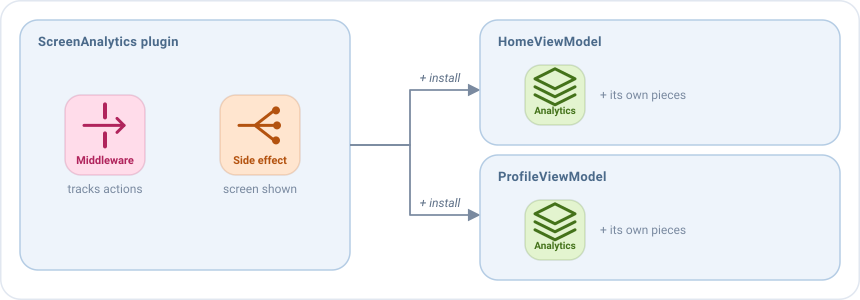

# Plugins

A plugin is a **reusable setup**: it groups a set of middlewares, reducers, side effects and broadcast listeners that
work together, and any screen installs all of them in one line.



Use a plugin for a feature that many screens need, but that has nothing to do with what each screen does: analytics,
a session check, a feature flag, the [backup of the state](../guides/saving-state.md)... Without plugins, that code is
copied in every ViewModel, or hidden in a base class that every screen must extend.

## Installing a plugin

Plugins are installed in the `plugins` block of the `setup`, with `+`:

```kotlin
override fun setup() = source {
    plugins {
        +ScreenAnalytics<HomeState>(tracker, screen = "Home")
    }
    reducers { /* ... */ }
}
```

Its pieces are added to the setup of the screen, where the `plugins` block is written, and work together with the
pieces of the screen.

## Writing a plugin

A plugin implements `EmaSourcePlugin` and adds its pieces in `install`, with the same blocks as `setup`. This one
tracks every action of the screen and when the screen is shown:

```kotlin
class ScreenAnalytics<S : EmaState>(private val tracker: Tracker, private val screen: String) :
    EmaSourcePlugin<S, Nothing> {

    override fun install(setup: SourceSetupScope<S, Nothing, Nothing>) {
        // A middleware sees every action of the screen before the reducers
        setup.middlewares {
            add<EmaAction> { action ->
                tracker.track(screen, action::class.simpleName.orEmpty())
                next()
            }
        }
        // A side effect reacts to the lifecycle of the screen
        setup.sideEffects {
            add<EmaLifecycle.Resumed> { tracker.screenShown(screen) }
        }
    }
}
```

- **What it needs, it receives in the constructor**, like the `tracker`. It can't be installed without it.
- **`S` is the state** of the screens where it can be installed. A generic `S`, as here, works in any screen; write it
  when installing it: `ScreenAnalytics<HomeState>(...)`.
- **The second type is the type of the actions the plugin dispatches.** `Nothing` means it dispatches none.

## A plugin with its own actions

A plugin can't post events, because the events belong to each screen. To tell the screen something, it dispatches its
own actions, and the screen decides what to do with them.

This plugin stops the actions of the user when the session has expired, and tells the screen with
`SessionAction.Expired`:

```kotlin
sealed interface SessionAction : EmaAction {
    data object Expired : SessionAction
}

class SessionGuard<S : EmaState>(private val session: Session) : EmaSourcePlugin<S, SessionAction> {

    override fun install(setup: SourceSetupScope<S, SessionAction, Nothing>) {
        setup.middlewares(MiddlewarePosition.First) {
            add<EmaAction> { action ->
                // The lifecycle and the actions of the plugin always continue
                if (action is EmaLifecycle || action is SessionAction || session.isActive) {
                    next()
                } else {
                    dispatch(SessionAction.Expired)
                }
            }
        }
    }
}
```

The screen installs it and reacts to its action like to any other:

```kotlin
override fun setup() = source {
    plugins {
        +SessionGuard<HomeState>(session)
    }
    sideEffects {
        add<SessionAction.Expired> { postEvent(HomeEvent.SessionExpired) }
    }
}
```

## Where its pieces go

- The reducers, side effects and broadcast listeners of a plugin stay **where the `plugins` block is written**, in
  order with the pieces of the screen.
- Its middlewares can choose a position: `MiddlewarePosition.First` to see every action before anything else, like the
  `SessionGuard`, or `Last` to see the new state of every action, like the backup. See
  [Where a middleware runs](middlewares.md#where-a-middleware-runs).

## Plugin or extension function?

To reuse pieces you can also write an extension function of the setup. Choose by what the pieces do:

| Use a plugin when...                                    | Use an [extension function](source.md#reusing-pieces-between-screens) when... |
|---------------------------------------------------------|-------------------------------------------------------------------|
| It is a self-contained feature, like analytics.         | It splits the pieces of one big screen.                          |
| It dispatches its own actions, or none.                 | It dispatches the actions of the screen.                          |
| It should be injected, so an environment can install it or not. | It is always part of the screen.                          |

## The plugins of Emanate

- **The backup of the state**, created with `backupOf`, saves parts of the state and restores them after the system
  kills the app. See [Saving state](../guides/saving-state.md).
