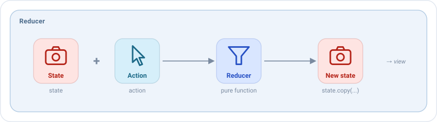

# Reducers

Un reducer responde a una pregunta: **dado el estado actual y una acción, ¿cuál es el siguiente estado?**



Es el único sitio donde cambia el estado de una pantalla. Todo lo que el usuario ve en la pantalla es el resultado de un
reducer.

## Tu primer reducer

Los reducers se declaran en el bloque `reducers` del `setup` del ViewModel. `add<Tipo>` añade un reducer para las
acciones de ese tipo, y su lambda devuelve el nuevo estado:

```kotlin
override fun setup() = source {
    reducers {
        add<HomeAction.QueryWritten> { action ->
            state.copy(query = action.query)
        }
    }
}
```

Dentro de la lambda tienes:

| Nombre   | Qué es                                             |
|----------|----------------------------------------------------|
| `state`  | El estado actual de la pantalla.                   |
| `action` | La acción que ha llegado, ya de su tipo.           |

El valor que devuelve la lambda se convierte en el nuevo estado, y la vista lo pinta de inmediato.

## Un reducer para toda la pantalla

Con un tipo `sealed` de acciones, un solo reducer puede gestionar todas las acciones de la pantalla con un `when`. El
compilador comprueba que no se olvide ninguna: añade una acción nueva y te dice dónde gestionarla.

```kotlin
reducers {
    add<HomeAction> { action ->
        when (action) {
            is HomeAction.QueryWritten -> state.copy(query = action.query, errorQueryTooShort = false)
            is HomeAction.ErrorAccepted -> state.copy(dialog = null)
            is HomeAction.EffectQueryResult.Started -> state.copy(isLoading = true)
            is HomeAction.EffectQueryResult.Loaded -> state.copy(isLoading = false, friends = action.friends)
            is HomeAction.EffectQueryResult.Failed -> state.copy(isLoading = false, dialog = HomeDialog.LoadError)
            is HomeAction.RefreshRequested,
            is HomeAction.FriendClicked -> state
        }
    }
}
```

Una acción que no cambia el estado, como `FriendClicked`, devuelve `state` tal cual. Otra cosa reaccionará a ella: un
[side effect](side-effects.md).

Se pueden mezclar ambos estilos: un `when` grande para la pantalla, y reducers pequeños para otros tipos, como el
[inicializador](../guides/initializers.md) o un [broadcast](broadcasts.md).

## Las reglas

Un reducer es una **función pura**: con el mismo estado y la misma acción, siempre devuelve el mismo estado nuevo, y no
hace nada más. Eso es lo que lo hace fácil de leer y de testear.

| Un reducer puede                      | Un reducer no puede                                                  |
|---------------------------------------|----------------------------------------------------------------------|
| Leer `state` y la acción              | Llamar a casos de uso, repositorios o a la red                       |
| Devolver un nuevo estado con `copy`   | Enviar acciones o publicar eventos: aquí `dispatch` ni siquiera compila |
| Calcular valores a partir de ellos    | Leer el reloj, números aleatorios o algo que cambie por sí solo      |

El trabajo como cargar datos o guardar algo va en un [side effect](side-effects.md), que se ejecuta después de los
reducers y comunica su resultado con una nueva acción, que aplica un reducer.

## Varios reducers para la misma acción

Cuando más de un reducer gestiona una acción, se ejecutan **en el orden en que se añadieron**, y cada uno recibe el
estado que devolvió el anterior:

```kotlin
reducers {
    add<HomeAction.QueryWritten> { action -> state.copy(query = action.query) }
    // Recibe el estado con la nueva consulta
    add<HomeAction.QueryWritten> { state.copy(errorQueryTooShort = state.query.length == 1) }
}
```

## Reducers como valores

Un reducer también se puede crear con `reducerOf`, para declararlo como propiedad, compartirlo o recibirlo en el
constructor, y añadirlo con `add`:

```kotlin
class HomeViewModel : EmaViewModel<HomeState, HomeAction, HomeEvent>(HomeState()) {

    private val queryReducer = reducerOf(HomeAction.QueryWritten::class) { action ->
        state.copy(query = action.query)
    }

    override fun setup() = source {
        reducers { add(queryReducer) }
    }
}
```

Mira [Las piezas son valores](viewmodel.md#las-piezas-son-valores).

## Testear un reducer

Envía la acción y comprueba el estado:

```kotlin
viewModel.dispatch(HomeAction.QueryWritten("Ana"))

assertEquals("Ana", viewModel.stateFlow.value.query)
```

Con [emanate-test](../guides/testing.md), `record()` guarda cada estado que devuelven los reducers, en orden.
