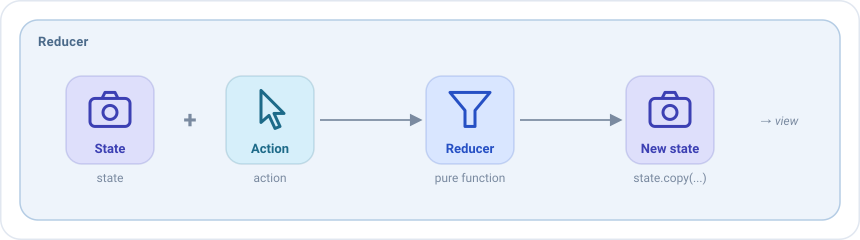

# Reducers

A reducer answers one question: **given the current state and an action, what is the next state?**



It is the only place where the state of a screen changes. Everything the user sees on the screen is the result of a
reducer.

## Your first reducer

Reducers are declared in the `reducers` block of the `setup` of the ViewModel. `add<Type>` adds a reducer for the
actions of that type, and its lambda returns the new state:

```kotlin
override fun setup() = source {
    reducers {
        add<HomeAction.QueryWritten> { action ->
            state.copy(query = action.query)
        }
    }
}
```

Inside the lambda you have:

| Name     | What it is                                         |
|----------|----------------------------------------------------|
| `state`  | The current state of the screen.                   |
| `action` | The action that arrived, already of its type.      |

The value the lambda returns becomes the new state, and the view draws it straight away.

## One reducer for the whole screen

With a `sealed` type of actions, a single reducer can handle every action of the screen with a `when`. The compiler
checks that no action is forgotten: add a new action and it tells you where to handle it.

```kotlin
reducers {
    add<HomeAction> { action ->
        when (action) {
            is HomeAction.QueryWritten -> state.copy(query = action.query, errorQueryTooShort = false)
            is HomeAction.ErrorAccepted -> state.copy(dialog = null)
            is HomeAction.EffectQueryResult.Started -> state.copy(isLoading = true)
            is HomeAction.EffectQueryResult.Loaded -> state.copy(isLoading = false, friends = action.friends)
            is HomeAction.EffectQueryResult.Failed -> state.copy(isLoading = false, dialog = HomeDialog.LoadError)
            is HomeAction.RefreshRequested,
            is HomeAction.FriendClicked -> state
        }
    }
}
```

An action that doesn't change the state, like `FriendClicked`, returns `state` as it is. Something else will react to
it: a [side effect](side-effects.md).

Both styles can be mixed: a big `when` for the screen, and small reducers for other types, like the
[initializer](../guides/initializers.md) or a [broadcast](broadcasts.md).

## The rules

A reducer is a **pure function**: with the same state and the same action, it always returns the same new state, and
it does nothing else. That is what makes it easy to read and to test.

| A reducer can                         | A reducer can't                                                      |
|---------------------------------------|----------------------------------------------------------------------|
| Read `state` and the action           | Call use cases, repositories or the network                          |
| Return a new state with `copy`        | Dispatch actions or post events: `dispatch` doesn't even compile here |
| Compute values from them              | Read the clock, random numbers or anything that changes on its own   |

Work like loading data or saving something goes in a [side effect](side-effects.md), which runs after the reducers and
reports its result with a new action, that a reducer applies.

## Several reducers for the same action

When more than one reducer handles an action, they run **in the order they were added**, and each one receives the
state returned by the previous one:

```kotlin
reducers {
    add<HomeAction.QueryWritten> { action -> state.copy(query = action.query) }
    // Receives the state with the new query
    add<HomeAction.QueryWritten> { state.copy(errorQueryTooShort = state.query.length == 1) }
}
```

## Reducers as values

A reducer can also be created with `reducerOf`, to declare it as a property, share it or receive it in the
constructor, and added with `+`:

```kotlin
class HomeViewModel : EmaViewModel<HomeState, HomeAction, HomeEvent>(HomeState()) {

    private val queryReducer = reducerOf(HomeAction.QueryWritten::class) { action ->
        state.copy(query = action.query)
    }

    override fun setup() = source {
        reducers { +queryReducer }
    }
}
```

See [Pieces are values](viewmodel.md#pieces-are-values).

## Testing a reducer

Dispatch the action and check the state:

```kotlin
viewModel.dispatch(HomeAction.QueryWritten("Ana"))

assertEquals("Ana", viewModel.stateFlow.value.query)
```

With [emanate-test](../guides/testing.md), `record()` keeps every state the reducers return, in order.
