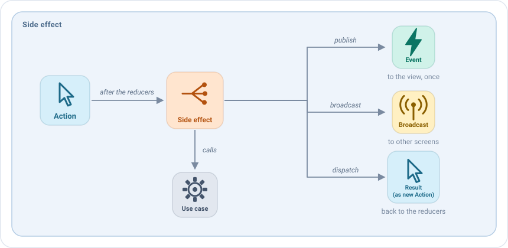
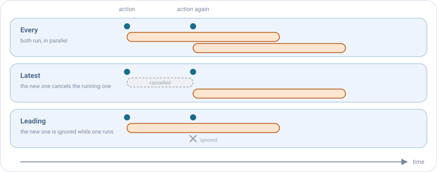

# Side effects

Un side effect es **el trabajo que inicia una acción**: cargar datos, guardar algo, llamar a un caso de uso, esperar a
un temporizador. Se ejecuta después de los [reducers](reducers.md) de la acción, así que ya ve el nuevo estado, y
comunica lo ocurrido de tres formas:



Cuando termina su trabajo, un side effect no puede cambiar directamente el estado ni la UI. Comunica el resultado con
una de estas tres funciones, según lo que tenga que pasar con él:

| Úsalo para                                             | Llama a              | Ejemplo                                                                             | Resultado                                           |
|--------------------------------------------------------|----------------------|-------------------------------------------------------------------------------------|-----------------------------------------------------|
| **Guardar el resultado en el estado**                  | `dispatch(action)`   | Los amigos se han cargado: `dispatch(HomeAction.SideEffects.FriendsLoaded(friends))` | Un reducer los pone en el estado y la lista los muestra. |
| **Lanzar una acción de UI de un solo uso**, como navegar o mostrar un mensaje | `publish(event)` | El usuario ha pulsado un amigo: `publish(HomeEvent.FriendSelected(friend))` | Se abre el perfil del amigo.                        |
| **Avisar a otros ViewModels**                          | `broadcast(action)`  | Se ha creado un amigo: `broadcast(ProfileBroadcast.FriendCreated(friend))`          | Los ViewModels que lo escuchan lo reciben. Mira [Broadcasts](broadcasts.md). |

Un side effect nunca cambia el estado por sí mismo: envía una acción y un reducer la aplica. Así cada cambio del estado
está en un único sitio, y es visible como una acción.

## Tu primer side effect

Los side effects se declaran en el bloque `sideEffects` del `setup`, para un tipo de acción. Son `suspend`, así que
pueden llamar a casos de uso directamente:

```kotlin
sideEffects {
    add<HomeAction.RefreshRequested> {
        dispatch(HomeAction.SideEffects.FriendsLoadStarted)
        getFriendsUseCase(GetFriendsUseCase.Input(state.query))
            .onSuccess { friends -> dispatch(HomeAction.SideEffects.FriendsLoaded(friends)) }
            .onFailure { dispatch(HomeAction.SideEffects.FriendsLoadFailed) }
    }
}
```

Paso a paso:

1. El usuario tira para refrescar, y la vista envía `RefreshRequested`.
2. Se ejecutan los reducers de `RefreshRequested`. Después empieza este side effect.
3. Envía `FriendsLoadStarted`: un reducer muestra el indicador de carga.
4. Espera al caso de uso. Mientras tanto la pantalla sigue funcionando.
5. Envía `FriendsLoaded` o `FriendsLoadFailed`: un reducer muestra la lista o el diálogo de error.

Dentro de la lambda tienes `state` (siempre el más reciente), la `action` que lo lanzó, y `dispatch`, `publish` y
`broadcast`.

## Publicar un evento

Cuando la vista debe hacer algo una vez, como navegar o mostrar un mensaje, publica un [evento](events.md):

```kotlin
sideEffects {
    add<HomeAction.FriendClicked> { action ->
        publish(HomeEvent.FriendSelected(action.friend))
    }
}
```

## Cuando la misma acción llega dos veces

¿Y si el usuario vuelve a tocar "refrescar" mientras el primer refresco sigue en marcha? Lo eliges con `concurrency`:



| `concurrency`        | Qué pasa                                              | Úsalo para                              |
|----------------------|-------------------------------------------------------|-----------------------------------------|
| `Every` (por defecto)| Se ejecutan ambos, a la vez.                          | Trabajo independiente, como enviar mensajes. |
| `Latest`             | Se cancela el que está en marcha y empieza el nuevo.  | Una búsqueda: solo importa la última consulta. |
| `Leading`            | Se ignora el nuevo mientras hay uno en marcha.        | Un botón pulsado dos veces: no lo envíes dos veces. |

```kotlin
sideEffects {
    add<HomeAction.RefreshRequested>(concurrency = SideEffectConcurrency.Leading) { /* ... */ }
    add<HomeAction.QueryWritten>(concurrency = SideEffectConcurrency.Latest) { /* ... */ }
}
```

## Rendirse tras un tiempo

Con `timeout`, un side effect que tarda demasiado se cancela, y se ejecuta `onTimeout` en su lugar:

```kotlin
sideEffects {
    add<HomeAction.RefreshRequested>(
        timeout = 10.seconds,
        onTimeout = { dispatch(HomeAction.SideEffects.FriendsLoadFailed) }
    ) {
        // ...
    }
}
```

## Cuando se cierra la pantalla

Cuando se cierra la pantalla, los side effects en marcha se cancelan, porque nadie vería su resultado. Dos opciones
permiten que el trabajo termine igualmente, hasta el `closeTimeout` de la [configuración](../guides/configuration.md):

- `survivesClose = true`: el side effect puede terminar después de cerrar la pantalla, como una petición que guarda lo
  que hizo el usuario.
- `onClose { }`: trabajo que empieza cuando se cierra la pantalla, como enviar un resultado a la pantalla anterior.

```kotlin
sideEffects {
    add<EditorAction.SaveClicked>(survivesClose = true) { saveDraftUseCase(state.draft) }
    onClose { broadcast(EditorBroadcast.Closed(state.draft)) }
}
```

## Errores

Si un side effect lanza una excepción, decide la [política de errores](../guides/configuration.md#errores) de la
configuración: fallar al instante durante el desarrollo, o reportarla y mantener la pantalla funcionando. Para los
errores que esperas, como una petición fallida, devuelve un resultado desde el caso de uso y envía una acción, como en
los ejemplos anteriores.

Los errores y el [listener de side effects](../guides/configuration.md#medir-los-side-effects) identifican cada side
effect por el tipo de su acción, `RefreshRequested` en los ejemplos anteriores. Pasa `name` a `add` para elegir otro:
`add<HomeAction.RefreshRequested>(name = "refreshFriends") { ... }`.

## Side effects como valores

Un side effect también se puede crear con `sideEffectOf`, o escribir como una clase que implementa `SideEffect`, para
declararlo como propiedad, compartirlo o recibirlo en el constructor. Así es como la misma pantalla puede llamar al
backend real en producción y a un mock en una build de demo:

```kotlin
class HomeViewModel(private val getFriendsUseCase: GetFriendsUseCase) :
    EmaViewModel<HomeState, HomeAction, HomeEvent>(HomeState.DEFAULT) {

    private val openFriend = sideEffectOf(HomeAction.FriendClicked::class) { action ->
        publish(HomeEvent.FriendSelected(action.friend))
    }

    override fun setup() = source {
        sideEffects { add(openFriend) }
    }
}
```

Mira [Las piezas son valores](viewmodel.md#las-piezas-son-valores) e [Inyección de dependencias y entornos](../guides/dependency-injection.md#inyectar-piezas).

## Consejos

- **Mantén la lógica de negocio en los casos de uso.** El side effect los llama y convierte su resultado en acciones.
- **Envía una acción por cada paso del trabajo**, como `FriendsLoadStarted`, `FriendsLoaded` y `FriendsLoadFailed` en
  [tu primer side effect](#tu-primer-side-effect). Así los reducers pueden mostrar cada paso (carga, lista, error), y los
  tests también pueden comprobarlo.
- **Elige la concurrencia a propósito.** `Every` es el valor por defecto, pero la mayoría de acciones del usuario
  quieren `Leading` o `Latest`.
