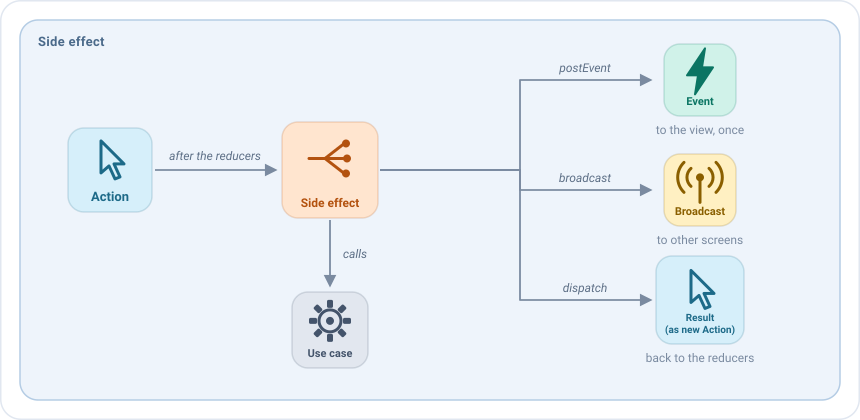
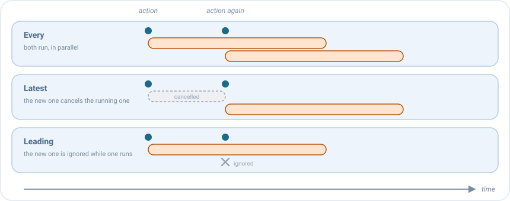

# Side effects

A side effect is **the work that an action starts**: loading data, saving something, calling a use case, waiting for
a timer. It runs after the [reducers](reducers.md) of the action, so it already sees the new state, and it reports
what happened in three ways:



When its work finishes, a side effect can't change the state nor the UI directly. It reports the result with one of
these three functions, depending on what has to happen with it:

| Use it to                                              | Call                 | Example                                                                             | Result                                              |
|--------------------------------------------------------|----------------------|-------------------------------------------------------------------------------------|-----------------------------------------------------|
| **Save the result in the state**                       | `dispatch(action)`   | The friends were loaded: `dispatch(HomeAction.EffectQueryResult.Loaded(friends))`  | A reducer puts them in the state and the list shows them. |
| **Trigger a one-time UI action**, like navigating or showing a message | `postEvent(event)` | The user clicked a friend: `postEvent(HomeEvent.FriendSelected(friend))` | The profile of the friend is opened.                |
| **Notify other ViewModels**                            | `broadcast(action)`  | A friend was created: `broadcast(ProfileBroadcast.FriendCreated(friend))`           | The ViewModels that listen to it receive it. See [Broadcasts](broadcasts.md). |

A side effect never changes the state by itself: it dispatches an action and a reducer applies it. That keeps every
change of the state in one place, and visible as an action.

## Your first side effect

Side effects are declared in the `sideEffects` block of the `setup`, for a type of action. They are `suspend`, so they
can call use cases directly:

```kotlin
sideEffects {
    add<HomeAction.RefreshRequested> {
        dispatch(HomeAction.EffectQueryResult.Started)
        getFriendsUseCase(GetFriendsUseCase.Input(state.query))
            .onSuccess { friends -> dispatch(HomeAction.EffectQueryResult.Loaded(friends)) }
            .onFailure { dispatch(HomeAction.EffectQueryResult.Failed) }
    }
}
```

Step by step:

1. The user pulls to refresh, and the view dispatches `RefreshRequested`.
2. The reducers of `RefreshRequested` run. Then this side effect starts.
3. It dispatches `Started`: a reducer shows the loading indicator.
4. It waits for the use case. The screen keeps working meanwhile.
5. It dispatches `Loaded` or `Failed`: a reducer shows the list or the error dialog.

Inside the lambda you have `state` (always the latest one), the `action` that launched it, and `dispatch`, `postEvent`
and `broadcast`.

## Posting an event

When the view must do something once, like navigating or showing a message, post an [event](events.md):

```kotlin
sideEffects {
    add<HomeAction.FriendClicked> { action ->
        postEvent(HomeEvent.FriendSelected(action.friend))
    }
}
```

## When the same action arrives twice

What if the user taps "refresh" again while the first refresh is still running? You choose with `concurrency`:



| `concurrency`        | What happens                                          | Use it for                              |
|----------------------|-------------------------------------------------------|-----------------------------------------|
| `Every` (default)    | Both run, at the same time.                           | Independent work, like sending messages. |
| `Latest`             | The running one is cancelled and the new one starts.  | A search: only the last query matters.  |
| `Leading`            | The new one is ignored while one is running.          | A button tapped twice: don't send it twice. |

```kotlin
sideEffects {
    add<HomeAction.RefreshRequested>(concurrency = SideEffectConcurrency.Leading) { /* ... */ }
    add<HomeAction.QueryWritten>(concurrency = SideEffectConcurrency.Latest) { /* ... */ }
}
```

## Giving up after some time

With `timeout`, a side effect that takes too long is cancelled, and `onTimeout` runs instead:

```kotlin
sideEffects {
    add<HomeAction.RefreshRequested>(
        timeout = 10.seconds,
        onTimeout = { dispatch(HomeAction.EffectQueryResult.Failed) }
    ) {
        // ...
    }
}
```

## When the screen is closed

When the screen is closed, the running side effects are cancelled, because nobody would see their result. Two options
let work finish anyway, up to the `closeTimeout` of the [configuration](../guides/configuration.md), 5 seconds by
default:

- `survivesClose = true`: the side effect can finish after the screen is closed, like a request that saves what the
  user did.
- `onClose { }`: work that starts when the screen is closed, like sending a result to the previous screen.

```kotlin
sideEffects {
    add<EditorAction.SaveClicked>(survivesClose = true) { saveDraftUseCase(state.draft) }
    onClose { broadcast(EditorBroadcast.Closed(state.draft)) }
}
```

## Errors

If a side effect throws an exception, the [error policy](../guides/async-and-errors.md#errors) of the configuration
decides: fail at once while developing, or report it and keep the screen working. For the errors you expect, like a
failed request, return a result from the use case and dispatch an action, as in the examples above.

## Side effects as values

A side effect can also be created with `sideEffectOf`, or written as a class that implements `SideEffect`, to declare
it as a property, share it or receive it in the constructor. That is how the same screen can call the real backend in
production and a mock in a demo build:

```kotlin
class HomeViewModel(private val getFriendsUseCase: GetFriendsUseCase) :
    EmaViewModel<HomeState, HomeAction, HomeEvent>(HomeState()) {

    private val openFriend = sideEffectOf(HomeAction.FriendClicked::class) { action ->
        postEvent(HomeEvent.FriendSelected(action.friend))
    }

    override fun setup() = source {
        sideEffects { +openFriend }
    }
}
```

See [Pieces are values](source.md#pieces-are-values) and [Mocking and environments](../guides/environments.md).

## Tips

- **Keep the business logic in use cases.** The side effect calls them and turns their result into actions.
- **Dispatch an action for each step of the work**, like `Started`, `Loaded` and `Failed` in
  [your first side effect](#your-first-side-effect). Then the reducers can show each step (loading, list, error), and
  the tests can check it too.
- **Choose the concurrency on purpose.** `Every` is the default, but most user actions want `Leading` or `Latest`.
