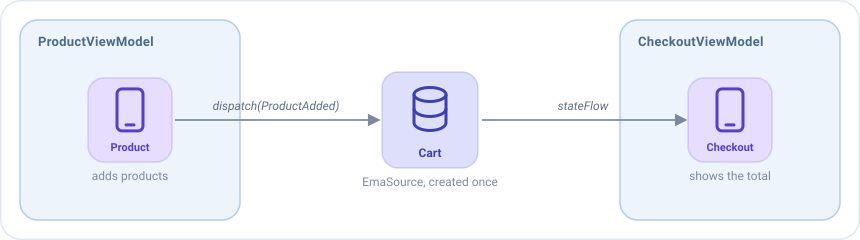

# EmaSource

Un `EmaSource` es **el motor de Emanate**: guarda un estado, recibe acciones y ejecuta los middlewares, reducers y side
effects que las gestionan. Cada [`EmaViewModel`](viewmodel.md) tiene uno dentro.

La mayoría de apps solo necesitan ViewModels. Un `EmaSource` es para los casos en que quieres ese mismo motor **sin una
pantalla**: un estado que comparten varias pantallas, o lógica que nada tiene que ver con la UI. También puede ser la
base de un **ViewModel propio construido desde cero**, cuando el comportamiento de un `EmaViewModel` estándar no encaja
con lo que necesitas.

## ¿ViewModel o EmaSource?

Un `EmaSource` tiene las mismas piezas que un ViewModel. Lo que cambia es todo lo que las rodea:

|                                                         | `EmaViewModel`                   | `EmaSource`                                  |
|---------------------------------------------------------|----------------------------------|----------------------------------------------|
| Middlewares, reducers, side effects, broadcasts, plugins | Sí                              | Sí                                           |
| Quién lo crea                                           | Su pantalla, una vez             | Tú                                           |
| El inicializador y el ciclo de vida, como acciones      | Sí                               | No: solo recibe las acciones que le envías   |
| Logs de cada acción                                     | Automáticos                      | Si los añades                                |
| Cuándo se cierra                                        | Cuando se cierra su pantalla     | Cuando llamas a `close()`                    |
| Úsalo para                                              | Una pantalla                     | Un estado que no es una pantalla, o un ViewModel propio construido desde cero |

Usa un `EmaSource` cuando el estado **no pertenece a una pantalla**, por ejemplo:

- Un carrito de la compra que rellenan las pantallas de producto y muestra la pantalla de pago.
- Un reproductor de música que sigue sonando mientras el usuario se mueve entre pantallas.
- Una cola de descargas que se ejecuta en segundo plano.
- Un ViewModel propio: envuelve un `EmaSource` en tu clase y expón solo lo que necesita tu pantalla, sin el ciclo de vida
  de un `EmaViewModel`.

## Crear un EmaSource

Créalo con `EmaSource(...)`: el estado inicial y los mismos bloques que el [setup de un ViewModel](viewmodel.md#el-setup).

```kotlin
data class CartState(val products: List<Product>) : EmaState {

    companion object {
        val DEFAULT = CartState(products = emptyList())
    }

    val total get() = products.sumOf { it.price }
}

sealed interface CartAction : EmaAction {
    data class ProductAdded(val product: Product) : CartAction
    data class ProductRemoved(val product: Product) : CartAction
}

fun cartSource() = EmaSource<CartState, CartAction, EmaEvent.EMPTY>(CartState.DEFAULT) {
    reducers {
        add<CartAction> { action ->
            when (action) {
                is CartAction.ProductAdded -> state.copy(products = state.products + action.product)
                is CartAction.ProductRemoved -> state.copy(products = state.products - action.product)
            }
        }
    }
}
```

## Usarlo

| Para                     | Llama a                                                     |
|--------------------------|-------------------------------------------------------------|
| Enviar una acción        | `cart.dispatch(CartAction.ProductAdded(product))`           |
| Leer el estado actual    | `cart.state`                                                |
| Seguir el estado         | `cart.stateFlow.collect { state -> ... }`                   |
| Seguir los eventos       | `cart.eventFlow`, y `cart.consumeEvent(event)` cuando se gestiona cada uno |
| Detenerlo                | `cart.close()`                                              |

`close()` procesa las acciones que quedan pendientes y después cancela el trabajo del `EmaSource`. Un `EmaSource` no
tiene una pantalla que lo cierre, así que **ciérralo tú** cuando ya no haga falta. Un `EmaSource` creado una vez para
toda la app, como el carrito, puede vivir tanto como la app.

## Ejemplo: un carrito compartido por dos pantallas

El carrito se crea una vez, por ejemplo como un `single` de tu inyección de dependencias, y los ViewModels de dos
pantallas lo reciben en su constructor:



La pantalla de producto envía acciones al carrito desde un side effect:

```kotlin
class ProductViewModel(private val cart: EmaSource<CartState, CartAction, EmaEvent.EMPTY>) :
    EmaViewModel<ProductState, ProductAction, ProductEvent>(ProductState.DEFAULT) {

    override fun setup() = source {
        sideEffects {
            add<ProductAction.AddClicked> { cart.dispatch(CartAction.ProductAdded(state.product)) }
        }
    }
}
```

La pantalla de pago sigue el estado del carrito, y convierte cada cambio en una acción propia:

```kotlin
class CheckoutViewModel(private val cart: EmaSource<CartState, CartAction, EmaEvent.EMPTY>) :
    EmaViewModel<CheckoutState, CheckoutAction, CheckoutEvent>(CheckoutState.DEFAULT) {

    override fun setup() = source {
        reducers {
            add<CheckoutAction.CartChanged> { action -> state.copy(total = action.total) }
        }
        sideEffects {
            // Se ejecuta mientras existe la pantalla: se cancela al cerrar el ViewModel
            add<EmaInitializer> {
                cart.stateFlow.collect { cart -> dispatch(CheckoutAction.CartChanged(cart.total)) }
            }
        }
    }
}
```

Cada pantalla mantiene su propio estado, y el carrito es el único sitio donde están los productos.

## Logs

Un ViewModel registra cada acción por sí mismo, pero un `EmaSource` no. Para ver sus acciones con el estado antes y
después de ellas, añade `loggerMiddleware` como su último middleware:

```kotlin
fun cartSource() = EmaSource<CartState, CartAction, EmaEvent.EMPTY>(CartState.DEFAULT) {
    middlewares(MiddlewarePosition.Last) {
        add(loggerMiddleware(tag = "Cart", logger = EmaLogger.Println))
    }
    // ...
}
```

## Configuración

Un `EmaSource` usa la [configuración de la aplicación](../guides/configuration.md) (la establecida con `Emanate.init`),
como un ViewModel. Para dar a un `EmaSource` la suya, pásala como segundo parámetro:

```kotlin
EmaSource<CartState, CartAction, EmaEvent.EMPTY>(CartState.DEFAULT, configuration) { ... }
```

Esa configuración decide, entre otras cosas, el dispatcher donde se ejecuta el `EmaSource` (`main` por defecto) y qué
pasa cuando se lanza una excepción.

## Tests

[emanate-test](../guides/testing.md) funciona con un `EmaSource` como con un ViewModel. Llama a `useTestConfiguration()`
antes de crear el `EmaSource`, para que se ejecute en el dispatcher del test. Después llama a `record()` en el
`EmaSource` antes de enviar la primera acción, y el recorder guarda cada acción, estado y evento en orden, para que
puedas hacer aserciones sobre ellos. Por ejemplo, un test del carrito anterior podría ser así:

```kotlin
val recorder = cart.record()

cart.dispatch(CartAction.ProductAdded(product))

recorder.assertState { it.products == listOf(product) }
```
