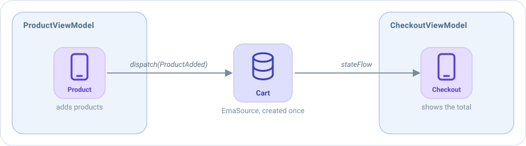

# Source

An `EmaSource` is **the engine of Emanate**: it holds a state, receives actions and runs the middlewares, reducers and
side effects that handle them. Every [`EmaViewModel`](viewmodel.md) has one inside.

Most apps only need ViewModels. A source is for the cases where you want that same engine **without a screen**: a state
that several screens share, or logic that has nothing to do with the UI. It can also be the base of a **custom
ViewModel built from scratch**, when the behavior of a standard `EmaViewModel` doesn't fit what you need.

## ViewModel or source?

A source has the same pieces as a ViewModel. What changes is everything around them:

|                                                         | `EmaViewModel`                   | `EmaSource`                                  |
|---------------------------------------------------------|----------------------------------|----------------------------------------------|
| Middlewares, reducers, side effects, broadcasts, plugins | Yes                             | Yes                                          |
| Who creates it                                          | Its screen, once                 | You                                          |
| The initializer and the lifecycle, as actions           | Yes                              | No: it only receives the actions you send it |
| Logs of every action                                    | Automatic                        | If you add them                              |
| When it is closed                                       | When its screen is closed        | When you call `close()`                      |
| Use it for                                              | A screen                         | A state that is not a screen, or a custom ViewModel built from scratch |

Use a source when the state **doesn't belong to one screen**, for example:

- A shopping cart that the product screens fill and the checkout screen shows.
- A music player that keeps playing while the user moves between screens.
- A queue of downloads that runs in the background.
- A ViewModel of your own: wrap a source in your class and expose only what your screen needs, without the lifecycle
  of an `EmaViewModel`.

## Creating a source

Create it with `EmaSource(...)`: the initial state, and the same blocks as the [setup of a ViewModel](viewmodel.md#the-setup).

```kotlin
data class CartState(val products: List<Product> = emptyList()) : EmaState {
    val total get() = products.sumOf { it.price }
}

sealed interface CartAction : EmaAction {
    data class ProductAdded(val product: Product) : CartAction
    data class ProductRemoved(val product: Product) : CartAction
}

fun cartSource() = EmaSource<CartState, CartAction, EmaEvent.EMPTY>(CartState()) {
    reducers {
        add<CartAction> { action ->
            when (action) {
                is CartAction.ProductAdded -> state.copy(products = state.products + action.product)
                is CartAction.ProductRemoved -> state.copy(products = state.products - action.product)
            }
        }
    }
}
```

## Using it

| To                       | Call                                                        |
|--------------------------|-------------------------------------------------------------|
| Send an action           | `cart.dispatch(CartAction.ProductAdded(product))`           |
| Read the current state   | `cart.state`                                                |
| Follow the state         | `cart.stateFlow.collect { state -> ... }`                   |
| Follow the events        | `cart.eventFlow`, and `cart.consumeEvent(event)` once each one is handled |
| Stop it                  | `cart.close()`                                              |

`close()` processes the actions still pending and then cancels the work of the source. A source has no screen that
closes it, so **close it yourself** when it isn't needed anymore. A source created once for the whole app, like the cart,
can live as long as the app.

## Example: a cart shared by two screens

The cart is created once, for example as a `single` of your dependency injection, and the ViewModels of two screens
receive it in their constructor:



The product screen sends actions to the cart from a side effect:

```kotlin
class ProductViewModel(private val cart: EmaSource<CartState, CartAction, EmaEvent.EMPTY>) :
    EmaViewModel<ProductState, ProductAction, ProductEvent>(ProductState()) {

    override fun setup() = source {
        sideEffects {
            add<ProductAction.AddClicked> { cart.dispatch(CartAction.ProductAdded(state.product)) }
        }
    }
}
```

The checkout screen follows the state of the cart, and turns every change into an action of its own:

```kotlin
class CheckoutViewModel(private val cart: EmaSource<CartState, CartAction, EmaEvent.EMPTY>) :
    EmaViewModel<CheckoutState, CheckoutAction, CheckoutEvent>(CheckoutState()) {

    override fun setup() = source {
        reducers {
            add<CheckoutAction.CartChanged> { action -> state.copy(total = action.total) }
        }
        sideEffects {
            // Runs while the screen exists: it is cancelled when the ViewModel is closed
            add<EmaInitializer> {
                cart.stateFlow.collect { cart -> dispatch(CheckoutAction.CartChanged(cart.total)) }
            }
        }
    }
}
```

Each screen keeps its own state, and the cart is the only place where the products are.

## Logs

A ViewModel logs every action by itself, but a source doesn't. To see its actions with the state before and after
them, add `loggerMiddleware` as its last middleware:

```kotlin
fun cartSource() = EmaSource<CartState, CartAction, EmaEvent.EMPTY>(CartState()) {
    middlewares(MiddlewarePosition.Last) {
        +loggerMiddleware(tag = "Cart", logger = EmaLogger.Println)
    }
    // ...
}
```

## Configuration

A source uses the [configuration of the application](../guides/configuration.md) (the one set with `Emanate.init`), like
a ViewModel does. To give one source its own, pass it as the second parameter:

```kotlin
EmaSource<CartState, CartAction, EmaEvent.EMPTY>(CartState(), configuration) { ... }
```

That configuration decides, among other things, the dispatcher where the source runs (`main` by default) and what
happens when an exception is thrown.

## Tests

[emanate-test](../guides/testing.md) works with a source like with a ViewModel. Call `useTestDispatchers()` before
creating the source, so it runs on the dispatcher of the test. Then call `record()` on the source before sending the
first action, and the recorder keeps every action, state and event in order, so you can assert on them. For example,
a test of the cart above could look like this:

```kotlin
val recorder = cart.record()

cart.dispatch(CartAction.ProductAdded(product))

recorder.assertState { it.products == listOf(product) }
```