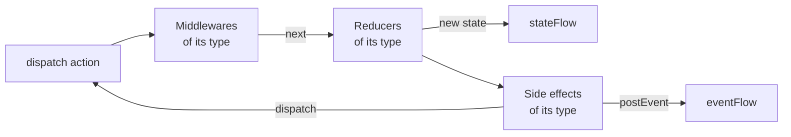

# Source

An `EmaSource` holds a state handled with actions, in the style of Redux. It is the engine of
[`EmaViewModel`](viewmodel.md), and it can also be used on its own.

Every action that enters the source goes through the same path, one action after another:



1. The **middlewares** decide the path of the action: let it continue, change it, delay it or stop it.
2. The **reducers** return the next state. It is published as soon as they return.
3. The **side effects** run the business logic asynchronously, with the new state, and react dispatching actions or
   posting events.

Each piece is declared for a type of action and only receives the actions of that type, so a `sealed` hierarchy of
actions lets you handle a whole screen in one `when`, or a single action with its own class.

## Setup

The source is configured once, in `setup` (the `setup` function of an `EmaViewModel`, which returns `source { }`, or
the last parameter of `EmaSource(...)`). Nothing can be added after it. Each kind of piece has its own block, in the
order an action goes through them:

```kotlin
override fun setup() = source {
    middlewares {
        add<HomeAction.QueryWritten> { /* ... */ }
        +middlewareDelayOf(HomeAction.RefreshRequested::class, 300.milliseconds)
    }
    reducers {
        add<HomeAction> { action -> /* ... */ }
        // Declared as a property of the ViewModel
        +userReducer
    }
    sideEffects {
        add<HomeAction.RefreshRequested> { /* ... */ }
    }
    broadcasts {
        listen<ProfileBroadcast.FriendAdded>()
    }
}
```

| Block             | Adds                                                                                  |
|-------------------|---------------------------------------------------------------------------------------|
| `middlewares { }` | The [middlewares](#middlewares), which run first.                                    |
| `reducers { }`    | The [reducers](#reducers).                                                           |
| `sideEffects { }` | The [side effects](#side-effects).                                                   |
| `broadcasts { }`  | The types of the actions broadcast by other sources that it receives, with `listen<Type>()`. See [Results between screens](../guides/results-between-screens.md). |
| `plugins { }`     | The [plugins](#plugins): groups of pieces that the screen doesn't need to know.      |

Inside a block, `add<Type> { }` adds a piece for the actions of that type, and `+` adds one already created.

## Pieces are values

Every piece can be replaced. Besides the lambdas, each piece can be written as a class that implements `EmaMiddleware`, `EmaReducer` or
`SideEffect`, or created with `middlewareOf`, `middlewareDelayOf`, `reducerOf` and `sideEffectOf`. Then it can be declared as a
property, shared between screens or **received in the constructor** of the ViewModel:

```kotlin
class LiveFriends(private val getFriendsUseCase: GetFriendsUseCase) :
    SideEffect<HomeState, HomeAction, HomeEvent, HomeAction.RefreshRequested> {

    override val actionType = HomeAction.RefreshRequested::class
    override val concurrency = SideEffectConcurrency.Leading

    override suspend fun SideEffectScope<HomeState, HomeAction, HomeEvent>.invoke(action: HomeAction.RefreshRequested) {
        dispatch(HomeAction.EffectQueryResult.Started)
        getFriendsUseCase(GetFriendsUseCase.Input(state.query))
            .onSuccess { friends -> dispatch(HomeAction.EffectQueryResult.Loaded(friends)) }
            .onFailure { dispatch(HomeAction.EffectQueryResult.Failed) }
    }
}

class HomeViewModel(
    private val loadFriends: SideEffect<HomeState, HomeAction, HomeEvent, HomeAction.RefreshRequested>
) : EmaViewModel<HomeState, HomeAction, HomeEvent>(HomeState()) {

    override fun setup() = source {
        sideEffects { +loadFriends }
    }
}
```

A ViewModel that receives its pieces doesn't know which ones it gets: the real API, a mock or a fake. That is how the
same screen behaves differently in production, in a demo build and in the tests. See
[Mocking and environments](../guides/environments.md).

The middlewares run in the order they are added, and so do the reducers: each one receives the state returned by the
previous one. A block can be used more than once, for example to group the pieces of each feature: its pieces are
added after the ones of the previous blocks of the same kind.

Each piece only reaches what belongs to it: a reducer can't add other pieces nor dispatch, and a side effect can't
add other side effects. The properties of the ViewModel, like its use cases, can be used everywhere.

### Reusing pieces between screens

To share a group of pieces between screens, write an extension function of `SourceSetupScope` with its blocks and
call it inside `source { }`. As the blocks can be used more than once, its pieces are added in the place where it is
called, together with the ones of the screen:

```kotlin
fun <S : EmaState, A : EmaAction, E : EmaEvent> SourceSetupScope<S, A, E>.analytics(tracker: Tracker, screen: String) {
    middlewares {
        add<EmaAction> { action ->
            tracker.track(action::class.simpleName.orEmpty())
            next()
        }
    }
    sideEffects {
        add<EmaLifecycle.Resumed> { tracker.screenShown(screen) }
    }
}

override fun setup() = source {
    analytics(tracker, screen = "Home")
    reducers {
        add<HomeAction> { action -> /* ... */ }
    }
}
```

A generic function like this one can be used by any screen. Its side effects can only dispatch actions of type `A`,
the actions of the screen that calls it, so a function that dispatches its own actions is written for the types of
one screen: it is useful to split a big ViewModel by feature. The function only reaches what it receives as
parameters, so pass it the use cases it needs.

## Reducers

A reducer returns the next state for an action. It only reads `state`, so it is a pure function: it can't dispatch
actions, post events nor launch work. Calling `dispatch` inside a reducer doesn't compile.

```kotlin
reducers {
    add<HomeAction> { action ->
        when (action) {
            is HomeAction.QueryWritten -> state.copy(query = action.query)
            is HomeAction.ErrorAccepted -> state.copy(dialog = null)
            // ...
        }
    }
}
```

## Middlewares

A middleware receives the actions of its type before the reducers and decides their path calling `next` **once**:

| In a middleware        | Effect                                                                        |
|------------------------|-------------------------------------------------------------------------------|
| `next()`               | The action continues to the next middleware and to the reducers.              |
| `next(action)`         | Other action continues instead of the received one.                           |
| Not calling `next`     | The action stops here: it doesn't reach the reducers nor the side effects.    |
| `nextAfter { }`        | The action continues when the block finishes. The source keeps working meanwhile. |
| `dispatch(action)`     | Dispatches a new action.                                                      |
| `state`                | The current state.                                                            |

`nextAfter` waits without blocking the source. Inside its block, `stop()` finishes it without continuing the action.

```kotlin
middlewares {
    add<HomeAction.QueryWritten> { action ->
        // Debounce: a new query cancels the previous one, which doesn't continue
        nextAfter(id = "search", timeout = 5.seconds) {
            delay(300)
            if (action.query.isBlank()) stop()
        }
    }
}
```

| `nextAfter` parameter | Effect                                                                         |
|-----------------------|--------------------------------------------------------------------------------|
| `id`                  | A `nextAfter` with the same id that is still waiting is cancelled.            |
| `timeout`             | If the block doesn't finish in this time, it is cancelled and `onTimeout` is called. |

`middlewareDelayOf(Type::class, delay)` creates a middleware that delays the actions of a type. Middlewares don't
post events: they dispatch an action whose side effect posts it. For business logic, use a side effect.

### Where a middleware runs

By default the middlewares run where their block is written, in order with the rest of the setup. A block can place
them elsewhere with its `position`, whatever the place where it is written:

| `MiddlewarePosition` | Runs                                       | Use it for                                                        |
|----------------------|--------------------------------------------|-------------------------------------------------------------------|
| `First`              | Before the rest                            | Deciding the path of every action first: a session guard, a feature flag, a simulated latency. |
| `InPlace` (default)  | Where the block is written                 | The middlewares of the screen.                                    |
| `Last`               | After the rest, right before the reducers  | Observing the new state of every action: when `next()` returns, the reducers have run. |

```kotlin
middlewares(MiddlewarePosition.First) {
    add<HomeAction.FriendClicked> { if (featureFlags.profilesEnabled) next() }
}
```

## Side effects

A side effect is the business logic launched by the actions of its type: use cases, requests, timers... It runs
asynchronously after the reducers of the action, so it reads the new state.

```kotlin
sideEffects {
    add<HomeAction.RefreshRequested>(concurrency = SideEffectConcurrency.Leading, timeout = 30.seconds) {
        val friends = getFriendsUseCase(GetFriendsUseCase.Input(state.query)).getOrDefault(emptyList())
        dispatch(HomeAction.EffectQueryResult.Loaded(friends))
        postEvent(HomeEvent.FriendsUpdated(friends.size))
    }
}
```

| In a side effect                 | Effect                                                                    |
|----------------------------------|---------------------------------------------------------------------------|
| `state`                          | The state at the moment it is read.                                       |
| `dispatch(action)`               | Dispatches an action to the source.                                       |
| `postEvent(event)`               | Posts an [event](events.md). It arrives after the actions dispatched before it. |
| `broadcast(action)`              | Broadcasts an action to other sources. See [Results between screens](../guides/results-between-screens.md). |

`concurrency` decides what happens when an action launches the side effect while it is still running:

| `SideEffectConcurrency` | Behaviour                                                  | Example                      |
|-------------------------|------------------------------------------------------------|------------------------------|
| `Every` (default)       | Every action launches it, in parallel.                     | Independent requests.        |
| `Latest`                | The running one is cancelled and the new one is launched.  | A search while typing.       |
| `Leading`               | The new one is ignored while one is running.               | A button tapped twice.       |

With `timeout`, a side effect that doesn't finish in time is cancelled and its `onTimeout` is called. With
`survivesClose = true` it can finish after the source is closed, up to the `closeTimeout` of the
[configuration](../guides/configuration.md). The errors follow the [error policy](../guides/async-and-errors.md#errors)
of the configuration.

`onClose { }` adds work that runs when the source is closed, like sending a result to the previous screen. See
[When the ViewModel is closed](viewmodel.md#when-the-viewmodel-is-closed).

## Broadcasts

A source can send actions to other sources, for example to give a result to the previous screen. A side effect
broadcasts the action with `broadcast`, and every source that listens to its type in its `broadcasts` block receives
it as one more action, which goes through its middlewares, reducers and side effects:

```kotlin
// Sender
sideEffects {
    add<ProfileAction.SaveClicked> { broadcast(ProfileBroadcast.FriendCreated(state.friend)) }
}

// Receiver
reducers {
    add<ProfileBroadcast.FriendCreated> { action -> state.copy(friends = state.friends + action.friend) }
}
broadcasts {
    listen<ProfileBroadcast.FriendCreated>()
}
```

The type of the action is the id of the broadcast, so it is typed end to end. Without `listen`, the pieces of that
type never run: `assertSetup()` of `emanate-test` detects it. The delivery rules and `keepUntilReceived` are in
[Results between screens](../guides/results-between-screens.md).

## Plugins

A plugin is a feature that the screen doesn't need to know, packaged as a group of pieces: it adds its middlewares,
reducers, side effects and broadcast listeners to the setup where it is installed. Emanate ships the
[backup of the state](../guides/saving-state.md), and you can write your own by implementing `EmaSourcePlugin`:

```kotlin
class ScreenAnalytics<S : EmaState>(private val tracker: Tracker, private val screen: String) :
    EmaSourcePlugin<S, Nothing> {

    override fun install(setup: SourceSetupScope<S, Nothing, Nothing>) {
        setup.middlewares {
            add<EmaAction> { action ->
                tracker.track(screen, action::class.simpleName.orEmpty())
                next()
            }
        }
        setup.sideEffects {
            add<EmaLifecycle.Resumed> { tracker.screenShown(screen) }
        }
    }
}

override fun setup() = source {
    plugins {
        +ScreenAnalytics<HomeState>(tracker, screen = "Home")
    }
    reducers { /* ... */ }
}
```

- A plugin receives what it needs when it is created, so it can't be installed without it.
- Its pieces stay where the `plugins` block is written, except the middlewares it places `First` or `Last`.
- The second type is the type of the actions it can dispatch: `Nothing` if it dispatches none. The source accepts
  them, and the screen can handle them like any other. A plugin can't post events: they belong to the screen, so it
  dispatches an action and the screen decides the event.
- The plugin is injected like any other dependency, so an environment can install it or not.

Use a plugin for a self-contained feature that dispatches its own actions, and an
[extension function](#reusing-pieces-between-screens) to split the pieces of a screen or share pieces that dispatch
the actions of the screen.

## Using a source on its own

A source doesn't depend on any ViewModel. Create it with `EmaSource(...)`, observe `stateFlow` and `eventFlow`, and
call `close()` when it isn't needed anymore: it processes the pending actions and cancels its work.

```kotlin
val counter = EmaSource<CounterState, CounterAction, CounterEvent>(CounterState()) {
    reducers {
        add<CounterAction.Increment> { state.copy(count = state.count + 1) }
    }
}

counter.dispatch(CounterAction.Increment)
counter.close()
```

By default it uses the [configuration](../guides/configuration.md) of Emanate and runs on its `main` dispatcher; pass
another one in the `configuration` parameter.
