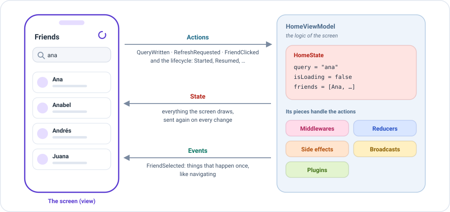
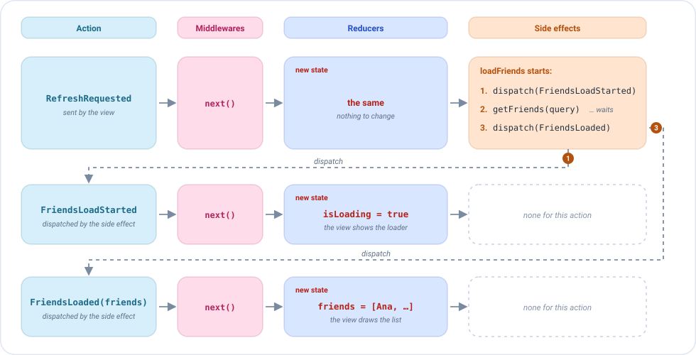
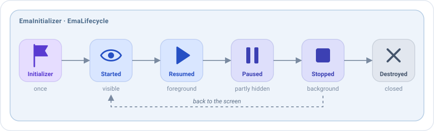

# ViewModel

Un `EmaViewModel` es **la lógica de una pantalla**. La vista solo pinta y cuenta lo que hace el usuario; el ViewModel
decide todo lo demás. Ahí se juntan todas las piezas descritas en las páginas anteriores: el [estado](state.md), las
[acciones](actions.md), los [eventos](events.md), y los [reducers](reducers.md), [side effects](side-effects.md),
[middlewares](middlewares.md), [broadcasts](broadcasts.md) y [plugins](plugins.md) que los gestionan.



La conversación entre los dos siempre tiene la misma forma:

- **La vista envía acciones**: lo que hace el usuario, como escribir en el campo de búsqueda o tirar para refrescar, y el
  ciclo de vida de la pantalla.
- **El ViewModel devuelve el estado**: todo lo que pinta la pantalla. Cada vez que cambia, la vista lo pinta de nuevo.
- **Y los eventos**: lo que ocurre una vez, como navegar al detalle de un amigo.

Cada pantalla tiene su propio ViewModel. **Es una clase Kotlin normal**, sin código de plataforma, así que se puede
testear y compartir entre plataformas.

## Tu primer ViewModel, en tres pasos

**1. Extiende `EmaViewModel`** con los tres tipos de la pantalla, y pasa el estado inicial:

```kotlin
class HomeViewModel(
    private val getFriendsUseCase: GetFriendsUseCase,
    initialState: HomeState = HomeState.DEFAULT
) : EmaViewModel<HomeState, HomeAction, HomeEvent>(initialState)
```

**2. Declara sus piezas en `setup`.** Devuelve `source { }`, donde cada tipo de pieza tiene su propio bloque:

```kotlin
class HomeViewModel(
    private val getFriendsUseCase: GetFriendsUseCase,
    initialState: HomeState = HomeState.DEFAULT
) : EmaViewModel<HomeState, HomeAction, HomeEvent>(initialState) {

    override fun setup() = source {
        reducers {
            add<HomeAction> { action ->
                when (action) {
                    is HomeAction.QueryWritten -> state.copy(query = action.query)
                    is HomeAction.SideEffects.FriendsLoadStarted -> state.copy(isLoading = true)
                    is HomeAction.SideEffects.FriendsLoaded -> state.copy(isLoading = false, friends = action.friends)
                    is HomeAction.SideEffects.FriendsLoadFailed -> state.copy(isLoading = false, dialog = HomeDialog.LoadError)
                    is HomeAction.RefreshRequested,
                    is HomeAction.FriendClicked -> state
                }
            }
        }
        sideEffects {
            add<HomeAction.RefreshRequested>(concurrency = SideEffectConcurrency.Leading) {
                dispatch(HomeAction.SideEffects.FriendsLoadStarted)
                getFriendsUseCase(GetFriendsUseCase.Input(state.query))
                    .onSuccess { friends -> dispatch(HomeAction.SideEffects.FriendsLoaded(friends)) }
                    .onFailure { dispatch(HomeAction.SideEffects.FriendsLoadFailed) }
            }
            add<HomeAction.FriendClicked> { action ->
                publish(HomeEvent.FriendSelected(action.friend))
            }
        }
    }
}
```

**3. Dáselo a la pantalla.** La pantalla lo crea una vez, y lo conserva mientras existe la pantalla:

```kotlin
emaScreen(
    screenContent = HomeScreenContent(),
    viewModel = { HomeViewModel(getFriendsUseCase) },
    onEvent = { event -> /* navegación */ }
)
```

Eso es todo: la pantalla pinta el estado, envía las acciones y gestiona los eventos. Mira
[Pantallas en Compose](../compose/screens.md) e [Inyección de dependencias](../guides/dependency-injection.md).

## Qué pasa cuando el usuario hace algo

Cada acción sigue el mismo camino: **middlewares, reducers, side effects**. Los reducers devuelven el nuevo estado, y la
vista lo pinta. Cuando un side effect envía una acción, esa acción empieza el camino otra vez desde el principio.

Este es un refresco en el ViewModel anterior. Cada fila es una acción:



1. La vista envía `RefreshRequested`. Los reducers dejan el estado como está, y el side effect `loadFriends` empieza.
2. El side effect envía `FriendsLoadStarted`. Pasa por los middlewares, y un reducer devuelve `isLoading = true`: la vista muestra
   el indicador de carga.
3. El side effect llama al caso de uso y espera. Mientras tanto la pantalla sigue funcionando.
4. Cuando llegan los amigos, envía `FriendsLoaded(friends)`. Mismo camino: un reducer los pone en el estado, y la vista pinta la
   lista.

Este ViewModel no tiene middlewares, así que cada acción sigue directamente, como si un middleware llamara a `next()`.

## El setup

`setup` es donde el ViewModel declara sus piezas. Cada tipo tiene su propio bloque:

| Bloque                         | Añade                                                                              |
|--------------------------------|------------------------------------------------------------------------------------|
| `middlewares { }`              | [Middlewares](middlewares.md): deciden el camino de una acción antes que nada.     |
| `reducers { }`                 | [Reducers](reducers.md): devuelven el siguiente estado.                            |
| `sideEffects { }`              | [Side effects](side-effects.md): ejecutan el trabajo que inicia una acción.        |
| `broadcasts { listen<T>() }`   | [Broadcasts](broadcasts.md): las acciones de otras pantallas que recibe.           |
| `plugins { }`                  | [Plugins](plugins.md): grupos de piezas reutilizados en muchas pantallas.          |

Unas pocas reglas se aplican a todos ellos:

- **`add<Tipo> { }` crea una pieza** para las acciones de ese tipo, y **`add(pieza)` instala una pieza que ya existe**, como una
  propiedad del ViewModel o un plugin. `add` acepta varias piezas, `add(primera, segunda)`, o una colección,
  `add(piezas)`. Dos piezas del mismo tipo también se pueden unir con `primera + segunda`, que da una lista que `add` acepta.
- **Las piezas del mismo tipo se ejecutan en el orden en que se añaden.** Un bloque se puede usar más de una vez: sus
  piezas van después de las de los bloques anteriores del mismo tipo.
- **`setup` se ejecuta una vez**, la primera vez que se usa el ViewModel, no en su constructor. Así puede usar las
  propiedades de la clase, como sus casos de uso.

### Las piezas son valores

**Por defecto un ViewModel recibe solo sus casos de uso y su estado** (y su `EmaStateStore` si tiene backup). Recibe piezas en el constructor solo cuando el comportamiento deba cambiar según la compilación.

Una pieza no tiene por qué escribirse dentro de `setup`. Puede ser una propiedad del ViewModel, declarada con
`reducerOf` o `sideEffectOf`, e instalada con `add`:

```kotlin
class HomeViewModel(
    private val getFriendsUseCase: GetFriendsUseCase,
    initialState: HomeState = HomeState.DEFAULT
) : EmaViewModel<HomeState, HomeAction, HomeEvent>(initialState) {

    private val homeReducer = reducerOf(HomeAction::class) { action ->
        when (action) {
            is HomeAction.QueryWritten -> state.copy(query = action.query)
            is HomeAction.SideEffects.FriendsLoadStarted -> state.copy(isLoading = true)
            is HomeAction.SideEffects.FriendsLoaded -> state.copy(isLoading = false, friends = action.friends)
            is HomeAction.SideEffects.FriendsLoadFailed -> state.copy(isLoading = false, dialog = HomeDialog.LoadError)
            is HomeAction.RefreshRequested,
            is HomeAction.FriendClicked -> state
        }
    }

    private val refresh = sideEffectOf(
        HomeAction.RefreshRequested::class,
        concurrency = SideEffectConcurrency.Leading
    ) {
        dispatch(HomeAction.SideEffects.FriendsLoadStarted)
        getFriendsUseCase(GetFriendsUseCase.Input(state.query))
            .onSuccess { friends -> dispatch(HomeAction.SideEffects.FriendsLoaded(friends)) }
            .onFailure { dispatch(HomeAction.SideEffects.FriendsLoadFailed) }
    }

    private val openFriend = sideEffectOf(HomeAction.FriendClicked::class) { action ->
        publish(HomeEvent.FriendSelected(action.friend))
    }

    override fun setup() = source {
        reducers { add(homeReducer) }
        sideEffects {
            add(refresh, openFriend)
        }
    }
}
```

El `setup` solo las instala. Eso es lo que permite a un ViewModel recibir una pieza en su constructor, sin saber qué
implementación le llega: la misma pantalla puede llamar al backend real en producción, usar un mock en una build de demo
y un fake en los tests. Mira [Inyección de dependencias y entornos](../guides/dependency-injection.md#inyectar-piezas).

## El ciclo de vida como acciones

El `EmaViewModel` también recibe los estados del ciclo de vida y los datos de inicialización como **acciones**. Las
mismas piezas que gestionan las acciones del usuario pueden gestionar estas.



| Acción                       | Cuándo                                                                   |
|------------------------------|--------------------------------------------------------------------------|
| `EmaInitializer`             | **Una vez**, la primera vez que se crea la pantalla: su [inicializador](../guides/initializers.md), o `EmaInitializer.EMPTY`. |
| `EmaLifecycle.Started`       | La pantalla se hace visible.                                             |
| `EmaLifecycle.Resumed`       | La pantalla está en primer plano.                                        |
| `EmaLifecycle.Paused`        | La pantalla deja de ser totalmente visible.                              |
| `EmaLifecycle.Stopped`       | La pantalla pasa a segundo plano.                                        |
| `EmaLifecycle.Destroyed`     | La última acción, justo antes de cerrar el ViewModel.                    |

El [inicializador](../guides/initializers.md) llega **una vez**, así que recrear la pantalla no lo recibe de nuevo. Un
reducer puede cambiar el estado cuando llegan estas acciones, y un side effect puede reaccionar a ellas:

```kotlin
override fun setup() = source {
    reducers {
        // El inicializador da a la pantalla su primer estado
        add<HomeInitializer> { initializer ->
            when (initializer) {
                is HomeInitializer.HomeUser -> state.copy(user = initializer.user)
            }
        }
        // El diálogo se cierra cuando el usuario sale de la pantalla
        add<EmaLifecycle.Stopped> { state.copy(dialog = null) }
    }
    sideEffects {
        // Los amigos se cargan una vez, cuando se crea la pantalla
        add<HomeInitializer> { dispatch(HomeAction.RefreshRequested) }
        // Y se refrescan cada vez que el usuario vuelve a la pantalla
        add<EmaLifecycle.Resumed> { dispatch(HomeAction.RefreshRequested) }
    }
}
```

Por ejemplo, el trabajo que solo tiene sentido mientras el usuario ve la pantalla, como un temporizador o las
actualizaciones de ubicación, empieza con `Started` y se detiene con `Stopped`.

### Cuando se cierra el ViewModel

Tras `Destroyed`, el ViewModel se cierra y el trabajo que sigue en marcha se cancela, a menos que se le permita
terminar. Mira [Cuando se cierra la pantalla](side-effects.md#cuando-se-cierra-la-pantalla).

## El ViewModel y su pantalla

**Un ViewModel por pantalla.** La pantalla lo crea la primera vez que se abre, con la función `viewModel` que le das, y
lo conserva mientras existe la pantalla. Recrear la vista o volver a la pantalla lo reutiliza. Cuando la pantalla se
cierra definitivamente, el ViewModel recibe `Destroyed` y se cierra. Abrir la pantalla otra vez crea uno nuevo.

```kotlin
emaScreen(
    screenContent = HomeScreenContent(),
    // Se llama una vez, la primera vez que se abre la pantalla
    viewModel = { HomeViewModel(getFriendsUseCase) },
    onEvent = { event -> /* navegación */ }
)
```

## Pintar antes del primer cambio

Por defecto la pantalla pinta el estado inicial al instante. Para evitar un parpadeo de contenido vacío, sobrescribe
`updateOnInitialization` con `false`: la pantalla espera hasta que el ViewModel recibe su primera acción de la pantalla,
o un inicializador distinto de `EmaInitializer.EMPTY`.

```kotlin
class HomeViewModel(
    private val getFriendsUseCase: GetFriendsUseCase,
    initialState: HomeState = HomeState.DEFAULT
) : EmaViewModel<HomeState, HomeAction, HomeEvent>(initialState) {

    override val updateOnInitialization = false

    // ...
}
```

## Configuración

El constructor también recibe la `configuration` del ViewModel: por defecto la establecida con `Emanate.init`. Decide
dónde se ejecuta el ViewModel y qué pasa con sus errores. Mira [Configuración](../guides/configuration.md).

```kotlin
class HomeViewModel(
    private val getFriendsUseCase: GetFriendsUseCase,
    initialState: HomeState = HomeState.DEFAULT
) : EmaViewModel<HomeState, HomeAction, HomeEvent>(
    initialState,
    configuration = EmaConfiguration.Android(debug = BuildConfig.DEBUG)
) {

    // ...
}
```

## Logs

Cada `EmaViewModel` registra cada acción que recibe, con el estado antes y después. Por defecto los logs van a la salida
estándar, con el nombre del ViewModel como tag. Para cada acción se muestra un bloque como este (abreviado):

```
EMA_HomeViewModel: ********************** STARTING EMA ACTION LOGGING **********************
EMA_HomeViewModel: | Dispatched action
EMA_HomeViewModel: | QueryWritten(query=ana)
EMA_HomeViewModel: | State before apply action
EMA_HomeViewModel: | HomeState(query=, isLoading=false, friends=[])
EMA_HomeViewModel: | State after apply action
EMA_HomeViewModel: | HomeState(query=ana, isLoading=false, friends=[])
EMA_HomeViewModel: ********************** FINISHED EMA ACTION LOGGING **********************
```

El `logger` de la [configuración](../guides/configuration.md#qué-se-puede-configurar) decide adónde van los logs. Para
enviarlos a tu propio logger, implementa `EmaLogger` en la configuración:

```kotlin
Emanate.init(
    EmaConfiguration.Android(debug = BuildConfig.DEBUG).copy(
        logger = EmaLogger { tag, message -> Timber.tag(tag).d(message) }
    )
)
```

## Bajo el capó: EmaSource

Dentro de cada `EmaViewModel` hay un `EmaSource`: el motor que ejecuta las piezas. El `source { }` de `setup` es lo que
lo construye. El ViewModel añade por encima lo que necesita una pantalla: el ciclo de vida y el inicializador como
acciones, los logs, y una vida ligada a su pantalla.

No necesitas saber más para escribir pantallas. Si necesitas el mismo motor sin una pantalla, por ejemplo para un estado
compartido por varias pantallas, mira [EmaSource](source.md).
