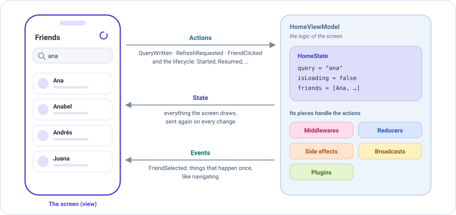
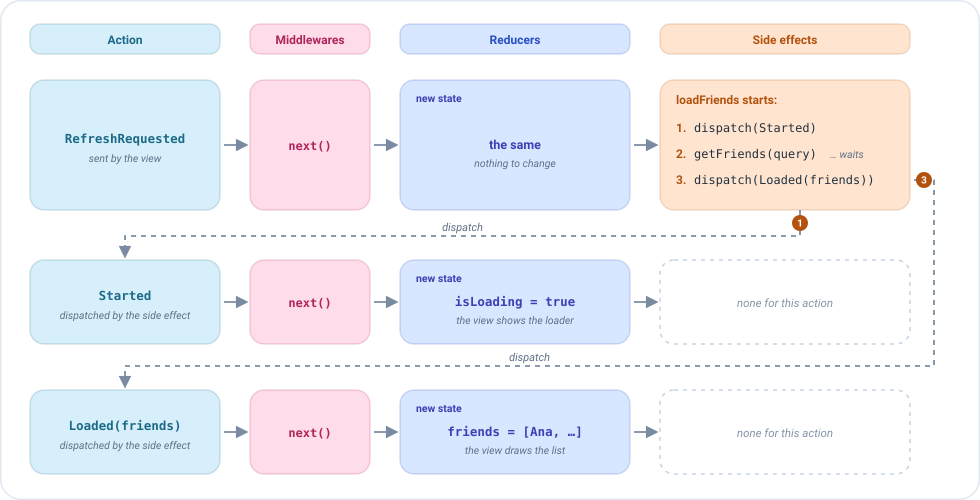

# ViewModel

An `EmaViewModel` is **the logic of a screen**. The view only draws and tells what the user does; the ViewModel
decides everything else. That is where all the pieces described in the previous pages come together: the [state](state.md), the
[actions](actions.md), the [events](events.md), and the [reducers](reducers.md), [side effects](side-effects.md),
[middlewares](middlewares.md), [broadcasts](broadcasts.md) and [plugins](plugins.md) that handle them.



The conversation between the two always has the same shape:

- **The view sends actions**: what the user does, like writing in the search field or pulling to refresh, and the
  lifecycle of the screen.
- **The ViewModel sends back the state**: everything the screen draws. Each time it changes, the view draws it again.
- **And the events**: what happens once, like navigating to the detail of a friend.

Each screen has its own ViewModel. **It is a plain Kotlin class**, with no platform code, so it can be tested and shared
between platforms.

## Your first ViewModel, in three steps

**1. Extend `EmaViewModel`** with the three types of the screen, and pass the initial state:

```kotlin
class HomeViewModel(
    private val getFriendsUseCase: GetFriendsUseCase,
    initialState: HomeState = HomeState()
) : EmaViewModel<HomeState, HomeAction, HomeEvent>(initialState)
```

**2. Declare its pieces in `setup`.** It returns `source { }`, where each kind of piece has its own block:

```kotlin
class HomeViewModel(
    private val getFriendsUseCase: GetFriendsUseCase,
    initialState: HomeState = HomeState()
) : EmaViewModel<HomeState, HomeAction, HomeEvent>(initialState) {

    override fun setup() = source {
        reducers {
            add<HomeAction> { action ->
                when (action) {
                    is HomeAction.QueryWritten -> state.copy(query = action.query)
                    is HomeAction.EffectQueryResult.Started -> state.copy(isLoading = true)
                    is HomeAction.EffectQueryResult.Loaded -> state.copy(isLoading = false, friends = action.friends)
                    is HomeAction.EffectQueryResult.Failed -> state.copy(isLoading = false, dialog = HomeDialog.LoadError)
                    is HomeAction.RefreshRequested,
                    is HomeAction.FriendClicked -> state
                }
            }
        }
        sideEffects {
            add<HomeAction.RefreshRequested>(concurrency = SideEffectConcurrency.Leading) {
                dispatch(HomeAction.EffectQueryResult.Started)
                getFriendsUseCase(GetFriendsUseCase.Input(state.query))
                    .onSuccess { friends -> dispatch(HomeAction.EffectQueryResult.Loaded(friends)) }
                    .onFailure { dispatch(HomeAction.EffectQueryResult.Failed) }
            }
            add<HomeAction.FriendClicked> { action ->
                postEvent(HomeEvent.FriendSelected(action.friend))
            }
        }
    }
}
```

**3. Give it to the screen.** The screen creates it once, and keeps it while the screen exists:

```kotlin
createComposableScreen(
    screenContent = HomeScreenContent(),
    viewModel = { HomeViewModel(getFriendsUseCase) },
    onEvent = { event -> /* navigation */ }
)
```

That's all: the screen draws the state, sends the actions and handles the events. See
[Compose screens](../compose/screens.md) and [Dependency injection](../guides/dependency-injection.md).

## What happens when the user does something

Every action takes the same path: **middlewares, reducers, side effects**. The reducers return the new state, and
the view draws it. When a side effect dispatches an action, that action starts the path again from the beginning.

This is a refresh in the ViewModel above. Each row is one action:



1. The view sends `RefreshRequested`. The reducers leave the state as it is, and the side effect `loadFriends` starts.
2. The side effect dispatches `Started`. It goes through the middlewares, and a reducer returns `isLoading = true`:
   the view shows the loader.
3. The side effect calls the use case and waits. The screen keeps working meanwhile.
4. When the friends arrive, it dispatches `Loaded(friends)`. Same path: a reducer puts them in the state, and the view
   draws the list.

This ViewModel has no middlewares, so each action goes straight on, as if a middleware called `next()`.

## The setup

`setup` is where the ViewModel declares its pieces. Each kind has its own block:

| Block                          | Adds                                                                               |
|--------------------------------|------------------------------------------------------------------------------------|
| `middlewares { }`              | [Middlewares](middlewares.md): they decide the path of an action before anything else. |
| `reducers { }`                 | [Reducers](reducers.md): they return the next state.                               |
| `sideEffects { }`              | [Side effects](side-effects.md): they run the work that an action starts.          |
| `broadcasts { listen<T>() }`   | [Broadcasts](broadcasts.md): the actions of other screens that it receives.        |
| `plugins { }`                  | [Plugins](plugins.md): groups of pieces reused in many screens.                    |

A few rules apply to all of them:

- **`add<Type> { }` creates a piece** for the actions of that type, and **`+` installs a piece that already exists**,
  like a property of the ViewModel or a plugin.
- **The pieces of the same kind run in the order they are added.** A block can be used more than once: its pieces go
  after the ones of the previous blocks of the same kind.
- **`setup` runs once**, the first time the ViewModel is used, not in its constructor. So it can use the properties of
  the class, like its use cases.

### Pieces are values

A piece doesn't have to be written inside `setup`. It can be a property of the ViewModel, declared with `reducerOf` or
`sideEffectOf`, and installed with `+`:

```kotlin
class HomeViewModel(
    private val getFriendsUseCase: GetFriendsUseCase,
    initialState: HomeState = HomeState()
) : EmaViewModel<HomeState, HomeAction, HomeEvent>(initialState) {

    private val homeReducer = reducerOf(HomeAction::class) { action ->
        when (action) {
            is HomeAction.QueryWritten -> state.copy(query = action.query)
            is HomeAction.EffectQueryResult.Started -> state.copy(isLoading = true)
            is HomeAction.EffectQueryResult.Loaded -> state.copy(isLoading = false, friends = action.friends)
            is HomeAction.EffectQueryResult.Failed -> state.copy(isLoading = false, dialog = HomeDialog.LoadError)
            is HomeAction.RefreshRequested,
            is HomeAction.FriendClicked -> state
        }
    }

    private val refresh = sideEffectOf(
        HomeAction.RefreshRequested::class,
        concurrency = SideEffectConcurrency.Leading
    ) {
        dispatch(HomeAction.EffectQueryResult.Started)
        getFriendsUseCase(GetFriendsUseCase.Input(state.query))
            .onSuccess { friends -> dispatch(HomeAction.EffectQueryResult.Loaded(friends)) }
            .onFailure { dispatch(HomeAction.EffectQueryResult.Failed) }
    }

    private val openFriend = sideEffectOf(HomeAction.FriendClicked::class) { action ->
        postEvent(HomeEvent.FriendSelected(action.friend))
    }

    override fun setup() = source {
        reducers { +homeReducer }
        sideEffects {
            +refresh
            +openFriend
        }
    }
}
```

The `setup` only installs them. That is what lets a ViewModel receive a piece in its constructor, without knowing which
implementation it gets: the same screen can call the real backend in production, use a mock in a demo build and a fake in
the tests. See [Dependency injection and environments](../guides/dependency-injection.md#injecting-pieces).

## The lifecycle as actions

The `EmaViewModel` also receives the lifecycle states and the initialization data as **actions**. The same pieces that handle
the user actions can handle these ones too.


| Action                       | When                                                                     |
|------------------------------|--------------------------------------------------------------------------|
| `EmaInitializer`             | **Once**, the first time the screen is created: its [initializer](../guides/initializers.md), or `EmaInitializer.EMPTY`. |
| `EmaLifecycle.Started`       | The screen becomes visible.                                              |
| `EmaLifecycle.Resumed`       | The screen is in the foreground.                                         |
| `EmaLifecycle.Paused`        | The screen is no longer fully visible.                                   |
| `EmaLifecycle.Stopped`       | The screen goes to the background.                                       |
| `EmaLifecycle.Destroyed`     | The last action, right before the ViewModel is closed.                   |

The [initializer](../guides/initializers.md) arrives **once**, so recreating the screen doesn't receive it again. A reducer can change the state
when these actions arrive, and a side effect can react to them:

```kotlin
override fun setup() = source {
    reducers {
        // The initializer gives the screen its first state
        add<HomeInitializer> { initializer ->
            when (initializer) {
                is HomeInitializer.HomeUser -> state.copy(user = initializer.user)
            }
        }
        // The dialog is closed when the user leaves the screen
        add<EmaLifecycle.Stopped> { state.copy(dialog = null) }
    }
    sideEffects {
        // The friends are loaded once, when the screen is created
        add<HomeInitializer> { dispatch(HomeAction.RefreshRequested) }
        // And refreshed every time the user comes back to the screen
        add<EmaLifecycle.Resumed> { dispatch(HomeAction.RefreshRequested) }
    }
}
```

For example, work that only makes sense while the user sees the screen, like a timer or location updates, starts with
`Started` and stops with `Stopped`.

### When the ViewModel is closed

After `Destroyed`, the ViewModel is closed and the work still running is cancelled, unless it is allowed to finish.
See [When the screen is closed](side-effects.md#when-the-screen-is-closed).

## The ViewModel and its screen

**One ViewModel per screen.** The screen creates it the first time it is opened, with the `viewModel` function you give
it, and keeps it while the screen exists. Recreating the view or coming back to the screen reuses it. When the screen is
closed for good, the ViewModel receives `Destroyed` and is closed. Opening the screen again creates a new one.

```kotlin
createComposableScreen(
    screenContent = HomeScreenContent(),
    // Called once, the first time the screen is opened
    viewModel = { HomeViewModel(getFriendsUseCase) },
    onEvent = { event -> /* navigation */ }
)
```

## Drawing before the first change

By default the screen draws the initial state at once. To avoid a flash of empty content, override
`updateOnInitialization` with `false`: the screen waits until the ViewModel receives its first action of the screen, or
an initializer other than `EmaInitializer.EMPTY`.

```kotlin
class HomeViewModel(
    private val getFriendsUseCase: GetFriendsUseCase,
    initialState: HomeState = HomeState()
) : EmaViewModel<HomeState, HomeAction, HomeEvent>(initialState) {

    override val updateOnInitialization = false

    // ...
}
```

## Configuration

The constructor also receives the `configuration` of the ViewModel: by default the one set with `Emanate.init`. It
decides where the ViewModel runs and what happens with its errors. See [Configuration](../guides/configuration.md).

```kotlin
class HomeViewModel(
    private val getFriendsUseCase: GetFriendsUseCase,
    initialState: HomeState = HomeState()
) : EmaViewModel<HomeState, HomeAction, HomeEvent>(
    initialState,
    configuration = EmaConfiguration.Android(debug = BuildConfig.DEBUG)
) {

    // ...
}
```

## Logs

Every `EmaViewModel` logs each action it receives, with the state before and after it. By default the logs go to the
standard output, with the name of the ViewModel as tag. A block like this is shown for each action (abbreviated):

```
EMA_HomeViewModel: ********************** STARTING EMA ACTION LOGGING **********************
EMA_HomeViewModel: | Dispatched action
EMA_HomeViewModel: | QueryWritten(query=ana)
EMA_HomeViewModel: | State before apply action
EMA_HomeViewModel: | HomeState(query=, isLoading=false, friends=[])
EMA_HomeViewModel: | State after apply action
EMA_HomeViewModel: | HomeState(query=ana, isLoading=false, friends=[])
EMA_HomeViewModel: ********************** FINISHED EMA ACTION LOGGING **********************
```

The `logger` of the [configuration](../guides/configuration.md#what-can-be-configured) decides where the logs go. To
send them to your own logger, implement `EmaLogger` in the configuration:

```kotlin
Emanate.init(
    EmaConfiguration.Android(debug = BuildConfig.DEBUG).copy(
        logger = EmaLogger { tag, message -> Timber.tag(tag).d(message) }
    )
)
```

## Under the hood: a source

Inside every `EmaViewModel` there is an `EmaSource`: the engine that runs the pieces. The `source { }` of `setup` is
what builds it. The ViewModel adds what a screen needs on top of it: the lifecycle and the initializer as actions, the
logs, and a life tied to its screen.

You don't need to know more to write screens. If you need the same engine without a screen, for example for a state
shared by several screens, see [Source](source.md).
