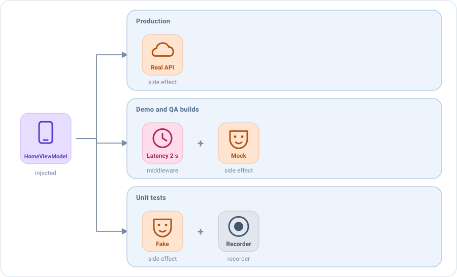
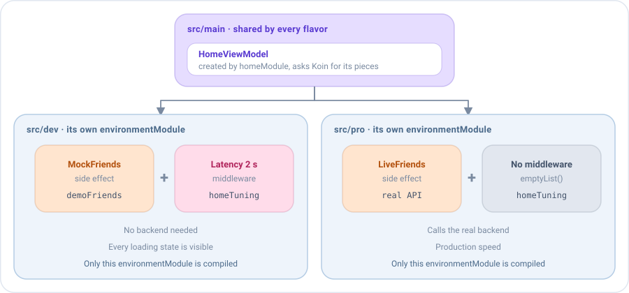

# Inyección de dependencias y entornos

Emanate no depende de ningún framework de inyección de dependencias. Dondequiera que necesita un ViewModel, te lo pide
con una función, así que puedes usar Koin, un contenedor manual o simples constructores.

```kotlin
emaScreen(
    screenContent = HomeScreenContent(),
    viewModel = { HomeViewModel(getFriendsUseCase, HomeState()) },
    onEvent = { /* ... */ }
)
```

Y como el comportamiento de una pantalla es una lista de piezas (middlewares, reducers y side effects) que
[se pueden sustituir](../concepts/viewmodel.md#las-piezas-son-valores), la misma inyección decide **cómo se comporta la
pantalla**: el backend real en producción, datos simulados en una build de desarrollo, latencia o errores en QA, un fake
en los tests. El ViewModel, la pantalla y el resto de la app se quedan exactamente igual.

## Un ViewModel por pantalla

Emanate llama a la función una vez, cuando la pantalla se abre por primera vez, y conserva el ViewModel mientras existe
la pantalla: mira [Cómo se mantiene vivo el ViewModel](../concepts/viewmodel.md#el-viewmodel-y-su-pantalla). La función
debe crear el ViewModel, no devolver uno que ya existe, para que cada pantalla tenga el suyo. Un singleton lo
compartirían todas las pantallas de ese tipo y conservaría el estado de una pantalla que ya se cerró.

## Con Koin

Así lo hace la app `sample`. Arranca Koin después de inicializar Emanate:

```kotlin
class EmaSampleApplication : Application() {

    override fun onCreate() {
        super.onCreate()
        Emanate.init(EmaConfiguration.Android(debug = BuildConfig.DEBUG))
        startKoin {
            androidContext(this@EmaSampleApplication)
            modules(dataModule, useCaseModule, uiModule)
        }
    }
}
```

Los repositorios suelen ser singletons y los casos de uso se crean cuando hacen falta. Declara los ViewModels como
`factory`, para que cada pantalla tenga el suyo. El estado inicial también se puede inyectar, lo que mantiene el estado
por defecto en un único sitio:

```kotlin
val dataModule = module {
    single<Repository> { RemoteRepository() }
}

val useCaseModule = module {
    factory { GetFriendsUseCase(get()) }
}

val uiModule = module {
    factoryOf(::HomeViewModel)
    factory { HomeState() }
}
```

```kotlin
emaScreen(
    screenContent = HomeScreenContent(),
    viewModel = { get<HomeViewModel>() },
    onEvent = { /* ... */ }
)
```

### El store de un backup

Un ViewModel que [sobrevive a la muerte del proceso](process-death.md) recibe su `EmaStateStore` en el constructor. La
función que crea el ViewModel recibe el store de la pantalla, así que pásaselo. Con Koin, como parámetro:

```kotlin
val uiModule = module {
    factory { (stateStore: EmaStateStore) -> HomeViewModel(get(), stateStore) }
}

emaScreen(
    screenContent = HomeScreenContent(),
    viewModel = { store -> get<HomeViewModel> { parametersOf(store) } },
    onEvent = { /* ... */ }
)
```

En las plataformas sin store, o en un test que no comprueba el estado guardado, pasa `EmaStateStore.None`.

## Inyectar piezas

Además de casos de uso, un ViewModel puede recibir sus middlewares, reducers y side effects. Un ViewModel que **recibe**
una pieza en lugar de declararla no sabe cuál le llega.



La pantalla de inicio carga los amigos del usuario. Saca del ViewModel el side effect que los carga, como una clase que
implementa `SideEffect`. Un type alias mantiene las firmas cortas:

```kotlin
typealias FriendsEffect = SideEffect<HomeState, HomeAction, HomeEvent, HomeAction.RefreshRequested>

class LiveFriends(private val getFriendsUseCase: GetFriendsUseCase) : FriendsEffect {

    override val actionType = HomeAction.RefreshRequested::class
    override val concurrency = SideEffectConcurrency.Leading

    override suspend fun SideEffectScope<HomeState, HomeAction, HomeEvent>.invoke(action: HomeAction.RefreshRequested) {
        dispatch(HomeAction.SideEffects.QueryStarted)
        getFriendsUseCase(GetFriendsUseCase.Input(state.query))
            .onSuccess { friends -> dispatch(HomeAction.SideEffects.QueryLoaded(friends)) }
            .onFailure { dispatch(HomeAction.SideEffects.QueryFailed) }
    }
}
```

El ViewModel lo recibe y lo instala con `add`. Los middlewares se pueden recibir de la misma forma:

```kotlin
class HomeViewModel(
    private val loadFriends: FriendsEffect,
    private val tuning: List<EmaMiddleware<HomeState, HomeAction, *>> = emptyList(),
    initialState: HomeState = HomeState()
) : EmaViewModel<HomeState, HomeAction, HomeEvent>(initialState) {

    override fun setup() = source {
        // Antes que nada, para que vean cada acción primero
        middlewares(MiddlewarePosition.First) {
            tuning.forEach { add(it) }
        }
        reducers {
            add<HomeAction> { action ->
                when (action) {
                    is HomeAction.SideEffects.QueryStarted -> state.copy(isLoading = true)
                    is HomeAction.SideEffects.QueryLoaded -> state.copy(isLoading = false, friends = action.friends)
                    is HomeAction.SideEffects.QueryFailed -> state.copy(isLoading = false, dialog = HomeDialog.LoadError)
                    // ...
                }
            }
        }
        sideEffects {
            add(loadFriends)
            add<HomeAction.FriendClicked> { action -> publish(HomeEvent.FriendSelected(action.friend)) }
        }
    }
}
```

Un mock es una implementación más de la misma pieza. Envía las mismas acciones que la real, así que el resto de la
pantalla no nota la diferencia:

```kotlin
class MockFriends(
    private val friends: List<User>?,
    private val latency: Duration = 500.milliseconds
) : FriendsEffect {

    override val actionType = HomeAction.RefreshRequested::class
    override val concurrency = SideEffectConcurrency.Leading

    override suspend fun SideEffectScope<HomeState, HomeAction, HomeEvent>.invoke(action: HomeAction.RefreshRequested) {
        dispatch(HomeAction.SideEffects.QueryStarted)
        delay(latency)
        dispatch(if (friends != null) HomeAction.SideEffects.QueryLoaded(friends) else HomeAction.SideEffects.QueryFailed)
    }
}
```

`MockFriends(friends = null)` muestra el diálogo de error, `MockFriends(emptyList())` la lista vacía y
`MockFriends(hundredFriends)` una larga. Los reducers y los eventos no cambian: la pantalla sigue mostrando su estado de
carga, su diálogo de error y su navegación exactamente como en producción.

## Dos comportamientos por flavor en Android: dev y pro

Este ejemplo es específico de Android, la única plataforma con product flavors. En las demás plataformas obtienes el
mismo resultado eligiendo los módulos en cada target, o con una factoría manual.

Decide las piezas donde se crea el ViewModel: en la inyección de dependencias de cada build. Con dos flavors de
Android, `dev` funciona sin backend y `pro` llama al real:



```kotlin
// build.gradle.kts de la app
android {
    flavorDimensions += "environment"
    productFlavors {
        create("dev") { dimension = "environment" }
        create("pro") { dimension = "environment" }
    }
}
```

El source set main declara lo que comparten ambas builds, y el source set de cada flavor declara un módulo con el mismo
nombre y sus propias piezas:

```kotlin
// src/main: igual en todas las builds
val homeModule = module {
    factory {
        HomeViewModel(loadFriends = get(), tuning = get(named("homeTuning")), initialState = get())
    }
}

// src/pro: el backend real
val environmentModule = module {
    factory<FriendsEffect> { LiveFriends(get()) }
    factory<List<EmaMiddleware<HomeState, HomeAction, *>>>(named("homeTuning")) { emptyList() }
}

// src/dev: amigos simulados y una red lenta
val environmentModule = module {
    factory<FriendsEffect> { MockFriends(friends = demoFriends) }
    factory<List<EmaMiddleware<HomeState, HomeAction, *>>>(named("homeTuning")) {
        listOf(middlewareDelayOf(HomeAction.RefreshRequested::class, 2.seconds))
    }
}
```

```kotlin
startKoin {
    modules(dataModule, useCaseModule, homeModule, environmentModule)
}
```

Cada build compila solo el `environmentModule` de su flavor, así que los mocks nunca llegan a la build `pro`. La lista
de middlewares tiene nombre porque Koin no distingue dos tipos `List`. Lo mismo funciona con build types (`debug`,
`qa`, `release`), con cualquier otro framework de inyección de dependencias, o con una factoría manual.

### Los entornos del sample

La app `sample` aplica esta idea a sus repositorios, con tres flavors. Cada uno tiene su `environmentModule` en
`src/<flavor>`, que enlaza los dos repositorios, y un `AppEnvironment` que la pantalla de login muestra como una etiqueta en una
esquina, salvo en `pro`:

| Flavor | `LoginRepository` | `FriendsRepository` | Para |
|--------|-------------------|---------------------|------|
| `mock` | `MockLoginRepository`, instantáneo | `InMemoryFriendsRepository` con tres amigos, sin guardar nada | Demos y trabajar sin conexión: siempre empieza igual |
| `dev`  | `MockLoginRepository`, 2 segundos | `DelayedFriendsRepository` sobre `MapFriendsRepository` | Ver los estados de carga y las animaciones de una red lenta |
| `pro`  | `ApiLoginRepository` sobre un `LoginApi` | `MapFriendsRepository` | El camino real: el `LoginApi` es la pieza que sustituye un cliente de red |

```kotlin
// app/src/mock
val environmentModule = module {
    single { AppEnvironment("mock") }
    single<LoginRepository> { MockLoginRepository(latency = ZERO) }
    single<FriendsRepository> { InMemoryFriendsRepository(demoFriends) }
}
```

Los casos de uso, los ViewModels y las pantallas son los mismos en las tres builds. Los repositorios se llaman por el tipo
de implementación que son, sin el sufijo `Impl`. Cada implementación vive en el source set del entorno que la usa (`MockLoginRepository` en
`src/mockDev`, compartido por `mock` y `dev`), así que la build de producción no lleva clases que no usa; el tono de la
etiqueta de `pro` es `Invisible`, así que ahí no se dibuja nada. Elige la variante en Build Variants de Android Studio, o con
`./gradlew :app:assembleMockDebug`. Cada flavor tiene su propio application id, así que las tres se pueden instalar a la vez.

## Qué puede cambiar un entorno

Sustituyes exactamente el comportamiento que quieres cambiar, al tamaño que quieras: una respuesta, un retraso, una
regla. Sin Emanate, esto suele significar un `if (isDemo)` dentro del ViewModel, una implementación falsa de todo un
repositorio, o una librería de mocks que solo funciona en los tests.

### Latencia

`middlewareDelayOf` retrasa las acciones de un tipo antes de que lleguen a los reducers y a los side effects, para ver
cada estado de carga como lo mostraría una red lenta:

```kotlin
val slowRefresh = middlewareDelayOf<HomeState, HomeAction, HomeAction.RefreshRequested>(
    HomeAction.RefreshRequested::class,
    2.seconds
)
```

Con `nextAfter`, un middleware también puede decidir el retraso, por ejemplo uno aleatorio para cada acción:

```kotlin
val randomLatency = middlewareOf<HomeState, HomeAction, EmaAction>(EmaAction::class) {
    nextAfter { delay(Random.nextLong(200, 1500)) }
}
```

### Errores y funcionalidades desactivadas

Un middleware puede sustituir una acción con `next(action)`. Este convierte cada refresco en un fallo, para comprobar el
diálogo de error en una build que habla con el backend real:

```kotlin
val failingRefresh = middlewareOf<HomeState, HomeAction, HomeAction.RefreshRequested>(HomeAction.RefreshRequested::class) {
    next(HomeAction.SideEffects.QueryFailed)
}
```

Y uno que no llama a `next` detiene la acción: nunca llega a los reducers ni a los side effects. Por ejemplo, para
mantener desactivada una funcionalidad en una build:

```kotlin
val profilesDisabled = middlewareOf<HomeState, HomeAction, HomeAction.FriendClicked>(HomeAction.FriendClicked::class) {
    // Sin llamar a next: los perfiles no se pueden abrir en esta build
}
```

### Una regla de negocio distinta

Los reducers también se pueden sustituir, para cambiar una regla de negocio en una build. Una build de desarrollo puede
dar a todos los usuarios el rol de administrador, para mostrar las pantallas que solo ven los administradores, sin una
cuenta especial:

```kotlin
class HomeViewModel(
    private val userReducer: EmaReducer<HomeState, HomeInitializer> = reducerOf(HomeInitializer::class) { initializer ->
        when (initializer) {
            is HomeInitializer.HomeUser -> state.copy(user = initializer.user)
        }
    }
) : EmaViewModel<HomeState, HomeAction, HomeEvent>(HomeState()) {

    override fun setup() = source {
        reducers { add(userReducer) }
    }
}

// dev
HomeViewModel(
    userReducer = reducerOf(HomeInitializer::class) { initializer ->
        when (initializer) {
            is HomeInitializer.HomeUser -> state.copy(user = initializer.user.copy(role = Role.ADMIN))
        }
    }
)
```

### El estado inicial

Para QA, abre una pantalla ya en el estado que quieres comprobar, sin repetir los pasos que llevan hasta él. Recibe el
estado inicial en el constructor, con el habitual como valor por defecto, y pasa el que necesites:

```kotlin
class HomeViewModel(
    private val loadFriends: FriendsEffect,
    initialState: HomeState = HomeState()
) : EmaViewModel<HomeState, HomeAction, HomeEvent>(initialState) {
    // ...
}

// QA: una búsqueda sin resultados
HomeViewModel(
    loadFriends = MockFriends(friends = emptyList()),
    initialState = HomeState(query = "Zoe", friends = emptyList())
)
```

Con los módulos de entorno de los [flavors](#dos-comportamientos-por-flavor-en-android-dev-y-pro), cada build aporta su
propio estado y el `homeModule` de `src/main` lo pasa con `initialState = get()`:

```kotlin
// src/pro
val environmentModule = module {
    factory { HomeState() }
}

// src/dev
val environmentModule = module {
    factory { HomeState(query = "Zoe", friends = emptyList()) }
}
```

El estado se construye a mano, así que mantenlo válido.

### Los tests

Los tests crean el ViewModel con las piezas que necesitan, sin librería de mocks y sin dispositivo:
`HomeViewModel(loadFriends = MockFriends(friends = null))`. Mira
[Testing](testing.md#cambiar-piezas-en-los-tests).

## Inyectar la configuración

Por defecto los ViewModels usan la configuración establecida con `Emanate.init`, así que no necesitan recibirla. Para
inyectarla en su lugar, por ejemplo en una librería que no puede llamar a `Emanate.init` o en un módulo con su propia
configuración, recíbela en el constructor y pásala al ViewModel. Mira
[Configuración explícita](configuration.md#configuración-explícita).

```kotlin
class HomeViewModel(
    private val getFriendsUseCase: GetFriendsUseCase,
    configuration: EmaConfiguration
) : EmaViewModel<HomeState, HomeAction, HomeEvent>(HomeState(), configuration)
```

Con Koin, decláralo como un `single`:

```kotlin
val uiModule = module {
    single { EmaConfiguration.Android(debug = BuildConfig.DEBUG) }
    factoryOf(::HomeViewModel)
}
```

Los casos de uso solo reciben el dispatcher `io` de la configuración, en el constructor:

```kotlin
val useCaseModule = module {
    factory { GetFriendsUseCase(get(), get<EmaConfiguration>().dispatchers.io) }
}
```

## Pautas

- **Declara el ViewModel como `factory`.** Cada pantalla necesita su propia instancia; un `single` compartiría el estado
  de una pantalla que ya se cerró.
- **Inyecta las piezas, no el ViewModel, y solo las que un entorno pueda cambiar.** Recibe en el constructor el side
  effect del backend, los middlewares o el estado inicial, con los de producción como valores por defecto. Lo que nunca
  cambia se queda dentro del ViewModel, para que el constructor no crezca con cada detalle.
- **Elige el entorno en la inyección de dependencias, nunca en el ViewModel.** Un `if (isDemo)` dentro del ViewModel es
  una rama que producción lleva consigo y que nadie testea.
- **Mantén los mocks fuera de la build de producción.** Decláralos en el source set de su flavor o build type, como en
  [el ejemplo de los flavors](#dos-comportamientos-por-flavor-en-android-dev-y-pro).
- **Ejecuta primero los middlewares que simulan condiciones**, con `MiddlewarePosition.First`, para que actúen antes que
  los middlewares de la pantalla.
- **Usa un plugin para una funcionalidad completa** que un entorno instala o no, como las analíticas o un overlay de
  debug. Mira [Plugins](../concepts/plugins.md).
