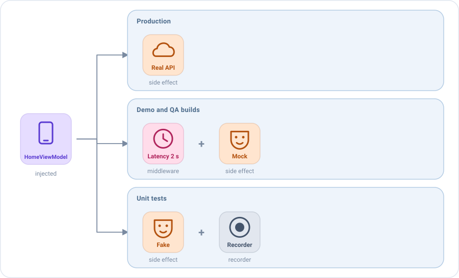

# Dependency injection and environments

Emanate does not depend on any dependency injection framework. Wherever it needs a ViewModel, it asks you for it with a
function, so you can use Koin, Hilt, Kodein, a manual container or plain constructors.

```kotlin
createComposableScreen(
    screenContent = HomeScreenContent(),
    viewModel = { HomeViewModel(getFriendsUseCase, HomeState()) },
    onEvent = { /* ... */ }
)
```

And because the behaviour of a screen is a list of pieces (middlewares, reducers and side effects) that
[can be replaced](../concepts/viewmodel.md#pieces-are-values), the same injection decides **how the screen behaves**:
the real backend in production, mocked data in a development build, latency or errors in QA, a fake in the tests. The
ViewModel, the screen and the rest of the app stay exactly the same.

## One ViewModel per screen

Emanate calls the function once, when the screen is opened for the first time, and keeps the ViewModel while the screen
exists: see [How the ViewModel is kept alive](../concepts/viewmodel.md#the-viewmodel-and-its-screen).
The function must create the ViewModel, not return one that already exists, so each screen gets its own. A singleton
would be shared by every screen of that type and would keep the state of a screen that was already closed.

## With Koin

This is how the `sample/` app does it. Start Koin after initializing Emanate:

```kotlin
class EmaSampleApplication : Application() {

    override fun onCreate() {
        super.onCreate()
        Emanate.init(EmaConfiguration.Android(debug = BuildConfig.DEBUG))
        startKoin {
            androidContext(this@EmaSampleApplication)
            modules(dataModule, useCaseModule, uiModule)
        }
    }
}
```

Repositories are usually singletons and use cases are created when needed. Declare the ViewModels as `factory`, so
each screen gets its own. The initial state can be injected too, which keeps the default state in one place:

```kotlin
val dataModule = module {
    single<Repository> { RemoteRepository() }
}

val useCaseModule = module {
    factory { GetFriendsUseCase(get()) }
}

val uiModule = module {
    factoryOf(::HomeViewModel)
    factory { HomeState() }
}
```

```kotlin
createComposableScreen(
    screenContent = HomeScreenContent(),
    viewModel = { get<HomeViewModel>() },
    onEvent = { /* ... */ }
)
```

### The store of a backup

A ViewModel that [survives the death of the process](process-death.md) receives its `EmaStateStore` in the
constructor. The function that creates the ViewModel receives the store of the screen, so pass it on. With Koin, as a
parameter:

```kotlin
val uiModule = module {
    factory { (stateStore: EmaStateStore) -> HomeViewModel(get(), stateStore) }
}

createComposableScreen(
    screenContent = HomeScreenContent(),
    viewModel = { store -> get<HomeViewModel> { parametersOf(store) } },
    onEvent = { /* ... */ }
)
```

On the platforms without a store, or in a test that doesn't check the saved state, pass `EmaStateStore.None`.

## Injecting pieces

Besides use cases, a ViewModel can receive its middlewares, reducers and side effects. A ViewModel that **receives** a
piece instead of declaring it doesn't know which one it gets.



The home screen loads the friends of the user. Take the side effect that loads them out of the ViewModel, as a class
that implements `SideEffect`. A type alias keeps the signatures short:

```kotlin
typealias FriendsEffect = SideEffect<HomeState, HomeAction, HomeEvent, HomeAction.RefreshRequested>

class LiveFriends(private val getFriendsUseCase: GetFriendsUseCase) : FriendsEffect {

    override val actionType = HomeAction.RefreshRequested::class
    override val concurrency = SideEffectConcurrency.Leading

    override suspend fun SideEffectScope<HomeState, HomeAction, HomeEvent>.invoke(action: HomeAction.RefreshRequested) {
        dispatch(HomeAction.EffectQueryResult.Started)
        getFriendsUseCase(GetFriendsUseCase.Input(state.query))
            .onSuccess { friends -> dispatch(HomeAction.EffectQueryResult.Loaded(friends)) }
            .onFailure { dispatch(HomeAction.EffectQueryResult.Failed) }
    }
}
```

The ViewModel receives it and installs it with `+`. Middlewares can be received the same way:

```kotlin
class HomeViewModel(
    private val loadFriends: FriendsEffect,
    private val tuning: List<EmaMiddleware<HomeState, HomeAction, *>> = emptyList()
) : EmaViewModel<HomeState, HomeAction, HomeEvent>(HomeState()) {

    override fun setup() = source {
        // Before anything else, so they see every action first
        middlewares(MiddlewarePosition.First) {
            tuning.forEach { +it }
        }
        reducers {
            add<HomeAction> { action ->
                when (action) {
                    is HomeAction.EffectQueryResult.Started -> state.copy(isLoading = true)
                    is HomeAction.EffectQueryResult.Loaded -> state.copy(isLoading = false, friends = action.friends)
                    is HomeAction.EffectQueryResult.Failed -> state.copy(isLoading = false, dialog = HomeDialog.LoadError)
                    // ...
                }
            }
        }
        sideEffects {
            +loadFriends
            add<HomeAction.FriendClicked> { action -> postEvent(HomeEvent.FriendSelected(action.friend)) }
        }
    }
}
```

A mock is one more implementation of the same piece. It dispatches the same actions as the real one, so the rest of the
screen can't tell the difference:

```kotlin
class MockFriends(
    private val friends: List<User>?,
    private val latency: Duration = 500.milliseconds
) : FriendsEffect {

    override val actionType = HomeAction.RefreshRequested::class
    override val concurrency = SideEffectConcurrency.Leading

    override suspend fun SideEffectScope<HomeState, HomeAction, HomeEvent>.invoke(action: HomeAction.RefreshRequested) {
        dispatch(HomeAction.EffectQueryResult.Started)
        delay(latency)
        dispatch(if (friends != null) HomeAction.EffectQueryResult.Loaded(friends) else HomeAction.EffectQueryResult.Failed)
    }
}
```

`MockFriends(friends = null)` shows the error dialog, `MockFriends(emptyList())` the empty list and
`MockFriends(hundredFriends)` a long one. The reducers and the events don't change: the screen still shows its loading
state, its error dialog and its navigation exactly as in production.

## Two behaviours by flavor: dev and pro

Decide the pieces where the ViewModel is created: in the dependency injection of each build. With two flavors, `dev`
works without a backend and `pro` calls the real one:

```kotlin
// build.gradle.kts of the app
android {
    flavorDimensions += "environment"
    productFlavors {
        create("dev") { dimension = "environment" }
        create("pro") { dimension = "environment" }
    }
}
```

The main source set declares what both builds share, and the source set of each flavor declares a module with the
same name and its own pieces:

```kotlin
// src/main: the same in every build
val homeModule = module {
    factory { HomeViewModel(loadFriends = get(), tuning = get(named("homeTuning"))) }
}

// src/pro: the real backend
val environmentModule = module {
    factory<FriendsEffect> { LiveFriends(get()) }
    factory<List<EmaMiddleware<HomeState, HomeAction, *>>>(named("homeTuning")) { emptyList() }
}

// src/dev: mocked friends and a slow network
val environmentModule = module {
    factory<FriendsEffect> { MockFriends(friends = demoFriends) }
    factory<List<EmaMiddleware<HomeState, HomeAction, *>>>(named("homeTuning")) {
        listOf(middlewareDelayOf(HomeAction.RefreshRequested::class, 2.seconds))
    }
}
```

```kotlin
startKoin {
    modules(dataModule, useCaseModule, homeModule, environmentModule)
}
```

Each build compiles only the `environmentModule` of its flavor, so the mocks never reach the `pro` build. The list of
middlewares has a name because Koin can't tell two `List` types apart. The same works
with build types (`debug`, `qa`, `release`), with any other dependency injection framework, or with a manual factory.

## What an environment can change

You replace exactly the behaviour you want to change, at the size you want: one response, one delay, one rule. Without
Emanate, this usually means an `if (isDemo)` inside the ViewModel, a fake implementation of a whole repository, or a
mocking library that only works in the tests.

### Latency

`middlewareDelayOf` delays the actions of a type before they reach the reducers and the side effects, to see every
loading state as a slow network would show it:

```kotlin
val slowRefresh = middlewareDelayOf<HomeState, HomeAction, HomeAction.RefreshRequested>(
    HomeAction.RefreshRequested::class,
    2.seconds
)
```

With `nextAfter`, a middleware can also decide the delay, for example a random one for every action:

```kotlin
val randomLatency = middlewareOf<HomeState, HomeAction, EmaAction>(EmaAction::class) {
    nextAfter { delay(Random.nextLong(200, 1500)) }
}
```

### Errors and disabled features

A middleware can replace an action with `next(action)`. This one turns every refresh into a failure, so the error
dialog can be checked in a build that talks to the real backend:

```kotlin
val failingRefresh = middlewareOf<HomeState, HomeAction, HomeAction.RefreshRequested>(HomeAction.RefreshRequested::class) {
    next(HomeAction.EffectQueryResult.Failed)
}
```

And one that doesn't call `next` stops the action: it never reaches the reducers nor the side effects. For example, to
keep a feature disabled in a build:

```kotlin
val profilesDisabled = middlewareOf<HomeState, HomeAction, HomeAction.FriendClicked>(HomeAction.FriendClicked::class) {
    // Not calling next: the profiles can't be opened in this build
}
```

### A rule

Reducers can be replaced too. A development build can give every user the administrator role, to show the screens
that only administrators see, without a special account:

```kotlin
class HomeViewModel(
    private val userReducer: EmaReducer<HomeState, HomeInitializer> = reducerOf(HomeInitializer::class) { initializer ->
        when (initializer) {
            is HomeInitializer.HomeUser -> state.copy(user = initializer.user)
        }
    }
) : EmaViewModel<HomeState, HomeAction, HomeEvent>(HomeState()) {

    override fun setup() = source {
        reducers { +userReducer }
    }
}

// dev
HomeViewModel(
    userReducer = reducerOf(HomeInitializer::class) { initializer ->
        when (initializer) {
            is HomeInitializer.HomeUser -> state.copy(user = initializer.user.copy(role = Role.ADMIN))
        }
    }
)
```

### The starting state

For QA, open a screen already in the state you want to check, without repeating the steps that lead to it. An
extension function adds a side effect that dispatches a list of actions when the screen is created:

```kotlin
fun <S : EmaState, A : EmaAction, E : EmaEvent> SourceSetupScope<S, A, E>.startWith(actions: List<A>) {
    sideEffects {
        add<EmaInitializer> { actions.forEach { dispatch(it) } }
    }
}

class HomeViewModel(
    private val loadFriends: FriendsEffect,
    private val startActions: List<HomeAction> = emptyList()
) : EmaViewModel<HomeState, HomeAction, HomeEvent>(HomeState()) {

    override fun setup() = source {
        startWith(startActions)
        // ...
    }
}

// QA: a search with no results
HomeViewModel(
    loadFriends = MockFriends(friends = emptyList()),
    startActions = listOf(HomeAction.QueryWritten("Zoe"), HomeAction.RefreshRequested)
)
```

The actions go through the same reducers as the ones of the user, so the state is always a valid one.

### The tests

The tests create the ViewModel with the pieces they need, with no mocking library and no device:
`HomeViewModel(loadFriends = MockFriends(friends = null))`. See [Testing](testing.md#swapping-pieces-in-the-tests).

## Injecting the configuration

By default the ViewModels use the configuration set with `Emanate.init`, so they don't need to receive it. To inject it
instead, for example in a library that can't call `Emanate.init` or in a module with its own configuration, receive it
in the constructor and pass it to the ViewModel. See [Explicit configuration](configuration.md#explicit-configuration).

```kotlin
class HomeViewModel(
    private val getFriendsUseCase: GetFriendsUseCase,
    configuration: EmaConfiguration
) : EmaViewModel<HomeState, HomeAction, HomeEvent>(HomeState(), configuration)
```

With Koin, declare it as a `single`:

```kotlin
val uiModule = module {
    single { EmaConfiguration.Android(debug = BuildConfig.DEBUG) }
    factoryOf(::HomeViewModel)
}
```

With Hilt, provide it from a module, and add `@Inject` to the constructor of the ViewModel:

```kotlin
@Module
@InstallIn(SingletonComponent::class)
object EmanateModule {

    @Provides
    @Singleton
    fun provideConfiguration(): EmaConfiguration = EmaConfiguration.Android(debug = BuildConfig.DEBUG)
}
```

The use cases only receive the `io` dispatcher of the configuration, in the constructor:

```kotlin
val useCaseModule = module {
    factory { GetFriendsUseCase(get(), get<EmaConfiguration>().dispatchers.io) }
}
```

## Guidelines

- **Swap the smallest piece.** Replace the side effect that calls the backend, not the ViewModel. The reducers, the
  events and the screen are then tested and demoed exactly as they run in production.
- **Mocks dispatch the same actions as the real pieces.** Then the rest of the screen can't tell them apart.
- **Keep the mocks out of the production build**, in the source set of their flavor or build type.
- **Use `MiddlewarePosition.First`** for the middlewares that simulate conditions, so they run before the ones of the
  screen.
- **Prefer a plugin for a whole feature** that an environment installs or not, like analytics or a debug overlay. See
  [Plugins](../concepts/plugins.md).
