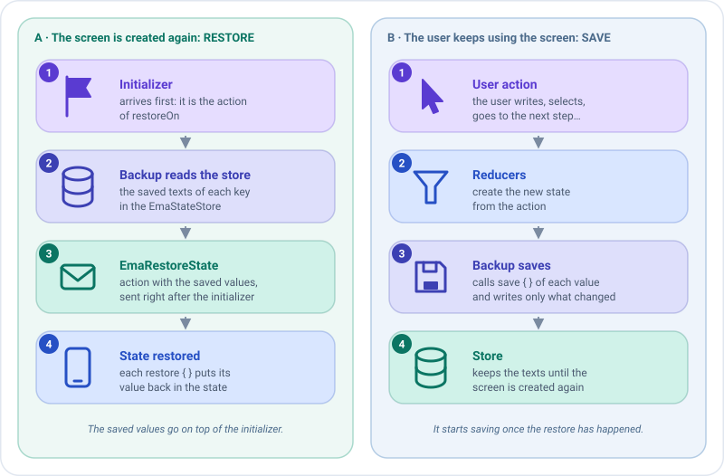

# Sobrevivir a la muerte del proceso

En algunas plataformas, como Android, el sistema puede matar tu app mientras está en segundo plano, por ejemplo mientras
el usuario va a los ajustes a conceder un permiso. Cuando el usuario vuelve, la pantalla se crea de nuevo con su
[inicializador](initializers.md), pero lo que el usuario había escrito se pierde.

Emanate lo resuelve con un **backup**: un [plugin](../concepts/plugins.md) que guarda las partes del estado que elijas
cada vez que cambian, y las restaura cuando la pantalla se crea de nuevo. El ViewModel sigue siendo Kotlin puro: la
plataforma solo le da el almacén donde se guardan los valores.

```kotlin
class ProfileCreationViewModel(
    private val addFriendUseCase: AddFriendUseCase,
    initialDataState: ProfileCreationState,
    private val stateStore: EmaStateStore
) : EmaViewModel<ProfileCreationState, ProfileCreationAction, ProfileCreationEvent>(initialDataState) {

    override fun setup() = source {
        plugins {
            add(backupOf(stateStore) {
                add(
                    key = "form",
                    codec = json(),
                    save = { ProfileCreationForm(name, surname) },
                    restore = { form -> copy(name = form.name, surname = form.surname) }
                )
            })
        }
        reducers { /* ... */ }
    }
}

@Serializable
data class ProfileCreationForm(val name: String, val surname: String)
```

Eso es todo. No hay callbacks de guardado, ni `SavedStateHandle`, ni código Android en el ViewModel.

## El store

`EmaStateStore` guarda los valores como texto. Cada plataforma decide dónde: en Android, Emanate da a cada pantalla un
store sobre el `SavedStateHandle` de su destino, y la función `viewModel` de la pantalla lo recibe, así que pásaselo al
ViewModel.

```kotlin
emaScreen(
    screenContent = ProfileCreationScreenContent(),
    viewModel = { store -> get<ProfileCreationViewModel> { parametersOf(store) } },
    onEvent = { /* ... */ }
)
```

Con Koin, pásalo como parámetro. Mira [Inyección de dependencias](dependency-injection.md#el-store-de-un-backup). Donde
no hay nada que guardar, por ejemplo en plataformas que no matan el proceso, pasa `EmaStateStore.None`.

## Cuándo se restauran los valores

Dos piezas lo deciden: `restoreOn`, **cuándo** restaura el backup, y `EmaRestoreState`, **cómo** llegan los valores.



### `restoreOn`: la acción que dispara la restauración

El backup restaura los valores justo después de la primera acción de tipo `restoreOn`. Por defecto es el
[inicializador](initializers.md), que el ViewModel siempre recibe cuando se crea su pantalla. Así el inicializador no
puede sobrescribir lo que escribió el usuario: se aplica primero, y los valores guardados encima.

!!! note "Cámbialo solo si tu pantalla no está lista tras el inicializador"
    Pasa otro tipo de acción al backup: `backupOf(stateStore, restoreOn = ScreenOpened::class)`. Hasta que llega esa
    acción el backup ni restaura ni guarda: espera para que el estado inicial no pueda sobrescribir los valores
    guardados. Una pantalla que nunca la recibe nunca se restaura, y su estado nunca se guarda.

### `EmaRestoreState`: la acción con los valores guardados

Los valores llegan como una acción `EmaRestoreState`, que pasa por los middlewares y reducers como cualquier otra. No
tienes que gestionarla: cada función `restore` ya ha puesto su valor en el estado. Gestiónala solo si el estado
restaurado necesita algo más, por ejemplo validar de nuevo el formulario:

```kotlin
reducers {
    add<EmaRestoreState> { state.copy(canCreate = state.name.isNotBlank()) }
}
```

!!! warning "Instala el backup antes de esos reducers"
    El backup debe haber restaurado sus valores cuando se ejecutan los reducers de `EmaRestoreState`, así que escribe
    `plugins { }` antes de `reducers { }`.

## Los valores

Cada valor tiene una clave única, una función que lo lee del estado y otra que lo devuelve a él:

| En `backupOf { }`                           | Guarda                                                                 |
|---------------------------------------------|------------------------------------------------------------------------|
| `add(key, save, restore)`                   | Un `String`.                                                           |
| `add(key, codec, save, restore)`            | Un valor de cualquier tipo, convertido a texto con un `EmaBackupCodec`. |
| `add(value)`                                | Un valor ya creado. Acepta varios, o una colección.                    |

`save` devuelve `null` para no guardar nada. Los valores se restauran en el orden en que se añaden.

### Codecs

| Codec                     | Módulo                  | Guarda                                                         |
|---------------------------|-------------------------|----------------------------------------------------------------|
| `EmaBackupCodec.Text`     | `emanate-core`          | Texto tal cual.                                                |
| `json()`                  | `emanate-serialization` | Cualquier clase `@Serializable` o tipo básico, en JSON. Dentro de `add`, el tipo se toma de `save`; en otros sitios escríbelo: `json<ProfileCreationForm>()`. |
| Tu propio `EmaBackupCodec`| Tu código               | Cualquier cosa, por ejemplo un enum por su nombre.             |

```kotlin
dependencies {
    implementation("com.github.carmabs.ema:emanate-serialization:$emanateVersion")
}
```

Un valor que no se puede decodificar, por ejemplo uno guardado por una versión anterior de la app con otros campos, no
se restaura: la pantalla mantiene su estado inicial.

## Ejemplos

### 1. Guardar un solo texto

El caso más sencillo: un `String` y ningún codec. `save` lo lee del estado y `restore` lo devuelve a él.

```kotlin
add(backupOf(stateStore) {
    add(
        key = "search",
        save = { query },                       // lo que se guarda cada vez que cambia el estado
        restore = { saved -> copy(query = saved) } // cómo se reconstruye el estado con él
    )
})
```

### 2. Guardar varios campos como un solo valor

Agrupa los campos en una clase `@Serializable` y usa `json()`. Una clave, un valor, sin importar cuántos campos haya.

```kotlin
@Serializable
data class SignUpForm(val email: String, val acceptedTerms: Boolean)

add(backupOf(stateStore) {
    add(
        key = "form",
        codec = json(),
        save = { SignUpForm(email, acceptedTerms) },
        restore = { form -> copy(email = form.email, acceptedTerms = form.acceptedTerms) }
    )
})
```

### 3. Guardar varios valores independientes

Añade un valor por cada cosa, con su propia clave. Se restauran en el orden en que se añaden.

```kotlin
add(backupOf(stateStore) {
    add(key = "name", save = { name }, restore = { copy(name = it) })
    add(key = "surname", save = { surname }, restore = { copy(surname = it) })
})
```

### 4. No guardar nada en algunos casos

`save` devuelve `null` para no guardar nada: el valor se elimina del store, así que no hay nada que restaurar. Aquí el
email se guarda solo cuando el usuario ha escrito algo.

```kotlin
add(
    key = "email",
    save = { email.takeIf { it.isNotBlank() } },
    restore = { saved -> copy(email = saved) }
)
```

### 5. Guardar un tipo con tu propio codec

Para cualquier cosa que no sea texto ni `@Serializable`, escribe un `EmaBackupCodec`: `encode` convierte el valor en
texto y `decode` lo convierte de vuelta, devolviendo `null` si el texto no es válido.

```kotlin
enum class Tab { Home, Settings }

val tabCodec = object : EmaBackupCodec<Tab> {
    override fun encode(value: Tab) = value.name
    override fun decode(value: String) = Tab.entries.firstOrNull { it.name == value }
}

add(key = "tab", codec = tabCodec, save = { tab }, restore = { copy(tab = it) })
```

### 6. Restaurar con otra acción

Por defecto los valores se restauran después del [inicializador](initializers.md). Si tu pantalla está lista tras otra
acción, díselo al backup con `restoreOn`:

```kotlin
add(backupOf(stateStore, restoreOn = ScreenOpened::class) {
    add(key = "name", save = { name }, restore = { copy(name = it) })
})
```

### 7. Juntarlo todo

Una pantalla completa: el ViewModel instala el backup, y la pantalla le pasa el store.

```kotlin
class SignUpViewModel(
    initialDataState: SignUpState,
    private val stateStore: EmaStateStore
) : EmaViewModel<SignUpState, SignUpAction, SignUpEvent>(initialDataState) {

    override fun setup() = source {
        plugins {
            add(backupOf(stateStore) {
                add(
                    key = "form",
                    codec = json(),
                    save = { SignUpForm(email, acceptedTerms) },
                    restore = { form -> copy(email = form.email, acceptedTerms = form.acceptedTerms) }
                )
            })
        }
        reducers {
            add<SignUpAction.EmailWritten> { state.copy(email = action.email) }
            add<SignUpAction.TermsToggled> { state.copy(acceptedTerms = !state.acceptedTerms) }
        }
    }
}

// En la pantalla (Android)
emaScreen(
    screenContent = SignUpScreenContent(),
    viewModel = { store -> SignUpViewModel(SignUpState.DEFAULT, store) },
    onEvent = { /* ... */ }
)
```

El flujo es: el usuario escribe el email, el backup guarda el formulario; el sistema mata el proceso; el usuario vuelve,
la pantalla se crea y llega el inicializador; el backup restaura el formulario encima. El usuario ve el email de nuevo.

## Testearlo

`emanate-test` tiene un store en memoria. Pásalo a un ViewModel y luego a uno nuevo, para simular la muerte del proceso:
el nuevo restaura lo que guardó el primero.

```kotlin
@Test
fun `the form survives the death of the process`() = runTest {
    val store = testStateStore()
    val first = ProfileCreationViewModel(AddFriendUseCase(FakeFriendsRepository()), ProfileCreationState.DEFAULT, store)
    first.onCreated()
    first.dispatch(ProfileCreationAction.UserNameWritten("Ana"))

    val restored = ProfileCreationViewModel(AddFriendUseCase(FakeFriendsRepository()), ProfileCreationState.DEFAULT, store)
    restored.onCreated()

    assertEquals("Ana", restored.stateFlow.value.name)
}
```

`store.values` muestra lo que está guardado, y `restoreStateOf("form" to "...")` crea el `EmaRestoreState` para
comprobarlo con `assertActions`.

## Consejos

- **Guarda solo lo que el usuario perdería**: campos de formularios, elementos seleccionados, el paso actual. La
  plataforma limita el tamaño de los valores guardados.
- **No guardes lo que puedes volver a cargar**, como las listas de la red: cárgalas de nuevo desde el inicializador.
- **Un backup por ViewModel o `EmaSource`.** Un backup no se puede instalar en dos ViewModels: crea uno en cada uno.
