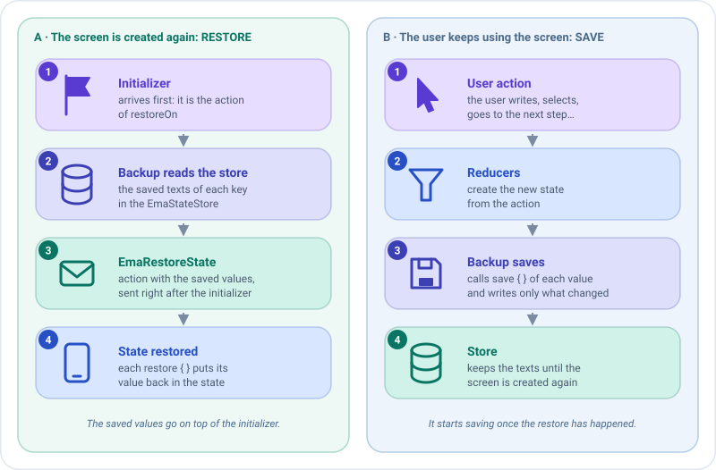

# Surviving process death

On some platforms, like Android, the system can kill your app while it is in the background, for example while the
user goes to the settings to grant a permission. When the user comes back, the screen is created again with its
[initializer](initializers.md), but what the user typed is lost.

Emanate solves it with a **backup**: a [plugin](../concepts/plugins.md) that saves the parts of the state you
choose every time they change, and restores them when the screen is created again. The ViewModel stays pure Kotlin:
the platform only gives it the store where the values are kept.

```kotlin
class ProfileCreationViewModel(
    initialDataState: ProfileCreationState,
    private val stateStore: EmaStateStore
) : EmaViewModel<ProfileCreationState, ProfileCreationAction, ProfileCreationEvent>(initialDataState) {

    override fun setup() = source {
        plugins {
            +backupOf(stateStore) {
                add(
                    key = "form",
                    codec = json(),
                    save = { ProfileCreationForm(name, surname) },
                    restore = { form -> copy(name = form.name, surname = form.surname) }
                )
            }
        }
        reducers { /* ... */ }
    }
}

@Serializable
data class ProfileCreationForm(val name: String, val surname: String)
```

That's all. There are no save callbacks, no `SavedStateHandle` and no Android code in the ViewModel.

## The store

`EmaStateStore` keeps the saved values as text. Each platform decides where: on Android, Emanate gives each screen a
store over the `SavedStateHandle` of its destination, and the `viewModel` function of the screen receives it, so pass
it to the ViewModel.

```kotlin
createComposableScreen(
    screenContent = ProfileCreationScreenContent(),
    viewModel = { store -> ProfileCreationViewModel(ProfileCreationState.DEFAULT, store) },
    onEvent = { /* ... */ }
)
```

With Koin, pass it as a parameter. See [Dependency injection](dependency-injection.md#the-store-of-a-backup). Where
nothing has to be saved, for example on platforms that don't kill the process, pass `EmaStateStore.None`.

## When the values are restored

Two pieces decide it: `restoreOn`, **when** the backup restores, and `EmaRestoreState`, **how** the values arrive.



### `restoreOn`: the action that triggers the restore

The backup restores the values right after the first action of type `restoreOn`. By default it is the
[initializer](initializers.md), which the ViewModel always receives when its screen is created. So the initializer
can't overwrite what the user typed: it is applied first, and the saved values on top of it.

!!! note "Change it only if your screen is not ready after the initializer"
    Pass another action type to the backup: `backupOf(stateStore, restoreOn = ScreenOpened::class)`. Until that
    action arrives the backup neither restores nor saves: it waits so the initial state can't overwrite the saved
    values. A screen that never receives it is never restored, and its state is never saved.

### `EmaRestoreState`: the action with the saved values

The values arrive as an `EmaRestoreState` action, which goes through the middlewares and reducers like any other.
You don't have to handle it: each `restore` function has already put its value in the state. Handle it only if the
restored state needs something else, for example to validate the form again:

```kotlin
reducers {
    add<EmaRestoreState> { state.copy(canCreate = state.name.isNotBlank()) }
}
```

!!! warning "Install the backup before those reducers"
    The backup must have restored its values when the `EmaRestoreState` reducers run, so write `plugins { }` before
    `reducers { }`.

## The values

Each value has a unique key, a function that reads it from the state and another one that puts it back:

| In `backupOf { }`                           | Saves                                                                  |
|---------------------------------------------|------------------------------------------------------------------------|
| `add(key, save, restore)`                   | A `String`.                                                            |
| `add(key, codec, save, restore)`            | A value of any type, converted to text with an `EmaBackupCodec`.       |
| `+value`                                    | A value already created.                                               |

`save` returns `null` to save nothing. The values are restored in the order they are added.

### Codecs

| Codec                     | Module                  | Saves                                                          |
|---------------------------|-------------------------|----------------------------------------------------------------|
| `EmaBackupCodec.Text`     | `emanate-core`          | Text as it is.                                                 |
| `json()`                  | `emanate-serialization` | Any `@Serializable` class or basic type, in JSON. Inside `add`, the type is taken from `save`; elsewhere write it: `json<ProfileCreationForm>()`. |
| Your own `EmaBackupCodec` | Your code               | Anything, for example an enum by its name.                     |

```kotlin
dependencies {
    implementation("com.github.carmabs.ema:emanate-serialization:$emanateVersion")
}
```

A value that can't be decoded, for example one saved by a previous version of the app with other fields, is not
restored: the screen keeps its initial state.

## Examples

### 1. Save a single text

The simplest case: one `String` and no codec. `save` reads it from the state and `restore` puts it back.

```kotlin
+backupOf(stateStore) {
    add(
        key = "search",
        save = { query },                       // what is saved every time the state changes
        restore = { saved -> copy(query = saved) } // how the state is rebuilt with it
    )
}
```

### 2. Save several fields as one value

Group the fields in a `@Serializable` class and use `json()`. One key, one value, no matter how many fields.

```kotlin
@Serializable
data class SignUpForm(val email: String, val acceptedTerms: Boolean)

+backupOf(stateStore) {
    add(
        key = "form",
        codec = json(),
        save = { SignUpForm(email, acceptedTerms) },
        restore = { form -> copy(email = form.email, acceptedTerms = form.acceptedTerms) }
    )
}
```

### 3. Save several independent values

Add one value for each thing, with its own key. They are restored in the order they are added.

```kotlin
+backupOf(stateStore) {
    add(key = "name", save = { name }, restore = { copy(name = it) })
    add(key = "surname", save = { surname }, restore = { copy(surname = it) })
}
```

### 4. Save nothing in some cases

`save` returns `null` to save nothing: the value is removed from the store, so there is nothing to restore.
Here the email is saved only once the user has typed something.

```kotlin
add(
    key = "email",
    save = { email.takeIf { it.isNotBlank() } },
    restore = { saved -> copy(email = saved) }
)
```

### 5. Save a type with your own codec

For anything that isn't text or `@Serializable`, write an `EmaBackupCodec`: `encode` converts the value to text and
`decode` converts it back, returning `null` if the text is not valid.

```kotlin
enum class Tab { Home, Settings }

val tabCodec = object : EmaBackupCodec<Tab> {
    override fun encode(value: Tab) = value.name
    override fun decode(value: String) = Tab.entries.firstOrNull { it.name == value }
}

add(key = "tab", codec = tabCodec, save = { tab }, restore = { copy(tab = it) })
```

### 6. Restore on another action

By default the values are restored after the [initializer](initializers.md). If your screen is ready after another
action, tell the backup with `restoreOn`:

```kotlin
+backupOf(stateStore, restoreOn = ScreenOpened::class) {
    add(key = "name", save = { name }, restore = { copy(name = it) })
}
```

### 7. Put it all together

A complete screen: the ViewModel installs the backup, and the screen passes the store to it.

```kotlin
class SignUpViewModel(
    initialDataState: SignUpState,
    private val stateStore: EmaStateStore
) : EmaViewModel<SignUpState, SignUpAction, SignUpEvent>(initialDataState) {

    override fun setup() = source {
        plugins {
            +backupOf(stateStore) {
                add(
                    key = "form",
                    codec = json(),
                    save = { SignUpForm(email, acceptedTerms) },
                    restore = { form -> copy(email = form.email, acceptedTerms = form.acceptedTerms) }
                )
            }
        }
        reducers {
            add<SignUpAction.EmailWritten> { state.copy(email = action.email) }
            add<SignUpAction.TermsToggled> { state.copy(acceptedTerms = !state.acceptedTerms) }
        }
    }
}

// In the screen (Android)
createComposableScreen(
    screenContent = SignUpScreenContent(),
    viewModel = { store -> SignUpViewModel(SignUpState.DEFAULT, store) },
    onEvent = { /* ... */ }
)
```

The flow is: the user writes the email, the backup saves the form; the system kills the process; the user comes back,
the screen is created and the initializer arrives; the backup restores the form on top of it. The user sees the
email again.

## Testing it

`emanate-test` has a store in memory. Pass it to a ViewModel and then to a new one, to simulate the death of the
process: the new one restores what the first one saved.

```kotlin
@Test
fun `the form survives the death of the process`() = runTest {
    val store = testStateStore()
    val first = ProfileCreationViewModel(ProfileCreationState.DEFAULT, store)
    first.onCreated(ProfileCreationInitializer.Admin)
    first.dispatch(ProfileCreationAction.UserNameWritten("Ana"))

    val restored = ProfileCreationViewModel(ProfileCreationState.DEFAULT, store)
    restored.onCreated(ProfileCreationInitializer.Admin)

    assertEquals("Ana", restored.stateFlow.value.name)
}
```

`store.values` shows what is saved, and `restoreStateOf("form" to "...")` creates the `EmaRestoreState` to check it
with `assertActions`.

## Tips

- **Save only what the user would lose**: form fields, selected items, the current step. The platform limits the size
  of the saved values.
- **Don't save what you can load again**, like lists from the network: load them again from the initializer.
- **One backup per source.** A backup can't be installed in two ViewModels: create one in each.
