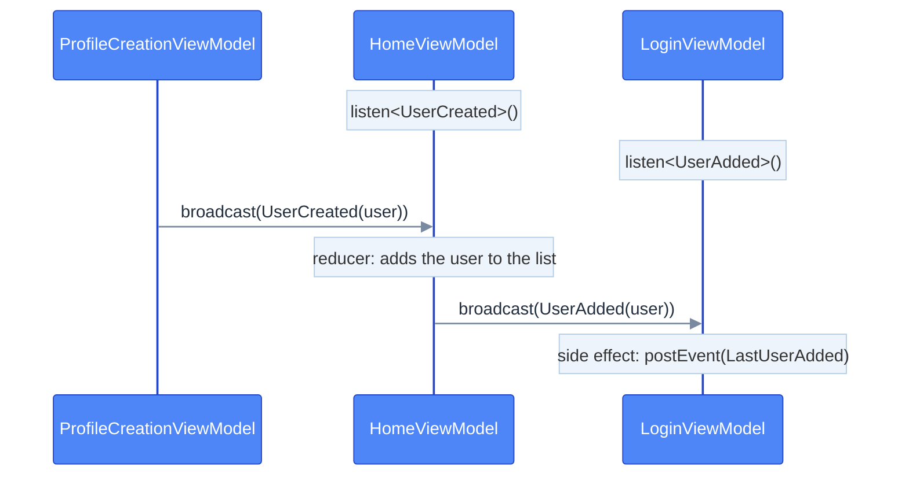

# Results between screens

Sometimes a screen needs to tell the previous one something: "I created this user". In Emanate a result is just an
**action** broadcast to the ViewModels that listen to its type. There are no fragment result APIs, no shared ViewModels
and no casts: the result is a typed data class, and the receiver handles it with its own reducers and side effects.

## Broadcast actions

A result is an **action**, and its type is the id of the broadcast. The sender broadcasts it from a side effect, and
every ViewModel listening to that type receives it as one more action of its source: it goes through its middlewares,
reducers and side effects of that type.



Declare the result as an action, next to the actions of the screen that sends it:

```kotlin
sealed interface ProfileCreationBroadcast : EmaAction {
    data class UserCreated(val user: User) : ProfileCreationBroadcast
}
```

## Send

Broadcast it with `broadcast`, available in every side effect. It accepts any action:

```kotlin
sideEffects {
    add<ProfileCreationAction.DialogConfirmClicked> {
        val user = User(state.name, state.surname, state.role)
        broadcast(ProfileCreationBroadcast.UserCreated(user), keepUntilReceived = true)
        postEvent(ProfileCreationEvent.DialogConfirmationAccepted)
    }
}
```

## Receive

Listen to its type in the `broadcasts` block of `setup` and handle it like any other action:

```kotlin
override fun setup() = source {
    reducers {
        add<ProfileCreationBroadcast.UserCreated> { action ->
            state.copy(userList = state.userList + action.user)
        }
    }
    sideEffects {
        // Passes it along to the login screen
        add<ProfileCreationBroadcast.UserCreated> { action ->
            broadcast(HomeBroadcast.UserAdded(action.user), keepUntilReceived = true)
        }
    }
    broadcasts {
        listen<ProfileCreationBroadcast.UserCreated>()
    }
}
```

## Rules

- **Delivery is immediate**, to every ViewModel listening to the type at that moment. The ViewModels of the previous
  screens are alive in the back stack, so they receive it. If nobody is listening, the action is lost, unless it is
  kept.
- **Any number of receivers.** Every ViewModel that listens to the type receives the action.
- **The listener is removed when the ViewModel is closed**, together with the rest of its work.
- **It is typed.** The result is a data class, with no casts.
- **It lives in memory.** It is not saved if the process is killed.
- **It goes through the broadcaster of the configuration.** By default every ViewModel uses the same one. The ones
  whose configuration has its own broadcaster only send and receive actions between them, for example the ones of a
  [library](configuration.md#libraries-and-sdks).

## Keep it until it is received

With `keepUntilReceived = true`, an action that nobody is listening to is kept and delivered to the **first** ViewModel
that listens to its type. Only the last one of each class is kept. If someone is listening, it is delivered at the
moment, as always.

It covers the screen that is not created yet: after the process is killed, the system restores the current screen, but
the ViewModel of the previous one is created only when the user goes back to it. Without keeping the result, it would
be lost. It doesn't cover a process killed after the result is broadcast: it is kept in memory too.

In tests, `resetTestDispatchers` of `emanate-test` removes the kept actions of the shared broadcaster that nobody
received. Each `testConfiguration` has its own broadcaster, so its kept actions don't reach other tests.

> If the receiver shows something, post an event: it waits until the view consumes it, so it is shown when the
> screen is visible again.
