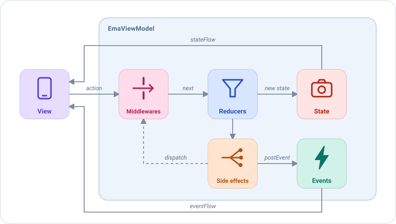

# Emanate

**Emanate es una arquitectura unidireccional para Kotlin donde cada comportamiento de una pantalla es una pieza
pequeña que puedes sustituir, interceptar, reutilizar y testear por separado.**

Describes una pantalla con tres tipos sencillos (un **estado**, las **acciones** del usuario y los **eventos** de un
solo uso) y un `EmaViewModel` que gestiona cada acción con **middlewares**, **reducers** y **side effects**. Emanate se
encarga de todo lo que los rodea: ciclo de vida, corrutinas, concurrencia, navegación, muerte del proceso, logs y
errores.



| Pieza          | Qué es                                                                 | Lo que escribes                                    |
|----------------|------------------------------------------------------------------------|----------------------------------------------------|
| **Estado**     | Una data class inmutable con todo lo que muestra la pantalla.          | `data class HomeState(...) : EmaState`             |
| **Acción**     | Algo que ha hecho el usuario.                                          | `sealed interface HomeAction : EmaAction`          |
| **Evento**     | Algo que ha ocurrido en la funcionalidad y se entrega a la vista una vez. | `sealed interface HomeEvent : EmaEvent`         |

La vista **pinta** el estado, **notifica** lo que hace el usuario con acciones y **reacciona** a los eventos. Nunca
contiene lógica de negocio.

## Una pantalla en pocas líneas

Cada pieza se declara para el tipo de acción que gestiona. Esta pantalla de inicio busca los amigos del usuario mientras
escribe:

```kotlin
class HomeViewModel(private val getFriendsUseCase: GetFriendsUseCase) :
    EmaViewModel<HomeState, HomeAction, HomeEvent>(HomeState()) {

    override fun setup() = source {
        middlewares {
            // Debounce: solo continúa la última consulta escrita en 300 ms
            add<HomeAction.QueryWritten> { nextAfter(id = "search") { delay(300) } }
        }
        reducers {
            // El siguiente estado para cada acción de la pantalla
            add<HomeAction> { action ->
                when (action) {
                    is HomeAction.QueryWritten -> state.copy(query = action.query)
                    is HomeAction.SideEffects.QueryStarted -> state.copy(isLoading = true)
                    is HomeAction.SideEffects.QueryLoaded -> state.copy(isLoading = false, friends = action.friends)
                    is HomeAction.SideEffects.QueryFailed -> state.copy(isLoading = false, dialog = HomeDialog.LoadError)
                    is HomeAction.FriendClicked -> state
                }
            }
        }
        sideEffects {
            // Busca con la nueva consulta, cancelando la búsqueda anterior si sigue en marcha
            add<HomeAction.QueryWritten>(concurrency = SideEffectConcurrency.Latest) {
                dispatch(HomeAction.SideEffects.QueryStarted)
                getFriendsUseCase(GetFriendsUseCase.Input(state.query))
                    .onSuccess { friends -> dispatch(HomeAction.SideEffects.QueryLoaded(friends)) }
                    .onFailure { dispatch(HomeAction.SideEffects.QueryFailed) }
            }
            // Indica a la vista que abra el perfil
            add<HomeAction.FriendClicked> { action -> publish(HomeEvent.FriendSelected(action.friend)) }
        }
    }
}
```

- El **middleware** espera a que el usuario deje de escribir antes de que la consulta continúe.
- El **reducer** devuelve el siguiente estado para cada acción, así que la vista siempre pinta un estado válido.
- Los **side effects** ejecutan la lógica de negocio y la comunican con acciones (`HomeAction.SideEffects`) o
  eventos.

Las mismas piezas también se pueden declarar como propiedades del ViewModel, con `middlewareOf`, `reducerOf` y
`sideEffectOf`, e instalarse con `add`. Así cada una se puede reutilizar, recibir en el constructor para
[cambiarla según el entorno](guides/dependency-injection.md) o testear por separado:

```kotlin
class HomeViewModel(private val getFriendsUseCase: GetFriendsUseCase) :
    EmaViewModel<HomeState, HomeAction, HomeEvent>(HomeState()) {

    private val searchDebounce = middlewareOf(HomeAction.QueryWritten::class) {
        nextAfter(id = "search") { delay(300) }
    }

    private val homeReducer = reducerOf(HomeAction::class) { action ->
        when (action) {
            is HomeAction.QueryWritten -> state.copy(query = action.query)
            is HomeAction.SideEffects.QueryStarted -> state.copy(isLoading = true)
            is HomeAction.SideEffects.QueryLoaded -> state.copy(isLoading = false, friends = action.friends)
            is HomeAction.SideEffects.QueryFailed -> state.copy(isLoading = false, dialog = HomeDialog.LoadError)
            is HomeAction.FriendClicked -> state
        }
    }

    private val searchFriends = sideEffectOf(HomeAction.QueryWritten::class, SideEffectConcurrency.Latest) {
        dispatch(HomeAction.SideEffects.QueryStarted)
        getFriendsUseCase(GetFriendsUseCase.Input(state.query))
            .onSuccess { friends -> dispatch(HomeAction.SideEffects.QueryLoaded(friends)) }
            .onFailure { dispatch(HomeAction.SideEffects.QueryFailed) }
    }

    private val openFriend = sideEffectOf(HomeAction.FriendClicked::class) { action ->
        publish(HomeEvent.FriendSelected(action.friend))
    }

    override fun setup() = source {
        middlewares { add(searchDebounce) }
        reducers { add(homeReducer) }
        sideEffects {
            add(searchFriends, openFriend)
        }
    }
}
```

Empieza por [Primeros pasos](getting-started.md), o mira lo que hacen posible estas piezas en
[Por qué Emanate](why-emanate.md).
