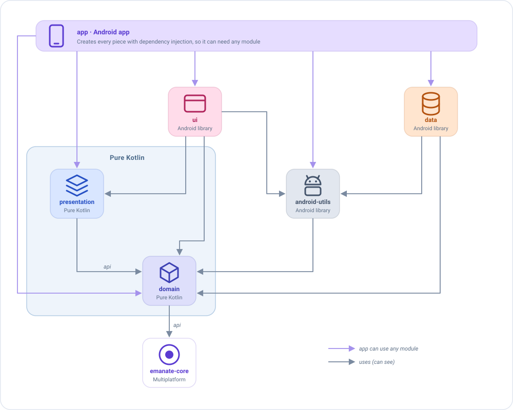

# Recomendaciones

Emanate no te obliga a seguir ninguna estructura de proyecto: puedes meterlo todo en un único módulo y llamar a tus
clases como quieras. Esta página recoge cómo está organizada la app `sample`, y **por qué**. Quédate con lo que te
sirva.

!!! tip "Por dónde empezar"
    Si solo estás probando Emanate, olvídate de los módulos y empieza con uno. Los tres hábitos que merece la pena
    adoptar desde el primer día son [organizar por funcionalidad](#organiza-por-funcionalidad),
    [usar los mismos nombres en todas partes](#nombres) y [mantener limpio el ViewModel](#mantén-limpio-el-viewmodel).
    Dividir en módulos puede esperar a que la app crezca.

## Divide la app en módulos

Un módulo es una parte del proyecto que se compila por separado y solo puede usar lo que declara como dependencia.
Ese límite es justo lo que queremos: **si un módulo no puede ver algo, nadie puede usarlo ahí por error.**

El sample tiene seis módulos:

| Módulo          | Qué vive aquí                                                          | Tipo             | Depende de                                                    |
|-----------------|------------------------------------------------------------------------|------------------|---------------------------------------------------------------|
| `app`           | La `Application`, la configuración de la inyección de dependencias y el manifest. | App Android | Todo                                                       |
| `ui`            | Contenidos de pantalla, navigators, diálogos, tema y recursos.         | Librería Android | `presentation`, `domain`, `android-utils`, `emanate-compose-android` |
| `presentation`  | Estado, acciones, eventos, inicializadores y ViewModels.               | **Kotlin puro**  | `domain`                                                      |
| `domain`        | Modelos, casos de uso e interfaces de los repositorios.                | **Kotlin puro**  | `emanate-core`                                                |
| `data`          | Implementaciones de los repositorios, red y almacenamiento.            | Librería Android | `domain`, `android-utils`                                     |
| `android-utils` | Ayudas de Android compartidas por varios módulos, como leer y guardar JSON en `SharedPreferences`. | Librería Android | `domain`                                                      |



Lee las flechas como *"puede ver"*: `ui` puede ver `presentation`, pero `presentation` no puede ver `ui`. Tres detalles:

- **`app` ve todos los módulos**, porque crea todas las piezas con la inyección de dependencias.
- **`api` expone una dependencia a los módulos de arriba.** `presentation` declara `domain` con `api`, y `domain` declara
  `emanate-core` con `api`. Así `ui` puede usar los modelos de `domain` que aparecen en el estado, y todos los módulos
  pueden usar `emanate-core`. Con `implementation`, un módulo se guarda sus dependencias para sí.
- **`android-utils` también depende de `domain`**, para trabajar con sus modelos.

### ¿`api` o `implementation`?

Las dos declaran una dependencia. La diferencia es quién más puede verla:

| Declaración | Quién ve la dependencia | Úsala cuando |
|-------------|-------------------------|--------------|
| `implementation` | Solo el módulo que la declara. | La dependencia es un detalle interno. Es la opción por defecto. |
| `api` | El módulo **y** todos los que dependen de él. | Sus tipos aparecen en tu código público: estados, acciones, firmas de funciones o superclases. |

Imagina el estado de una pantalla de inicio que contiene una lista de usuarios y el rol de cada uno:

```kotlin
data class HomeState(val users: List<User>, val role: Role) : EmaState   // User y Role viven en domain
```

`presentation` usa `api` para `domain` porque `User` y `Role` son modelos de `domain` y aparecen en el estado, así que quien
lo pinte necesita conocerlos. `domain` usa `api` para `emanate-core` porque sus casos de uso extienden `EmaUseCase`. `data`,
en cambio, usa `implementation` para `domain`: nadie por encima necesita verlo a través de `data`.

No marques todo con `api`: los módulos verían demasiado, y un cambio en uno obligaría a recompilar los otros. Y si `ui` usa
los modelos de `domain` directamente, declara también `implementation project(':domain')` en `ui`, para que no dependa de que
`presentation` mantenga su `api`.

### Por qué `presentation` y `domain` son Kotlin puro

*Kotlin puro* significa que el módulo no tiene nada de Android: ni `Context`, ni `View`, ni `R.string`. Esto tiene dos
ventajas:

- **El compilador hace cumplir la arquitectura.** Un ViewModel no puede usar un `Context` ni un recurso por error,
  porque el módulo no los tiene. No hace falta recordar una norma ni cazarla en una revisión.
- **Está preparado para Kotlin Multiplatform.** `emanate-core` es multiplataforma, así que `presentation` y `domain`
  pueden convertirse en módulos multiplataforma y compartir los ViewModels con otras plataformas.

Además, sus tests se ejecutan en milisegundos en tu ordenador, sin emulador (consulta [Testing](guides/testing.md)).

### ¿Qué va dónde?

Cuando no sepas dónde va una clase, hazte esta pregunta:

| Si la clase... | Va en |
|----------------|-------|
| Pinta algo o necesita Android para funcionar (un composable, un navigator, un `Toast`) | `ui` |
| Decide **qué muestra la pantalla** (estado, acciones, eventos, ViewModel) | `presentation` |
| Es un concepto de negocio o un caso de uso (`User`, `GetFriendsUseCase`), o la **interfaz** de un repositorio (`FriendsRepository`) | `domain` |
| **Implementa** esas interfaces de repositorio, hablando con la API REST o la base de datos (`FriendsRepositoryImpl`) | `data` |

`domain` dice **qué** datos necesita (la interfaz), y `data` decide **cómo** conseguirlos (la implementación).

## Organiza por funcionalidad

Agrupa los archivos **por pantalla**, no por tipo. No crees un paquete `states/` con todos los estados de la app y otro
`viewmodels/` con todos los ViewModels: al cambiar la pantalla Home tendrías que saltar entre cinco paquetes.

En su lugar, cada pantalla es un paquete en `presentation` y otro en `ui`, con el mismo nombre:

```
presentation/…/presentation/home/         ui/…/ui/home/
├── HomeState.kt                           ├── HomeScreenContent.kt
├── HomeAction.kt                          └── HomeNavigator.kt
├── HomeEvent.kt
├── HomeDialog.kt
├── HomeViewModel.kt
└── HomeInitializer.kt   (solo si la pantalla recibe datos)
```

Todo lo de Home está en dos carpetas con el mismo nombre. Para borrar la pantalla, borras esas carpetas.

## Nombres

Si todas las pantallas siguen la misma convención, puedes abrir cualquiera y saber dónde está cada cosa. Tomemos la
pantalla Home como ejemplo:

| Tipo             | Convención                              | Ejemplo                          |
|------------------|-----------------------------------------|----------------------------------|
| Estado           | `<Pantalla>State`                       | `HomeState`                      |
| Estado por defecto | `companion object { val DEFAULT }`    | `HomeState.DEFAULT`              |
| Acción           | `<Pantalla>Action`, con el nombre de **lo que hizo el usuario** | `QueryWritten`, `FriendClicked` |
| Evento           | `<Pantalla>Event`, con el nombre de **lo que pasó** | `FriendSelected`, `CloseClicked` |
| ViewModel        | `<Pantalla>ViewModel`                   | `HomeViewModel`                  |
| Diálogos en el estado | `<Pantalla>Dialog`                 | `HomeDialog.LoadError`           |
| Resultados de los side effects | `<Pantalla>Action.SideEffects.<Qué>` | `HomeAction.SideEffects.QueryLoaded` |
| Contenido de Compose | `<Pantalla>ScreenContent`           | `HomeScreenContent`              |
| Inicializador    | `<Pantalla>Initializer`                 | `HomeInitializer.HomeUser`       |
| Preview          | `Preview<Qué>`, con el prefijo para que las previews queden juntas | `PreviewAdmin`, `PreviewLoading` |

Las dos filas con pista son las que más ayudan a entender el código:

```kotlin
// Acción: dice lo que el usuario HIZO, no lo que queremos que ocurra
data class QueryWritten(val query: String) : HomeAction     // sí
data class SearchFriends(val query: String) : HomeAction    // no: suena a orden

// Evento: dice lo que PASÓ, y el navigator decide qué hacer con él
data class FriendSelected(val friend: Friend) : HomeEvent   // sí
data class GoToFriendDetail(val friend: Friend) : HomeEvent // no: el ViewModel no debe saber nada de navegación
```

## Crea clases base

Cuando todos los ViewModels necesitan lo mismo, escríbelo una sola vez.

**Crea un ViewModel base aunque al principio esté vacío.** Las clases de Emanate (`EmaViewModel`...) pertenecen a la
librería: no puedes modificarlas. Una clase base propia es lo contrario: es **tu** código, y es el único sitio donde
puedes añadir algo que deba afectar a todas las pantallas de la app (un logger, una gestión de errores...) el día que lo
necesites. Sin ella, tendrías que editar cada ViewModel uno a uno. Con ella, cambias una sola clase y mantienes el control
de la app.

```kotlin
// En `presentation`: todos los ViewModels heredan de él
abstract class BaseViewModel<S : EmaState, A : EmaAction, E : EmaEvent>(initialDataState: S) :
    EmaViewModel<S, A, E>(initialDataState)
```

!!! note "No todo va en una clase base"
    Una clase base la comparten **todos** los ViewModels, así que mete en ella solo lo que todos necesitan. Para un
    comportamiento que solo necesitan algunas pantallas, es mejor un [plugin](concepts/plugins.md) o una función de
    extensión del setup que una jerarquía más profunda (`BaseViewModel` → `BaseListViewModel` →
    `BasePaginatedListViewModel`...). Crear subclases de la clase base es un antipatrón: prefiere la composición frente a
    la herencia.

## Mantén limpio el ViewModel

El ViewModel es la parte de la app más fácil de probar, **si lo mantienes simple**. Estas reglas lo protegen.

### Nada de tipos de la plataforma

Un ViewModel no debe usar un context, una vista ni recursos.

### Cada pieza tiene un único trabajo

- Los **repositorios** solo se usan desde los casos de uso, nunca directamente desde un ViewModel.

    ```kotlin
    // Mal: el ViewModel habla con el repositorio
    add<HomeAction.RefreshRequested> { repository.getFriends(state.query) }

    // Bien: pasa por un caso de uso
    add<HomeAction.RefreshRequested> { getFriendsUseCase(GetFriendsUseCase.Input(state.query)) }
    ```

- Los **casos de uso** hacen una sola cosa, y reciben una única data class `Input`, declarada dentro del propio caso de
  uso, en lugar de varios parámetros sueltos.

    ```kotlin
    class GetFriendsUseCase(private val repository: FriendsRepository) :
        EmaUseCase<GetFriendsUseCase.Input, List<Friend>>() {

        override suspend fun useCaseFunction(input: Input): List<Friend> =
            repository.getFriends(input.query, input.onlyOnline)

        data class Input(val query: String, val onlyOnline: Boolean = false)
    }

    // En un side effect: cada valor tiene nombre, así que la llamada se explica sola
    getFriendsUseCase(GetFriendsUseCase.Input(query = state.query, onlyOnline = true))
    ```

    La llamada se lee bien (`onlyOnline = true` en lugar de un `true` suelto), y cuando el caso de uso necesita un valor
    nuevo añades un campo con valor por defecto a `Input`, sin tocar los sitios que ya lo llaman. Consulta
    [Casos de uso](utils/use-cases.md) para más información.

- Los **reducers** solo calculan el estado. La lógica de negocio (llamadas al backend, guardar...) va en los
  [side effects](concepts/side-effects.md).

    !!! warning "Importante: un reducer debe ser una función pura e idempotente"
        Dados el mismo estado y la misma acción, **siempre debe devolver el mismo estado nuevo**, y no hacer nada más: ni
        llamadas al backend, ni leer el reloj ni números aleatorios, ni cambiar nada fuera del estado. Así el estado es
        predecible y un reducer es trivial de probar. Consulta [Reducers](concepts/reducers.md).

    ```kotlin
    // Mal: el reducer llama al backend, y su resultado cambia entre llamadas
    add<LoginAction.LoginClicked> { state.copy(user = repository.login(state.name)) }

    // Bien: el reducer solo cambia el estado, el side effect hace el trabajo
    reducers    { add<LoginAction.LoginClicked> { state.copy(isLoading = true) } }
    sideEffects { add<LoginAction.LoginClicked> { dispatch(LoginAction.SideEffects.LoginResult(loginUseCase(...))) } }
    ```

### La vista solo informa y pinta

- La vista no llama a más funciones del ViewModel que `dispatch`.
- Pon los valores derivados en el estado, no en la vista, para que la pantalla no tenga lógica que probar:

```kotlin
data class HomeState(val userData: UserData?, val userList: List<User>) : EmaState {
    val showCreateButton get() = userData?.role == Role.ADMIN   // la vista solo lo lee
    val showEmptyList get() = userData != null && userList.isEmpty()
}
```

### No crees tus dependencias, recíbelas

Un ViewModel suele necesitar algo que habla con el exterior: un caso de uso que llama al backend, una base de datos, el
reloj... **No lo crees dentro del ViewModel. Pídelo en el constructor** y deja que otro decida cuál darle.

```kotlin
// Mal: el ViewModel crea la pieza real él mismo, así que siempre llama al backend real
class HomeViewModel : BaseViewModel<HomeState, HomeAction, HomeEvent>(HomeState.DEFAULT) {
    private val getFriendsUseCase = GetFriendsUseCase(RemoteFriendsRepository())
}

// Bien: la recibe, y no sabe (ni le importa) cuál es
class HomeViewModel(
    private val getFriendsUseCase: GetFriendsUseCase,
    initialState: HomeState
) : BaseViewModel<HomeState, HomeAction, HomeEvent>(initialState)
```

El ViewModel es el mismo en los dos casos, pero ahora **quien lo crea elige lo que recibe**:

| Dónde | Qué recibe | Por qué |
|-------|------------|---------|
| La app | El caso de uso real, que llama al backend. | Es lo que necesita el usuario. |
| Un test unitario | Un doble que devuelve una lista fija. | El test es rápido y siempre da el mismo resultado, sin red. |
| Un `@Preview` | Un doble con datos de ejemplo. | La preview se pinta sin backend. |
| Una build de QA | Un doble que falla o es lento. | Puedes ver los estados de error y de carga de la pantalla. |

Si el ViewModel creara el caso de uso por sí mismo, nada de esto sería posible sin cambiar su código. Consulta
[Inyección de dependencias](guides/dependency-injection.md) para ver cómo lo hace el sample con Koin.

No es solo para los casos de uso. Un ViewModel también puede **recibir sus middlewares, reducers y side effects**, y
entonces la inyección decide cómo se comporta toda la pantalla: por ejemplo, un side effect que devuelve amigos falsos en
una build de QA, o un middleware que añade latencia para ver el estado de carga. El ViewModel se escribe una vez y no
cambia. Consulta [Inyectar piezas](guides/dependency-injection.md#inyectar-piezas) para aprender a escribirlas, y
[Las piezas son valores](concepts/viewmodel.md#las-piezas-son-valores) para ver cómo se declara una pieza fuera de `setup`.

## Textos

Pon el idioma por defecto en `values/` y las traducciones en `values-xx/` (`values-es/`, `values-fr/`...). Mantén juntos
los textos de cada pantalla y ponles el nombre de la pantalla como prefijo, para saber dónde se usa cada uno:

```xml
<string name="home_title">Amigos</string>
<string name="home_empty_message">Todavía no tienes amigos</string>
<string name="login_error">Usuario o contraseña incorrectos</string>
```
