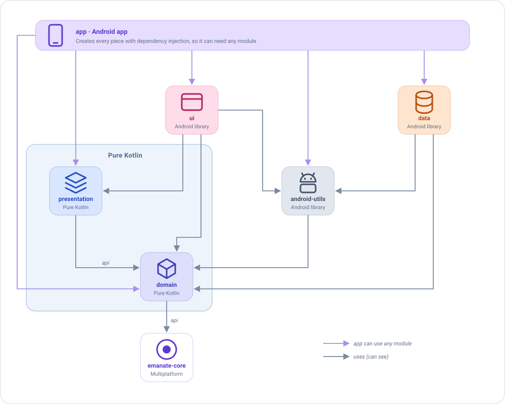

# Recommendations

Emanate does not force any project structure: you can put everything in a single module and call your classes
whatever you want. This page collects the way the `sample` app is organised, and **why**. Take what is useful for
you.

!!! tip "Where to start"
    If you are just trying Emanate, skip the modules and start with one. The three habits worth adopting from day one
    are [organise by feature](#organise-by-feature), [use the same names everywhere](#naming) and
    [keep the ViewModel clean](#keep-the-viewmodel-clean). Splitting into modules can wait until the app grows.

## Split the app into modules

A module is a part of the project that is compiled on its own and can only use what it declares as a dependency.
That limit is exactly what we want: **if a module cannot see something, nobody can use it there by mistake.**

The sample has six modules. `XXX` in a module name is the platform it is written for, here `android`:

| Module          | What lives here                                                       | Type            | Depends on                                                    |
|-----------------|-----------------------------------------------------------------------|-----------------|---------------------------------------------------------------|
| `app`           | Only the dependency injection and the initialization of the libraries, with the `Application` and the manifest. | Android app     | Everything                                                    |
| `ui-android`    | Screen contents, navigators, dialogs, theme and resources.            | Android library | `presentation`, `domain`, `utils-android`                     |
| `presentation`  | State, actions, events, initializers and ViewModels.                  | **Pure Kotlin** | `domain`                                                      |
| `domain`        | Models, use cases and the interfaces of repositories and managers.    | **Pure Kotlin** | Nothing of the app                                            |
| `data-android`  | Repository implementations, network and storage.                      | Android library | `domain`, `utils-android`                                     |
| `utils-android` | Android helpers shared by several modules, like reading and saving JSON in `SharedPreferences`. Optional. | Android library | `domain`                                                      |



Read the arrows as *"can see"*: `ui-android` can see `presentation`, but `presentation` cannot see `ui-android`. Two details:

- **`app` sees every module**, because it creates all the pieces with the dependency injection.
- **`utils-android` also depends on `domain`**, to work with its models.

With several platforms in the same project, write one module per platform: `data-android` and `data-ios`, `ui-android` and
`ui-ios`. A module shared by several platforms has no suffix.

### Declare the dependencies with `implementation`

Every module lists what it can see, so `implementation` is enough, and a change in one module doesn't recompile the ones
that don't use it. Declare the artifacts of Emanate with `implementation` too, never with `api`, in each module that uses them:

| Module | Artifacts of Emanate |
|--------|----------------------|
| `domain` | `emanate-core` |
| `presentation` | `emanate-core`, `emanate-serialization` if it has a backup, `emanate-test` for the tests |
| `ui-android` | `emanate-core`, `emanate-compose-android`, `emanate-compose-android-nav2` with a `NavHost`, `emanate-android` if it uses its helpers |
| `data-android`, `utils-android` | `emanate-core` only if they use its types |
| `app` | `emanate-core`, `emanate-android` |

### Initializing the libraries

`app` starts the injector and decides which implementations are used. To avoid depending on a concrete library:

1. If a library needs to be initialized, do it in the implementation of `data-android`, when the class that needs it is created.
2. If it is better to initialize it explicitly, add an `initialize()` to the interface of the repository or manager, and call
   it from `app`.

### Why `presentation` and `domain` are pure Kotlin

*Pure Kotlin* means the module has no Android in it: no `Context`, no `View`, no `R.string`. This has two benefits:

- **The compiler enforces the architecture.** A ViewModel cannot use a `Context` or a resource by mistake, because
  the module does not have them. You don't need to remember a rule or catch it in a review.
- **It is ready for Kotlin Multiplatform.** `emanate-core` is multiplatform, so `presentation` and `domain` can become
  multiplatform modules and share the ViewModels with other platforms.

As a bonus, their tests run in milliseconds on your computer, with no emulator (see [Testing](guides/testing.md)).

### What goes where?

When you are not sure where a class goes, ask yourself this:

| If the class... | It goes in |
|-----------------|------------|
| Draws something or needs Android to work (a composable, a navigator, a `Toast`) | `ui-android` |
| Decides **what the screen shows** (state, actions, events, ViewModel) | `presentation` |
| Is a business concept or a use case (`User`, `GetFriendsUseCase`), or the **interface** of a repository (`FriendsRepository`) | `domain` |
| **Implements** those repository interfaces, talking to the REST API or the database (`FriendsRepositoryImpl`) | `data-android` |

`domain` says **what** data it needs (the interface), and `data-android` decides **how** to get it (the implementation).

## Organise by feature

Group the files **by screen**, not by type. Don't create a package `states/` with every state of the app and another
`viewmodels/` with every ViewModel: when you change the Home screen you would have to jump through five packages.

Instead, each screen is one package in `presentation` and another one in `ui-android`, with the same name:

```
presentation/…/presentation/home/         ui-android/…/ui/home/
├── HomeState.kt                           ├── HomeScreenContent.kt
├── HomeAction.kt                          └── HomeNavigator.kt
├── HomeEvent.kt
├── HomeDialog.kt
├── HomeViewModel.kt
└── HomeInitializer.kt   (only if the screen receives data)
```

Everything about Home is in two folders with the same name. To delete the screen, you delete them.

## Naming

If every screen follows the same convention, you can open any of them and know where things are. Take the Home screen
as an example:

| Type             | Convention                              | Example                          |
|------------------|-----------------------------------------|----------------------------------|
| State            | `<Screen>State`                         | `HomeState`                      |
| Default state    | `companion object { val DEFAULT }`      | `HomeState.DEFAULT`              |
| Action           | `<Screen>Action`, named after **what the user did** | `QueryWritten`, `FriendClicked` |
| Event            | `<Screen>Event`, named after **what happened** | `FriendSelected`, `CloseClicked` |
| ViewModel        | `<Screen>ViewModel`                     | `HomeViewModel`                  |
| Dialogs in state | `<Screen>Dialog`                        | `HomeDialog.LoadError`           |
| Results of side effects | `<Screen>Action.SideEffects.<What>` | `HomeAction.SideEffects.FriendsLoaded` |
| Compose content  | `<Screen>ScreenContent`                 | `HomeScreenContent`              |
| Initializer      | `<Screen>Initializer`                   | `HomeInitializer.HomeUser`       |
| Preview          | `Preview<What>`, with the prefix so the previews are together | `PreviewAdmin`, `PreviewLoading` |

The two rows with a hint are the ones that most help to understand the code:

```kotlin
// Action: it says what the user DID, not what we want to happen
data class QueryWritten(val query: String) : HomeAction     // yes
data class SearchFriends(val query: String) : HomeAction    // no: it sounds like an order

// Event: it says what HAPPENED, and the navigator decides what to do with it
data class FriendSelected(val friend: Friend) : HomeEvent   // yes
data class GoToFriendDetail(val friend: Friend) : HomeEvent // no: the ViewModel should not know about navigation
```

## Create base classes

When every ViewModel needs the same thing, write it once.

**Create a base ViewModel even if it is empty at the beginning.** The classes of Emanate (`EmaViewModel`...) belong to the
library: you cannot modify them. A base class of your own is the opposite: it is **your** code, and it is the one place
where you can add something that must affect every screen of the app (a logger, an error handling...) the day you need
it. Without it, you would have to edit every ViewModel one by one. With it, you change a single class and keep the
control of the app.

```kotlin
// In `presentation`: all the ViewModels extend it
abstract class BaseViewModel<S : EmaState, A : EmaAction, E : EmaEvent>(initialDataState: S) :
    EmaViewModel<S, A, E>(initialDataState)
```

!!! note "Not everything belongs in a base class"
    A base class is shared by **all** the ViewModels, so put in it only what all of them need. For behaviour that only
    some screens need, prefer a [plugin](concepts/plugins.md) or an extension function of the setup to a deeper
    hierarchy (`BaseViewModel` → `BaseListViewModel` → `BasePaginatedListViewModel`...). Creating subclasses of the base
    class is an anti-pattern: prefer composition over inheritance.

## Keep the ViewModel clean

The ViewModel is the part of the app that is easiest to test, **if you keep it simple**. These rules protect that.

### No platform types

A ViewModel must not use a context, a view or resources.

### Each piece has a single job

- **Repositories** are only used from use cases, never from a ViewModel directly.

    ```kotlin
    // Bad: the ViewModel talks to the repository
    add<HomeAction.RefreshRequested> { repository.getFriends(state.query) }

    // Good: it goes through a use case
    add<HomeAction.RefreshRequested> { getFriendsUseCase(GetFriendsUseCase.Input(state.query)) }
    ```

- **Use cases** do one thing, and receive a single `Input` data class, declared inside the use case itself, instead of
  several loose parameters.

    ```kotlin
    class GetFriendsUseCase(private val repository: FriendsRepository) :
        EmaUseCase<GetFriendsUseCase.Input, List<Friend>>() {

        override suspend fun useCaseFunction(input: Input): List<Friend> =
            repository.getFriends(input.query, input.onlyOnline)

        data class Input(val query: String, val onlyOnline: Boolean = false)
    }

    // In a side effect: each value is named, so the call explains itself
    getFriendsUseCase(GetFriendsUseCase.Input(query = state.query, onlyOnline = true))
    ```

    The call reads clearly (`onlyOnline = true` instead of a lone `true`), and when the use case needs a new value you add a
    field with a default to `Input`, without changing the places that already call it. See
    [Use cases](utils/use-cases.md) for more.

- **Reducers** only compute the state. The business logic (calls to the backend, saving...) goes in the
  [side effects](concepts/side-effects.md).

    !!! warning "Important: a reducer must be a pure, idempotent function"
        Given the same state and the same action, it must **always return the same new state**, and do nothing else: no
        calls to the backend, no reading the clock or random numbers, no changing anything outside the state. That makes the
        state predictable and a reducer trivial to test. See [Reducers](concepts/reducers.md).

    ```kotlin
    // Bad: the reducer calls the backend, and its result changes between calls
    add<LoginAction.LoginClicked> { state.copy(user = repository.login(state.name)) }

    // Good: the reducer only changes the state, the side effect does the work
    reducers    { add<LoginAction.LoginClicked> { state.copy(isLoading = true) } }
    sideEffects { add<LoginAction.LoginClicked> { dispatch(LoginAction.SideEffects.LoginResult(loginUseCase(...))) } }
    ```

### The view only reports and draws

- The view does not call ViewModel functions other than `dispatch`.
- Put derived values in the state, not in the view, so the screen has no logic to test:

```kotlin
data class HomeState(val userData: UserData?, val friends: List<Friend>) : EmaState {
    val showCreateButton get() = userData?.role == Role.ADMIN   // the view only reads it
    val showEmptyList get() = userData != null && friends.isEmpty()
}
```

### Don't create your dependencies, receive them

A ViewModel often needs something that talks to the outside world: a use case that calls the backend, a database, the
clock... **Don't create it inside the ViewModel. Ask for it in the constructor** and let someone else decide which one
to give it.

```kotlin
// Bad: the ViewModel creates the real thing itself, so it always calls the real backend
class HomeViewModel : BaseViewModel<HomeState, HomeAction, HomeEvent>(HomeState.DEFAULT) {
    private val getFriendsUseCase = GetFriendsUseCase(RemoteFriendsRepository())
}

// Good: it receives it, and does not know (or care) which one it is
class HomeViewModel(
    private val getFriendsUseCase: GetFriendsUseCase,
    initialState: HomeState
) : BaseViewModel<HomeState, HomeAction, HomeEvent>(initialState)
```

The ViewModel is the same in both cases, but now **whoever creates it chooses what it receives**:

| Where | What it receives | Why |
|-------|------------------|-----|
| The app | The real use case, which calls the backend. | It is what the user needs. |
| A unit test | A fake that returns a fixed list. | The test is fast and always gives the same result, with no network. |
| A `@PreviewLightDark` | A fake with sample data. | The preview draws without a backend. |
| A QA build | A fake that fails or is slow. | You can see the error and loading states of the screen. |

If the ViewModel created the use case itself, none of this would be possible without changing its code. See
[Dependency injection](guides/dependency-injection.md) for how the sample does it with Koin.

**By default a ViewModel receives only its use cases and its state** (and its `EmaStateStore` if it has a backup). Receive pieces in the constructor only when the behaviour must change depending on the build.

It is not only for use cases. A ViewModel can also **receive its middlewares, reducers and side effects**, and then the
injection decides how the whole screen behaves: for example, a side effect that returns fake friends in a QA build, or
a middleware that adds latency to see the loading state. The ViewModel is written once and doesn't change. See
[Injecting pieces](guides/dependency-injection.md#injecting-pieces) to learn how to write them, and
[Pieces are values](concepts/viewmodel.md#pieces-are-values) to see how a piece is declared outside of `setup`.

## Strings

Provide the default language in `values/` and the translations in `values-xx/` (`values-es/`, `values-fr/`...). Keep
the strings of every screen together and prefix them with the name of the screen, so you know where each one is used:

```xml
<string name="home_title">Friends</string>
<string name="home_empty_message">You have no friends yet</string>
<string name="login_error">Wrong user or password</string>
```
