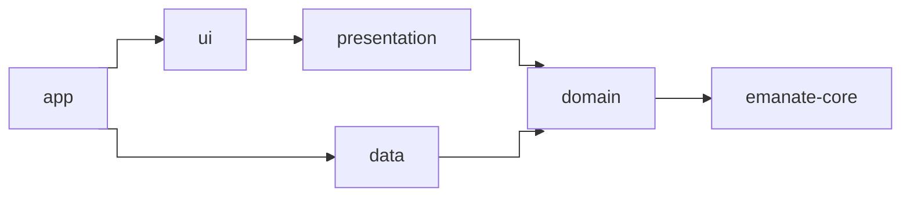

# Recommendations

None of this is required by Emanate, but it is how the `sample` app is organised and it works well.

## Split the app into modules

| Module          | Contains                                                                                | Type            | Depends on                                                                 |
|-----------------|-----------------------------------------------------------------------------------------|-----------------|----------------------------------------------------------------------------|
| `app`           | The `Application`, the dependency injection setup and the manifest.                     | Android app     | Everything                                                                 |
| `ui`            | Screen contents, navigators, dialogs, theme and resources.                              | Android library | `presentation`, `android-utils`, `emanate-compose`                         |
| `presentation`  | State, actions, events, initializers and ViewModels.                                    | **Pure Kotlin** | `domain`                                                                   |
| `domain`        | Models, use cases and repository interfaces.                                            | **Pure Kotlin** | `emanate-core`                                                             |
| `data`          | Repository implementations, network and storage.                                        | Android library | `domain`, `android-utils`                                                  |
| `android-utils` | Android helpers shared by several modules.                                              | Android library |                                                                            |



The diagram leaves out `android-utils`, which `ui` and `data` use.

Keeping `presentation` free of platform code has two benefits:

- **The compiler enforces the architecture.** A ViewModel cannot use `Context`, resources or views by mistake, because the module
  does not have them.
- **It is ready for Kotlin Multiplatform.** `emanate-core` is multiplatform, so `presentation` and `domain` can become
  multiplatform modules and share the ViewModels with other platforms. See [Kotlin Multiplatform](guides/multiplatform.md).

## Organise by feature

Each screen is a package in `presentation` and another one in `ui`, with the same name:

```
presentation/…/presentation/home/         ui/…/ui/home/
├── HomeState.kt                           ├── HomeScreenContent.kt
├── HomeAction.kt                          └── HomeNavigator.kt
├── HomeEvent.kt
├── HomeDialog.kt
├── HomeViewModel.kt
└── HomeInitializer.kt   (only if the screen receives data)
```

## Naming

| Type             | Convention                              | Example                          |
|------------------|-----------------------------------------|----------------------------------|
| State            | `<Screen>State`                         | `HomeState`                      |
| Default state    | `companion object { val DEFAULT }`      | `HomeState.DEFAULT`              |
| Action           | `<Screen>Action`, named after what the user did | `QueryWritten`, `FriendClicked` |
| Event            | `<Screen>Event`, named after what happened | `FriendSelected`, `OnBoardingCancelled` |
| ViewModel        | `<Screen>ViewModel`                     | `HomeViewModel`                  |
| Dialogs in state | `<Screen>Dialog`                        | `HomeDialog.LoadError`           |
| Results of side effects | `<Screen>Action.Effect<What>Result` | `HomeAction.EffectQueryResult.Loaded` |
| Compose content  | `<Screen>ScreenContent`                 | `HomeScreenContent`             |
| Initializer      | `<Screen>Initializer`                   | `HomeInitializer.HomeUser`       |

## Create base classes

Define the behaviour that every screen shares once. The sample has a `BaseScreenComposable` for its Compose screens,
which draws the dialogs every screen needs, and a `BaseViewModel` in `presentation`:

```kotlin
abstract class BaseScreenComposable<S : EmaState, A : EmaAction, E : EmaEvent> :
    EmaComposableScreenContent<S, A, E> {

    @Composable
    protected fun ShowDialog(data: SimpleDialogData, listener: SimpleDialogListener) { /* ... */ }

    @Composable
    protected fun ShowError(data: ErrorDialogData, listener: ErrorDialogListener) { /* ... */ }

    @Composable
    protected fun ShowLoading(loadingDialogData: LoadingDialogData? = null) { /* ... */ }
}
```

```kotlin
abstract class BaseViewModel<S : EmaState, A : EmaAction, E : EmaEvent>(initialDataState: S) :
    EmaViewModel<S, A, E>(initialDataState)
```

An (even empty) `BaseViewModel` gives you a single place to add something later. For behaviour that only some screens
need, prefer a [plugin](concepts/plugins.md) or an extension function of the setup to a deeper hierarchy.

## Keep the ViewModel clean

- No platform types, like a context, a view or resources. Use [`EmaText`](guides/texts.md) for strings.
- Repositories are only used from use cases, never from a ViewModel directly.
- Use cases have one job and take a single `Input` data class.
- Put derived values in the state (`val showCreateButton get() = ...`), not in the view.
- The view does not call ViewModel functions other than `dispatch`.
- The reducers only compute the state: the business logic goes in the side effects.
- Receive in the constructor the pieces that change between environments, like the side effects that call the
  backend, so they can be [mocked without touching the screen](guides/dependency-injection.md).

## Strings

Provide the default language in `values/` and translations in `values-xx/`. Keep every screen's strings together
and prefix them with the screen: `home_title`, `home_empty_message`.
