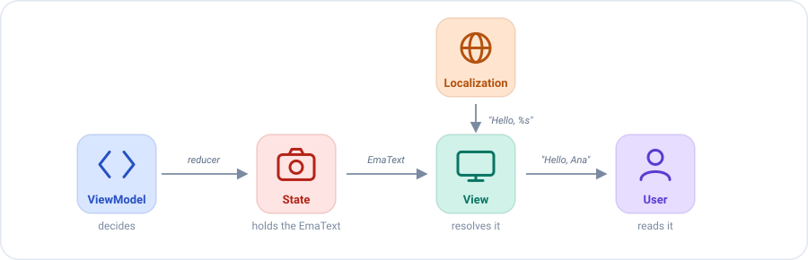

# Textos en el estado

Una pantalla muestra textos que dependen del estado: un saludo con el nombre del usuario, un mensaje de error, "3
amigos". ¿Dónde viven esos textos?

## El problema

La respuesta tentadora es construir el `String` final en el ViewModel y ponerlo en el estado:

```kotlin
state.copy(title = "Hola, Ana")   // ❌ un string traducido
```

Eso tiene tres problemas:

- **El ViewModel necesita el sistema de localización de la plataforma** (recursos, bundles, locale), y `emanate-core` es
  multiplataforma, así que no lo tiene.
- **El idioma queda fijado en ese momento.** Si el usuario cambia de idioma con la pantalla abierta, el estado sigue
  guardando el texto antiguo.
- **Los tests comparan strings traducidos** en lugar de la decisión que importa: *qué* texto se debe mostrar.

## La idea

`EmaText` separa dos cosas que un `String` mezcla: **decidir** qué texto se muestra y **escribirlo** en un idioma.

- El **ViewModel** decide: el estado guarda un `EmaText`, una pequeña descripción como *"el texto con id `HOME_TITLE`,
  con el argumento `Ana`"*.
- La **vista** escribe: al pintar, convierte la descripción en un `String` con el sistema de localización de su
  plataforma.



El mismo estado da un texto distinto para cada idioma, y el ViewModel nunca lo sabe:

| El estado guarda                 | El usuario inglés ve | El usuario español ve |
|----------------------------------|----------------------|-----------------------|
| `EmaText.id(HOME_TITLE, "Ana")`  | `Hello, Ana`         | `Hola, Ana`           |
| `EmaText.plural(FRIENDS, 3, 3)`  | `3 friends`          | `3 amigos`            |
| `EmaText.text("Ana")`            | `Ana`                | `Ana`                 |

## Paso a paso

**1. El estado declara los textos que guarda.**

```kotlin
data class HomeState(
    val title: EmaText,
    val error: EmaText?
) : EmaState {

    companion object {
        val DEFAULT = HomeState(title = EmaText.empty(), error = null)
    }
}
```

**2. Un reducer decide qué texto se muestra.** `HOME_TITLE` y `HOME_LOAD_ERROR` son identificadores de textos en el
sistema de localización de la plataforma.

```kotlin
reducers {
    add<HomeInitializer.HomeUser> { initializer ->
        state.copy(title = EmaText.id(HOME_TITLE, initializer.user.name))
    }
    add<HomeAction.SideEffects.FriendsLoadFailed> {
        state.copy(error = EmaText.id(HOME_LOAD_ERROR))
    }
}
```

**3. La vista lo resuelve al pintar.** Este paso depende de la plataforma, mira [Mostrar un texto](#mostrar-un-texto).

**4. El test comprueba la decisión, no la traducción.** No necesita ninguna plataforma:

```kotlin
recorder.assertState { it.title == EmaText.id(HOME_TITLE, "Ana") }
```

## Crear un texto

| Factoría                                       | Describe                                                      |
|------------------------------------------------|---------------------------------------------------------------|
| `EmaText.text("Hola")`                         | Un literal, tal cual.                                         |
| `EmaText.text("Hola %s", name)`                | Un literal formateado con argumentos.                         |
| `EmaText.id(id, userName)`                     | Un texto localizado identificado por `id`, con o sin argumentos. |
| `EmaText.plural(id, count, count)`             | Un plural localizado identificado por `id`: la cantidad, y después los argumentos. |
| `EmaText.composition(text1, text2, ...)`       | Varios textos, uno detrás de otro.                            |
| `EmaText.empty()`                              | Sin texto. `isEmpty()` lo indica.                             |

`"Hola".toEmaText()` es un atajo para un literal.

## Mostrar un texto

La vista resuelve el `EmaText` con el sistema de localización de su plataforma: lee el tipo del texto (`Text`, `Id`,
`Plural` o `Composition`) y sus argumentos, y busca el texto. `emanate-core` solo lo describe, así que cada plataforma
aporta su propia resolución.

### En Android

En Android el `id` es el identificador de un recurso, y `EmaText` se resuelve con el `Context`. Los identificadores
vienen de `R`, una clase generada por Android, así que solo se pueden referenciar desde código que dependa de Android,
como el módulo Android o la UI. Un ViewModel que debe seguir siendo independiente de la plataforma no referencia `R`.

```kotlin
// En código Android, donde existe R
EmaText.id(R.string.home_title, user.name)
EmaText.plural(R.plurals.friends, count, count)
```

| Dónde            | Cómo                            | Módulo                     |
|------------------|---------------------------------|----------------------------|
| Un composable    | `text.stringResource()`         | `emanate-compose-android`  |
| Con un `Context` | `text.string(context)`          | `emanate-android`          |

```kotlin
// En un composable
Text(text = state.title.stringResource())
```

`emanate-android` también tiene atajos para crearlos: `R.string.welcome.toEmaText(userName)` y
`R.plurals.friends.toEmaText(count, count)`.

## Igualdad

Dos `EmaText` son iguales cuando describen el mismo texto, argumentos incluidos. Así un estado que los guarda se compara
correctamente: poner el mismo texto otra vez no cambia el estado, y un test puede comprobarlo con `assertState`.

Un texto sin argumentos nunca se formatea, así que un `%` en él es seguro: `EmaText.text("50%")` se muestra tal cual.
