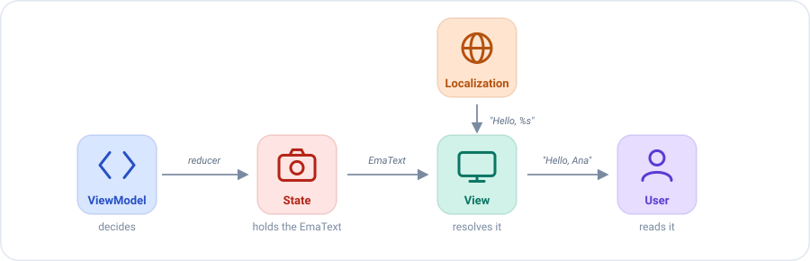

# Texts in the state

A screen shows texts that depend on the state: a greeting with the name of the user, an error message, "3 friends".
Where do those texts live?

## The problem

The tempting answer is to build the final `String` in the ViewModel and put it in the state:

```kotlin
state.copy(title = "Hello, Ana")   // ❌ a translated string
```

That has three problems:

- **The ViewModel needs the localization system of the platform** (resources, bundles, locale), and `emanate-core` is
  multiplatform, so it doesn't have it.
- **The language is fixed at that moment.** If the user changes the language while the screen is open, the state still
  holds the old text.
- **Tests compare translated strings** instead of the decision that matters: *which* text should be shown.

## The idea

`EmaText` separates two things that a `String` mixes: **deciding** which text is shown and **writing** it in a language.

- The **ViewModel** decides: the state holds an `EmaText`, a small description such as *"the text with id
  `HOME_TITLE`, with the argument `Ana`"*.
- The **view** writes: when it draws, it turns the description into a `String` with the localization system of its
  platform.



The same state gives a different text for each language, and the ViewModel never knows about it:

| The state holds                  | English user sees | Spanish user sees |
|----------------------------------|-------------------|-------------------|
| `EmaText.id(HOME_TITLE, "Ana")`  | `Hello, Ana`      | `Hola, Ana`       |
| `EmaText.plural(FRIENDS, 3, 3)`  | `3 friends`       | `3 amigos`        |
| `EmaText.text("Ana")`            | `Ana`             | `Ana`             |

## Step by step

**1. The state declares the texts it holds.**

```kotlin
data class HomeState(
    val title: EmaText,
    val error: EmaText?
) : EmaState {

    companion object {
        val DEFAULT = HomeState(title = EmaText.empty(), error = null)
    }
}
```

**2. A reducer decides which text is shown.** `HOME_TITLE` and `HOME_LOAD_ERROR` are identifiers of texts in the
localization system of the platform.

```kotlin
reducers {
    add<HomeInitializer.HomeUser> { initializer ->
        state.copy(title = EmaText.id(HOME_TITLE, initializer.user.name))
    }
    add<HomeAction.SideEffects.FriendsLoadFailed> {
        state.copy(error = EmaText.id(HOME_LOAD_ERROR))
    }
}
```

**3. The view resolves it when it draws.** This step depends on the platform, see [Showing a text](#showing-a-text).

**4. The test checks the decision, not the translation.** It needs no platform at all:

```kotlin
recorder.assertState { it.title == EmaText.id(HOME_TITLE, "Ana") }
```

## Creating a text

| Factory                                        | Describes                                                     |
|------------------------------------------------|---------------------------------------------------------------|
| `EmaText.text("Hello")`                        | A literal, as it is.                                          |
| `EmaText.text("Hello %s", name)`               | A literal formatted with arguments.                           |
| `EmaText.id(id, userName)`                     | A localized text identified by `id`, with or without arguments. |
| `EmaText.plural(id, count, count)`             | A localized plural identified by `id`: the quantity, then the arguments. |
| `EmaText.composition(text1, text2, ...)`       | Several texts, one after the other.                           |
| `EmaText.empty()`                              | No text. `isEmpty()` tells it.                                |

`"Hello".toEmaText()` is a shortcut for a literal.

## Showing a text

The view resolves the `EmaText` with the localization system of its platform: it reads the type of the text (`Text`,
`Id`, `Plural` or `Composition`) and its arguments, and looks the text up. `emanate-core` only describes it, so each
platform provides its own resolution.

### On Android

On Android the `id` is the identifier of a resource, and `EmaText` is resolved with the `Context`. The identifiers
come from `R`, a class generated by Android, so they can only be referenced from code that depends on Android, such as
the Android module or the UI. A ViewModel that must stay platform-independent doesn't reference `R`.

```kotlin
// In Android code, where R exists
EmaText.id(R.string.home_title, user.name)
EmaText.plural(R.plurals.friends, count, count)
```

| Where            | How                             | Module                     |
|------------------|---------------------------------|----------------------------|
| A composable     | `text.stringResource()`         | `emanate-compose-android`  |
| With a `Context` | `text.string(context)`          | `emanate-android`          |

```kotlin
// In a composable
Text(text = state.title.stringResource())
```

`emanate-android` also has shortcuts to create them: `R.string.welcome.toEmaText(userName)` and
`R.plurals.friends.toEmaText(count, count)`.

## Equality

Two `EmaText` are equal when they describe the same text, arguments included. So a state that holds them is compared
correctly: setting the same text again doesn't change the state, and a test can check it with `assertState`.

A text without arguments is never formatted, so a `%` in it is safe: `EmaText.text("50%")` is shown as it is.
