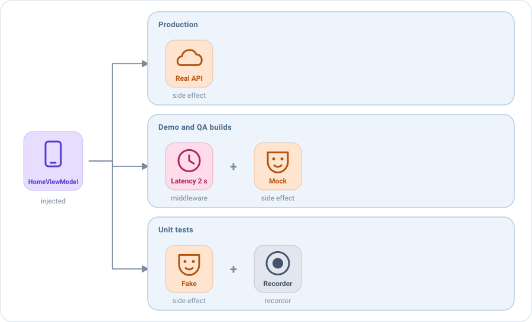

# Por qué Emanate

La mayoría de arquitecturas te dicen dónde poner tu código. Emanate además cambia **de qué está hecho tu código**.

En un ViewModel clásico el comportamiento de una pantalla es código dentro de sus funciones: para cambiarlo editas el
ViewModel, añades un `if` o mockeas todo un repositorio. En Emanate cada comportamiento es una pieza de código que
reacciona a una acción, y cada pieza se puede sustituir:

| Pieza           | Se ejecuta                             | Su trabajo                                                      |
|-----------------|----------------------------------------|-----------------------------------------------------------------|
| **Middleware**  | Primero, cuando llega una acción       | Decidir el camino de la acción: dejarla continuar, cambiarla, retrasarla o detenerla. |
| **Reducer**     | Después, de forma síncrona             | Devolver el siguiente estado. Una función pura.                 |
| **Side effect** | Tras los reducers, de forma asíncrona  | Ejecutar la lógica de negocio y comunicar el resultado con acciones o eventos. |
| **Broadcast**   | Se envía desde un side effect          | Enviar una acción a las otras pantallas que escuchan su tipo, como un resultado para la pantalla anterior. |
| **Plugin**      | Se instala en el setup                 | Agrupar un conjunto de piezas (middlewares, reducers, side effects) que trabajan juntas, para reutilizarlas en distintas pantallas, como las analíticas o el backup del estado. |

Una pieza puede ser una lambda escrita en la pantalla, una clase o un objeto recibido en el constructor. Así el
comportamiento de una pantalla se puede componer, sustituir e inspeccionar como cualquier otro dato, y eso desbloquea
cosas que una arquitectura clásica no permite sin reescribir la pantalla.

## 1. Cambia el comportamiento de una pantalla cambiando solo lo que inyectas

El ViewModel recibe el side effect que carga los amigos del usuario. Producción inyecta el real, la build de demo un
mock y los tests un fake. El ViewModel es el mismo en los tres.



```kotlin
class HomeViewModel(private val loadFriends: FriendsEffect) :
    EmaViewModel<HomeState, HomeAction, HomeEvent>(HomeState()) {

    override fun setup() = source {
        reducers { /* ... */ }
        sideEffects {
            add(loadFriends)
        }
    }
}

// Producción
HomeViewModel(LiveFriends(getFriendsUseCase))

// Build de demo: sin backend, una lista fija tras medio segundo
HomeViewModel(MockFriends(friends = demoFriends))
```

**Sin Emanate** las opciones habituales son un `if (isDemo)` dentro del ViewModel, una librería de mocks en los tests o
un repositorio falso para toda la app. Aquí sustituyes exactamente el comportamiento que quieres, y nada más.
Mira [Inyección de dependencias y entornos](guides/dependency-injection.md).

## 2. Middlewares: intervén antes de que se ejecute cualquier acción

Un middleware ve cada acción de su tipo antes que la lógica de negocio y decide qué pasa con ella, sin que el ViewModel
lo sepa. Inyéctalos solo donde los necesites:

```kotlin
// Dos segundos de latencia antes de cada refresco, en la build de QA
middlewareDelayOf<HomeState, HomeAction, HomeAction.RefreshRequested>(HomeAction.RefreshRequested::class, 2.seconds)

// Todos los refrescos fallan, para comprobar el diálogo de error con el backend real
middlewareOf<HomeState, HomeAction, HomeAction.RefreshRequested>(HomeAction.RefreshRequested::class) {
    next(HomeAction.EffectQueryResult.Failed)
}
```

El mismo mecanismo aplica un debounce a un campo de búsqueda, detiene las acciones de una funcionalidad tras un flag o
una sesión caducada, sustituye una acción por otra o registra cada acción para las analíticas. Probar estados de carga y
diálogos de error ya no requiere una red rota ni un backend especial. Mira [Middlewares](concepts/middlewares.md).

## 3. Plugins: escribe el comportamiento transversal una vez e instálalo donde quieras

Un plugin es un setup reutilizable: agrupa un conjunto de middlewares, reducers y side effects que trabajan juntos, y
cualquier pantalla lo instala en una línea. Las analíticas, los logs, las comprobaciones de sesión, los feature flags o
el backup del estado los necesitan muchas pantallas, así que se escriben una vez, como un plugin.

Este registra cada acción de la pantalla y cuándo se muestra la pantalla:

```kotlin
class ScreenAnalytics<S : EmaState>(private val tracker: Tracker, private val screen: String) :
    EmaSourcePlugin<S, Nothing> {

    override fun install(setup: SourceSetupScope<S, Nothing, Nothing>) {
        // Ve cada acción de la pantalla antes que los reducers
        setup.middlewares {
            add<EmaAction> { action ->
                tracker.track(screen, action::class.simpleName.orEmpty())
                next()
            }
        }
        // Reacciona al ciclo de vida de la pantalla
        setup.sideEffects {
            add<EmaLifecycle.Resumed> { tracker.screenShown(screen) }
        }
    }
}
```

Y cualquier pantalla lo instala:

```kotlin
override fun setup() = source {
    plugins {
        add(ScreenAnalytics<HomeState>(tracker, screen = "Home"))
    }
    reducers { /* ... */ }
}
```

Sin herencia, sin anotaciones y sin generación de código. Mira [Plugins](concepts/plugins.md).

## 4. Concurrencia bajo control

Cada side effect tiene mecanismos integrados para gestionar el trabajo encolado de sus acciones: ignorar las nuevas
acciones mientras una está en marcha, cancelar el trabajo en curso cuando llega una nueva, o ejecutarlas todas en
paralelo, con timeouts y debounce. Los fallos clásicos de una pantalla (el botón pulsado dos veces, la búsqueda que
muestra resultados antiguos, la petición lanzada con cada tecla) están a un parámetro de distancia:

```kotlin
sideEffects {
    // Un segundo refresco mientras hay otro en marcha se ignora
    add<HomeAction.RefreshRequested>(concurrency = SideEffectConcurrency.Leading) { /* ... */ }
    // Una consulta nueva cancela la búsqueda anterior
    add<HomeAction.QueryWritten>(concurrency = SideEffectConcurrency.Latest) { /* ... */ }
}
middlewares {
    // Debounce: solo continúa la última consulta de los últimos 300 ms
    add<HomeAction.QueryWritten> { nextAfter(id = "search") { delay(300) } }
}
```

Mira [Side effects](concepts/side-effects.md#cuando-la-misma-acción-llega-dos-veces) y
[Middlewares](concepts/middlewares.md#esperar-retrasos-y-debounce).

## 5. Resultados entre pantallas, como acciones tipadas

Una pantalla puede enviar un resultado a otras pantallas emitiendo una acción con un broadcast. Cada ViewModel que
escucha su tipo la recibe como una acción más de las suyas y la gestiona con sus propios reducers y side effects. Sin
ViewModels compartidos, sin las APIs de resultados de la plataforma y sin casts:

```kotlin
// La pantalla de perfil emite el amigo que ha creado
sideEffects {
    add<ProfileAction.SaveClicked> { broadcast(ProfileBroadcast.FriendCreated(state.friend), keepUntilReceived = true) }
}

// La pantalla de inicio lo añade a su lista
override fun setup() = source {
    reducers {
        add<ProfileBroadcast.FriendCreated> { action -> state.copy(friends = state.friends + action.friend) }
    }
    broadcasts {
        listen<ProfileBroadcast.FriendCreated>()
    }
}
```

Con `keepUntilReceived`, el resultado espera a la primera pantalla que lo escuche, aunque esa pantalla aún no esté
creada. Mira [Resultados entre pantallas](concepts/broadcasts.md).

## 6. Todo el historial de una pantalla, sin código extra

Cada acción, cambio de estado, evento y side effect pasa por la misma tubería, así que todo lo que ocurre en la pantalla
queda registrado sin escribir una línea. El módulo de testing graba ese historial en orden, de modo que un test comprueba
todo el flujo paso a paso, con tiempo virtual:

```kotlin
val viewModel = HomeViewModel(MockFriends(friends = listOf(ana)))
val recorder = viewModel.record()

viewModel.dispatch(HomeAction.RefreshRequested)
viewModel.dispatch(HomeAction.FriendClicked(ana))
advanceUntilIdle()

recorder.assertState { it.friends == listOf(ana) }
recorder.assertEvents(HomeEvent.FriendSelected(ana))
```

`assertSetup()` incluso falla cuando una pieza nunca puede ejecutarse, como el reducer de un resultado que la pantalla
olvidó escuchar. Mira [Testing](guides/testing.md).

## 7. Sobrevive a la muerte del proceso de forma declarativa

El sistema puede matar tu app mientras el usuario está en otra. Un plugin de backup guarda los campos que elijas y los
restaura cuando la pantalla vuelve, sin código de plataforma en el ViewModel:

```kotlin
plugins {
    add(backupOf(stateStore) {
        add("search", save = { query }, restore = { saved -> copy(query = saved) })
    })
}
```

Mira [Sobrevivir a la muerte del proceso](guides/process-death.md).

## 8. Una política para todos los errores

Cada `EmaViewModel` registra cada acción que recibe y el estado antes y después. Los errores de cualquier middleware,
reducer o side effect pasan por una única [política de errores](guides/configuration.md#errores) configurable: fallar al
instante durante el desarrollo, reportar y seguir funcionando en producción. Un `sideEffectListener` mide cada pieza de
lógica de negocio.

## 9. Multiplataforma

`emanate-core` es Kotlin Multiplatform puro, sin dependencias de plataforma. Los mismos ViewModels funcionan en tu app
Android, en tus tests unitarios y en iOS, así que la capa de presentación se puede compartir entre ambas.

## Las reglas que lo hacen funcionar

Emanate se mantiene predecible porque cumple unas pocas reglas: el estado solo cambia en los reducers, la vista solo
pinta y notifica, y lo que dura pertenece al estado mientras que lo que ocurre una vez es un evento. Léelas en
[Arquitectura](concepts/architecture.md).
